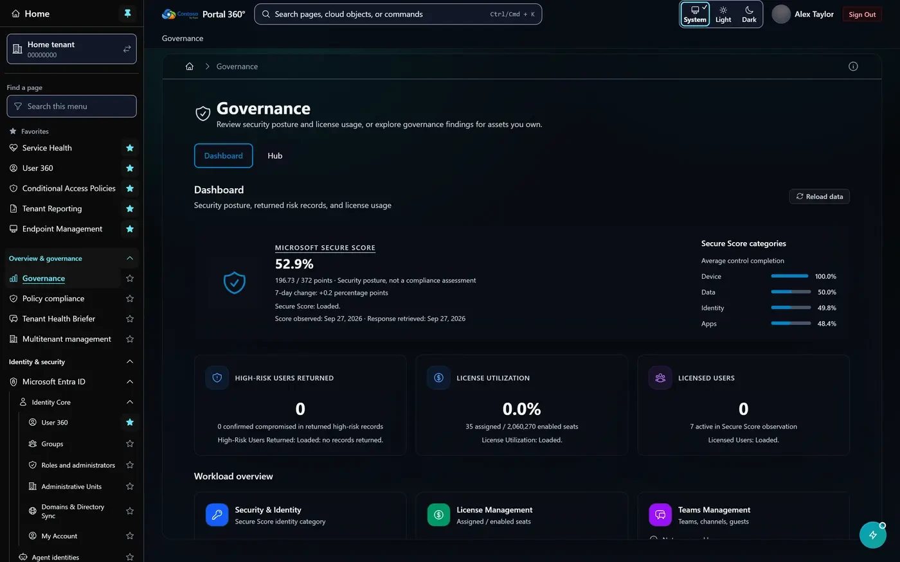
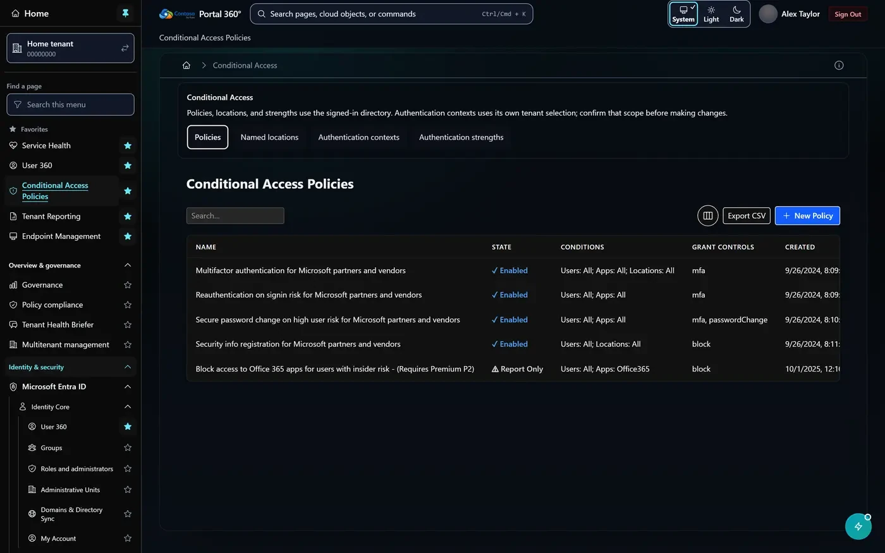
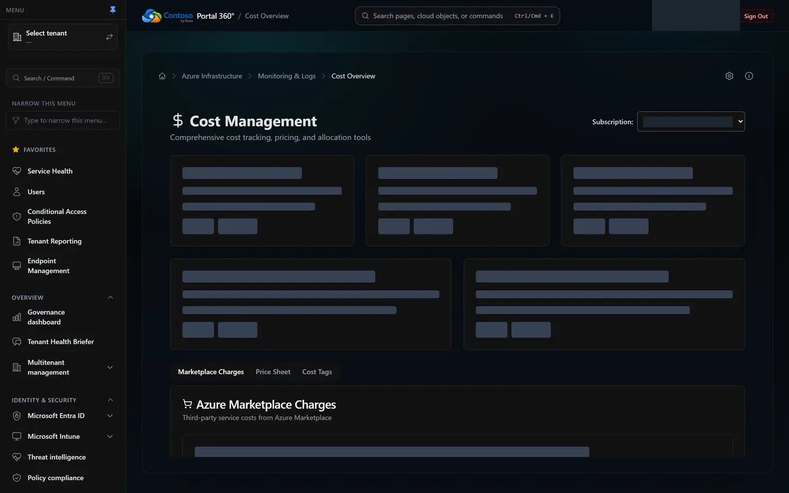
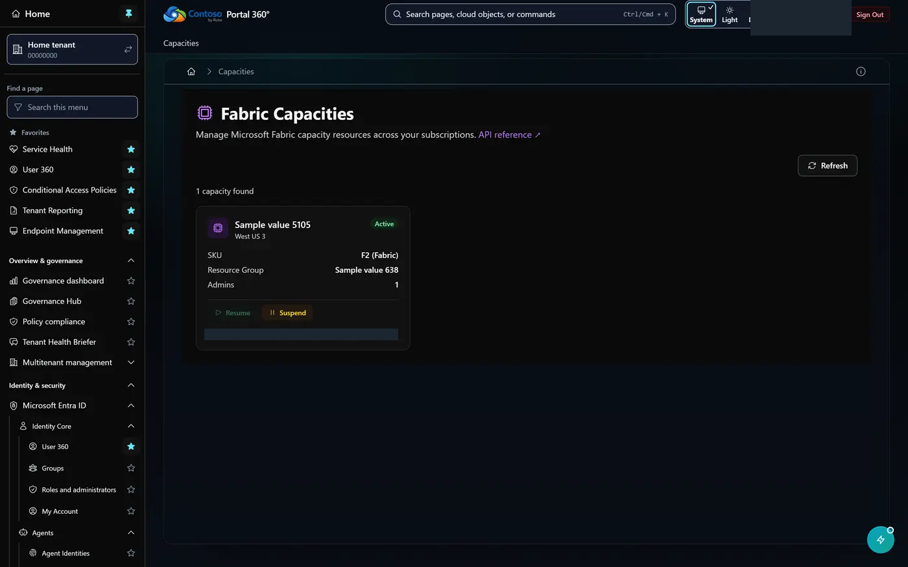

# Portal 360 screenshot showcase

A visual reference for **Portal 360°**, a unified administration portal for Microsoft Entra ID,
Microsoft 365, Intune, Azure, Power Platform, Microsoft Fabric and Azure DevOps.

**[Browse the showcase](https://russrimm.github.io/PortalofPortals-Docs/)**: 318 pages, each with a
screenshot, a short explanation of what the page is for, and the typical admin actions.

This repository is not an application and has nothing to install or run. It only holds the
screenshots and the descriptions that go with them.

## What you get

- Every Portal 360 page, grouped by product area (Identity, Azure, Power Platform, Intune,
  Fabric, Azure DevOps and more).
- Search and area filters, plus a full-size view for each screenshot.
- For each page: its route, what it is for, and what an admin can do there.

| | |
| --- | --- |
|  |  |
| **Governance** (`/dashboard`) | **Conditional Access Policies** (`/conditional-access`) |
|  |  |
| **Cost Overview** (`/azure/cost-management`) | **Capacities** (`/fabric/capacities`) |

## Where things live

| Path | Contents |
| --- | --- |
| `snapshot/docs/screenshots/` | The screenshots (WebP, plus a few legacy JPGs) |
| `showcase/pages.json` | Title, route, area, description and admin actions for each page |
| `showcase/` | Showcase page script, styles and icon |
| `scripts/build-showcase.mjs` | Builds the static site into `pages-dist/` |
| `snapshot/docs/` | The rest of the Portal 360 documentation, including the [screenshot gallery](snapshot/docs/screenshots/README.md) and [product tour](snapshot/docs/screenshots/TOUR.md) as Markdown you can read on GitHub |

## Maintaining the showcase

Pushes to `main` that touch the showcase or screenshots publish the site through
`.github/workflows/pages.yml`. To add or update a page:

1. Add or edit its entry in `showcase/pages.json`. Entries marked `curated` come from the
   Portal 360 in-app gallery; `generated` entries were written from the page source code.
2. Put the screenshot in `snapshot/docs/screenshots/` using the entry's `stem` as the file name.
   Pages without an approved screenshot yet use `"screenshotStatus": "pending"` and show
   **Screenshot pending**.
3. Run `node scripts/build-showcase.mjs` to preview the result in `pages-dist/`. The build fails
   if a page is missing its screenshot without the pending marker.

## Screenshot privacy

All tenant data in the screenshots is redacted or replaced with fictional stand-ins, and profile
photos are blurred. That processing reduces risk but is not a guarantee that no personal or
sensitive data remains. Image sources and processing details are recorded in
[`snapshot/screenshots-provenance.json`](snapshot/screenshots-provenance.json).

## Legacy local documentation site

The Node scripts, `site/` folder and `tests/` folder build a separate, offline documentation
library from the full snapshot (`npm ci`, then `npm start`, serving on `http://127.0.0.1:4173`).
It is optional and is not needed to view the showcase.

## License

MIT, Copyright (c) 2025 Russ Rimmerman [MSFT]. See [`LICENSE`](LICENSE). Microsoft product names
are descriptive; this site is not a Microsoft service.
