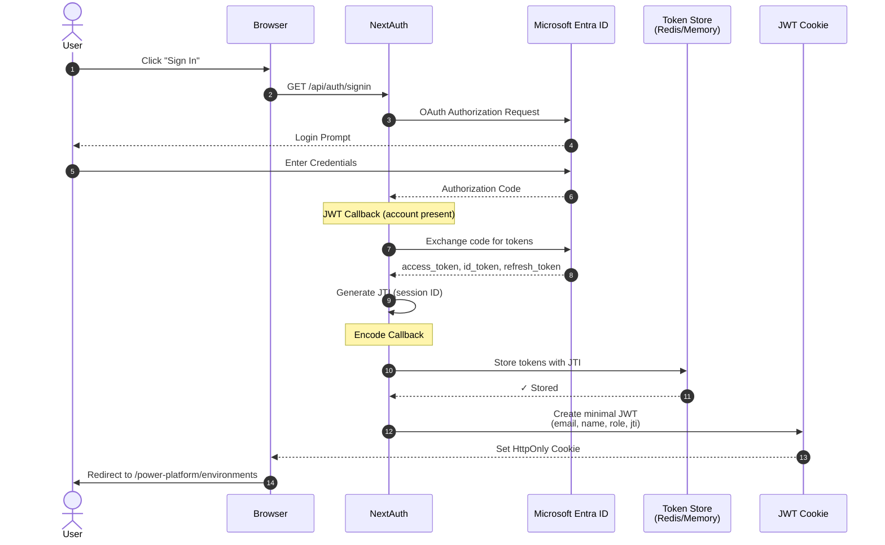
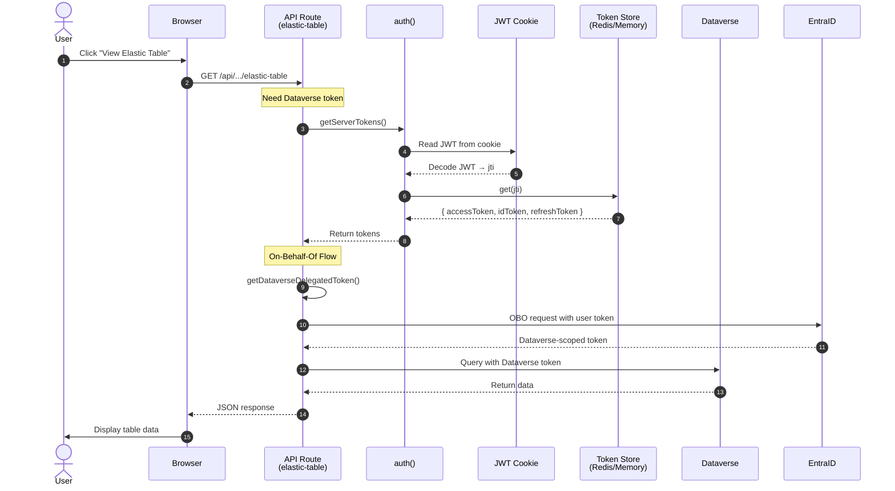
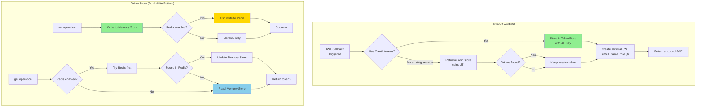
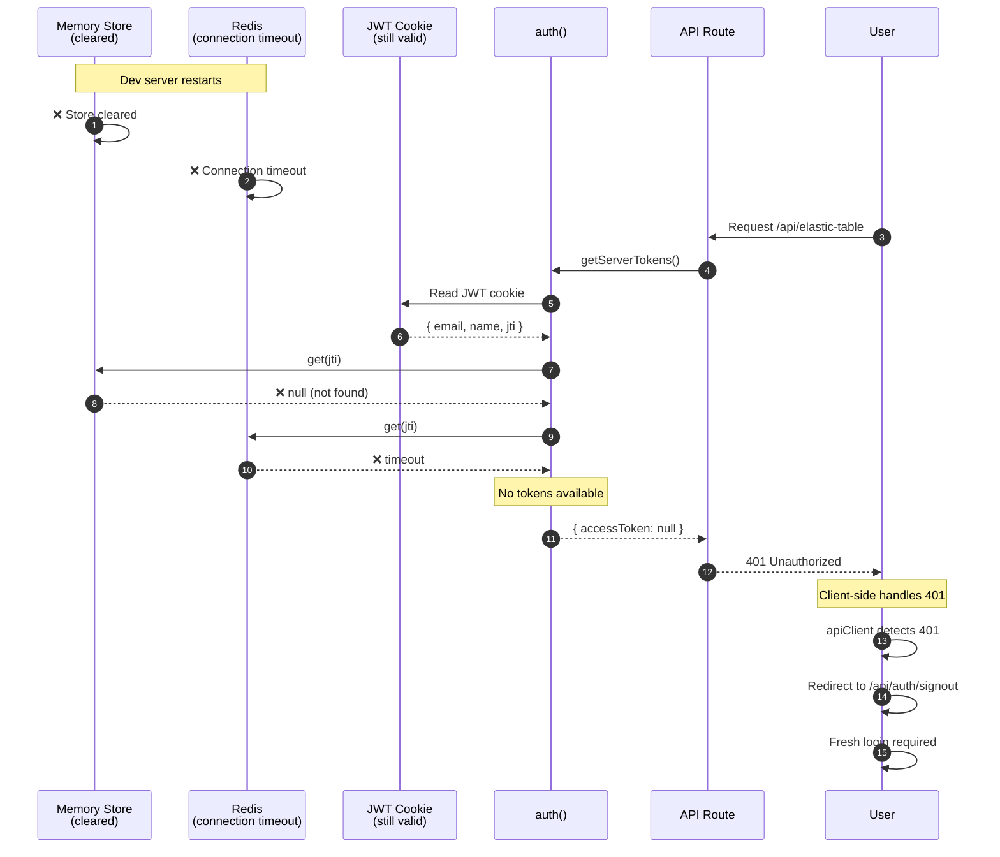
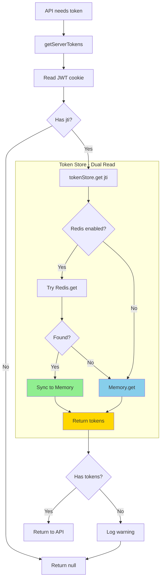
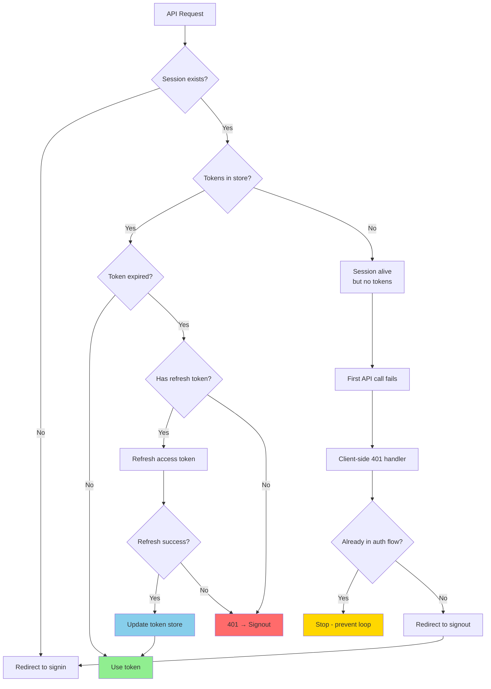
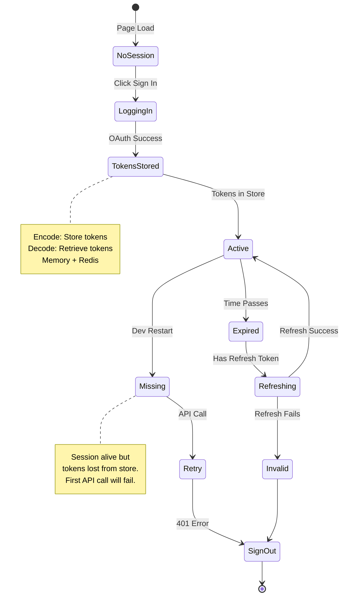

# JWT Authentication Token Flow - Portal 360°

This document explains the JWT authentication and token management architecture.

## 1. Initial Authentication Flow (OAuth Login)

## 2. API Request with Token Retrieval

## 3. Token Storage Architecture

## 4. Dev Server Restart Scenario

## 5. Dual-Write Pattern (Resilient Token Storage)

## 6. Error Scenarios and Recovery

## Key Design Decisions

### 1. **Server-Side Token Storage**
- **Why**: JWT cookies have 4KB size limit; OAuth tokens exceed this
- **Implementation**: Store tokens in Redis (prod) or Memory (dev) with JTI as key
- **Benefit**: Prevents 431 (Request Header Too Large) errors

### 2. **Dual-Write Pattern**
- **Why**: Redis connections can be unstable in dev environment
- **Implementation**: 
  - Write to Memory Store first (guaranteed)
  - Also write to Redis if available (bonus)
  - Read from both (Redis → Memory fallback)
- **Benefit**: Tokens never lost even with Redis failures

### 3. **Minimal JWT Payload**
- **Contents**: `email`, `name`, `role`, `jti` only
- **Why**: Reduce cookie size, avoid token exposure to client
- **Benefit**: Security + performance

### 4. **Session Resilience**
- **Behavior**: Keep session alive even when tokens missing from store
- **Why**: Prevents infinite signout loops after dev restart
- **Outcome**: First API call fails gracefully → client-side signout

### 5. **On-Behalf-Of (OBO) Flow**
- **When**: Any user-triggered call to Graph, Dataverse, or other upstream APIs.
- **How**: Exchange the user's access token for a resource-scoped token. For
  Microsoft Graph this is wrapped by
  [`getDelegatedGraphClient()`](../src/lib/delegatedGraph.ts) — the default
  Graph client used across `src/app/api/**` and `src/app/**/page.tsx`. The
  client auto-refreshes on `401` and throws `DelegatedAuthError` if no session
  tokens are available (caller returns 401 → user re-signs-in).
- **Benefit**: Maintains user security context, proper audience scoping,
  per-user RBAC, accurate audit attribution.
- **App-only**: `getAppOnlyGraphClient({ reason, jobId })` from
  `src/lib/auth/appOnly.ts` is reserved for the declared background jobs in
  [`APP-ONLY-JOBS.md`](./APP-ONLY-JOBS.md). It is **not** a fallback — never
  retry an OBO 401/403 with an app-only token. `pnpm run verify:auth-mode:strict`
  fails on any user-triggered route that uses it.

## Common Issues and Solutions

| Issue | Symptom | Solution |
|-------|---------|----------|
| **Infinite Signout Loop** | Page reloads endlessly | Don't force signout in JWT callback when tokens missing |
| **401 on All Requests** | "Tokens missing from store" | Dual-write pattern ensures Memory fallback works |
| **Token Signature Error** | AADSTS50013 | OBO automatically falls back to refresh token |
| **Child Table Error** | 0x80097259 | Elastic child tables need parent record reference |
| **Dev Restart** | Session broken | Expected - requires fresh login due to memory cleared |

## Token Lifecycle States

## Production vs Development Behavior

### Production (with Redis)
- ✅ Tokens persist across server restarts
- ✅ High availability with Redis clustering
- ✅ Shared sessions across multiple app instances
- ✅ No session loss on deployment

### Development (Memory Store)
- ⚠️ Tokens cleared on server restart
- ⚠️ Redis connection timeouts common
- ✅ Dual-write ensures Memory fallback works
- ✅ First API call after restart triggers re-login
- ℹ️ Expected behavior - not a bug

## References

- [NextAuth.js JWT Documentation](https://next-auth.js.org/configuration/options#jwt)
- [Microsoft Entra ID OAuth 2.0 On-Behalf-Of Flow](https://learn.microsoft.com/en-us/entra/identity-platform/v2-oauth2-on-behalf-of-flow)
- [Dataverse Web API Authentication](https://learn.microsoft.com/power-apps/developer/data-platform/webapi/authenticate-web-api)
- [Redis Client for Node.js](https://github.com/redis/node-redis)
