# Portal 360° API Architecture & Authentication Flow

This diagram shows the complete end-to-end flow from user interaction to API endpoints, including authentication, permissions, and Entra ID applications.

> **For the complete per-route auth audit**, see [`docs/API-AUTH-AUDIT.md`](./API-AUTH-AUDIT.md).  
> **To validate auth compliance**, run: `node scripts/validate-api-auth.js`

## Official Documentation

**Power Platform Authentication Reference**: [Authenticate to Power Platform services](https://learn.microsoft.com/en-us/power-platform/admin/security/authenticate-services)

This Microsoft Learn article provides comprehensive guidance on:
- Service-to-service authentication patterns
- OAuth 2.0 flows for Power Platform APIs
- On-Behalf-Of (OBO) token exchange
- Required API permissions and scopes
- Security best practices for production deployments

## Table of Contents

1. [Mermaid Architecture Diagram](#mermaid-architecture-diagram)
2. [Authentication Flow](#authentication-flow)
3. [Entra ID Application Configuration](#entra-id-application-configuration)
4. [Token Strategy & Authentication Methods](#token-strategy--authentication-methods)
5. [Environment Variable Usage by Component](#environment-variable-usage-by-component)
6. [API Endpoint to Permission Mapping](#api-endpoint-to-permission-mapping)
   - [Microsoft Graph API Endpoints](#microsoft-graph-api)
   - [Power Platform API Endpoints](#power-platform-api)
   - [Dataverse API Endpoints](#dataverse-api)
   - [Azure Management API Endpoints](#azure-resource-manager)
7. [Example API Call Chain](#example-api-call-chain)

## Mermaid Architecture Diagram

```mermaid
flowchart TB
    %% User & Browser Layer
    User["👤 User"]
    Browser["🌐 Browser"]
    
    %% NextAuth & Authentication
    subgraph Auth["🔐 Authentication Layer"]
        NextAuth["NextAuth v5<br/>(src/lib/auth.ts)"]
        EntraID["Microsoft Entra ID<br/>(Azure AD)"]
        Session["Session Storage<br/>(JWT Strategy)"]
    end
    
    %% Application Configuration
    subgraph Config["⚙️ Application Config"]
        direction TB
        ClientApp["Entra ID App Registration"]
        EnvVars["Environment Variables:<br/>• AZURE_CLIENT_ID<br/>• AZURE_CLIENT_SECRET<br/>• AZURE_TENANT_ID"]
        ClientApp --- EnvVars
    end
    
    %% Initial Scopes
    subgraph InitialScopes["📋 Initial Login Scopes"]
        OpenID["openid"]
        Profile["profile"]
        Email["email"]
        OfflineAccess["offline_access"]
        UserRead["User.Read"]
        UserAuthMethods["UserAuthenticationMethod.Read.All"]
        AuditLog["AuditLog.Read.All"]
        OrgRead["Organization.Read.All"]
        Dynamics["Dynamics 365<br/>user_impersonation"]
    end
    
    %% Token Exchange Layer
    subgraph TokenExchange["🔄 Token Exchange (OBO Flow)"]
        direction TB
        OBOHelper["OBO Helper<br/>(src/lib/obo.js)<br/>Uses: AZURE_CLIENT_ID, SECRET, TENANT_ID"]
        PPTokenHelper["PP Token Helper<br/>(src/lib/ppToken.js)<br/>Uses: AZURE_CLIENT_ID, SECRET, TENANT_ID"]
        MSALNode["@azure/msal-node<br/>ConfidentialClientApplication<br/>Authority: https://login.microsoftonline.com/{TENANT_ID}"]
        
        OBOHelper --- MSALNode
        PPTokenHelper --- MSALNode
    end
    
    %% API Routes Layer
    subgraph APIRoutes["🛣️ API Routes (src/app/api/)"]
        direction TB
        
        subgraph GraphAPIs["Microsoft Graph APIs<br/>Auth Method: Direct Session Token"]
            GraphTenantInfo["/api/graph/tenant-info<br/>━━━━━━━━━━━━━━━━━<br/>Endpoint: /organization<br/>Permission: Organization.Read.All<br/>Uses: session.accessToken"]
            GraphUsers["/api/users<br/>━━━━━━━━━━━━━━━━━<br/>Endpoint: /users<br/>Permission: User.Read.All<br/>Uses: session.accessToken"]
            GraphPolicies["/api/graph/policies/*<br/>━━━━━━━━━━━━━━━━━<br/>Endpoints: /policies/*<br/>Permission: Policy.Read.All<br/>Uses: session.accessToken"]
            GraphIdentity["/api/graph/identity/*<br/>━━━━━━━━━━━━━━━━━<br/>Endpoints: /identity/*<br/>Permission: IdentityRiskEvent.Read.All<br/>Uses: session.accessToken"]
            GraphAccessReviews["/api/graph/identityGovernance/*<br/>━━━━━━━━━━━━━━━━━<br/>Endpoints: /identityGovernance/accessReviews/*<br/>Permission: AccessReview.Read.All<br/>Uses: session.accessToken"]
        end
        
        subgraph PowerPlatformAPIs["Power Platform APIs<br/>Auth Method: OBO Token Exchange"]
            PPApps["/api/power-platform/apps<br/>━━━━━━━━━━━━━━━━━<br/>Endpoint: /powerapps/environments/{id}/apps<br/>Permission: Service Admin + .default<br/>Uses: getPowerPlatformDelegatedToken()"]
            PPTenantApps["/api/power-platform/tenant-apps<br/>━━━━━━━━━━━━━━━━━<br/>Endpoint: /appmanagement/environments/{id}/applicationpackages<br/>Permission: Service Admin + .default<br/>Uses: getPowerPlatformDelegatedToken()"]
            PPFlows["/api/power-platform/flows<br/>━━━━━━━━━━━━━━━━━<br/>Endpoint: /powerapps/environments/{id}/flows<br/>Permission: Service Admin + .default<br/>Uses: getPowerPlatformDelegatedToken()"]
            PPConnectors["/api/power-platform/connectors<br/>━━━━━━━━━━━━━━━━━<br/>Endpoint: /powerapps/environments/{id}/connectors<br/>Permission: Service Admin + .default<br/>Uses: getPowerPlatformDelegatedToken()"]
            PPEnvironments["/api/power-platform/environments<br/>━━━━━━━━━━━━━━━━━<br/>Endpoint: /powerapps/environments<br/>Permission: Service Admin + .default<br/>Uses: getPowerPlatformDelegatedToken()"]
            PPBots["/api/power-platform/bots<br/>━━━━━━━━━━━━━━━━━<br/>Endpoint: Dataverse /bots<br/>Permission: user_impersonation<br/>Uses: getDataverseDelegatedToken()"]
            PPSolutions["/api/power-platform/solutions<br/>━━━━━━━━━━━━━━━━━<br/>Endpoint: Dataverse /solutions<br/>Permission: user_impersonation<br/>Uses: getDataverseDelegatedToken()"]
            PPDataverse["/api/power-platform/dataverse/*<br/>━━━━━━━━━━━━━━━━━<br/>Endpoints: /{org}.crm.dynamics.com/api/data/v9.2/*<br/>Permission: user_impersonation<br/>Uses: getDataverseDelegatedToken()"]
            PPLicensing["/api/power-platform/licensing/*<br/>━━━━━━━━━━━━━━━━━<br/>Endpoints: /licensing/capacities, /licensing/billingPolicies<br/>Permission: Billing Admin + .default<br/>Uses: getPowerPlatformDelegatedToken()"]
            PPGovernance["/api/power-platform/governance/*<br/>━━━━━━━━━━━━━━━━━<br/>Endpoints: /governance/reports, /governance/crossTenantReports<br/>Permission: Tenant/Service Admin + .default<br/>Uses: getPowerPlatformDelegatedToken()"]
        end
        
        subgraph AzureAPIs["Azure Resource APIs<br/>Auth Method: OBO Token Exchange"]
            AzureResources["/api/azure/resources<br/>━━━━━━━━━━━━━━━━━<br/>Endpoint: /subscriptions/{id}/resources<br/>Permission: Reader role<br/>Uses: getAzureDelegatedToken()"]
            AzureAdvisor["/api/azure/advisor<br/>━━━━━━━━━━━━━━━━━<br/>Endpoint: /providers/Microsoft.Advisor/recommendations<br/>Permission: Reader role<br/>Uses: getAzureDelegatedToken()"]
            AzurePolicy["/api/azure/policy<br/>━━━━━━━━━━━━━━━━━<br/>Endpoint: /policyAssignments<br/>Permission: Policy Reader<br/>Uses: getAzureDelegatedToken()"]
            AzureCost["/api/azure/cost-management<br/>━━━━━━━━━━━━━━━━━<br/>Endpoint: /providers/Microsoft.CostManagement/query<br/>Permission: Cost Management Reader<br/>Uses: getAzureDelegatedToken()"]
            AzureMetrics["/api/azure/metrics<br/>━━━━━━━━━━━━━━━━━<br/>Endpoint: /providers/Microsoft.Insights/metrics<br/>Permission: Monitoring Reader<br/>Uses: getAzureDelegatedToken()"]
        end
    end
    
    %% External APIs
    subgraph ExternalAPIs["🌐 External APIs"]
        direction TB
        
        subgraph MSGraph["Microsoft Graph API<br/>Auth: Direct access_token from login<br/>Env: AZURE_CLIENT_ID + SECRET + TENANT_ID"]
            GraphEndpoint["https://graph.microsoft.com/v1.0/<br/>━━━━━━━━━━━━━━━━━━━━━<br/>/organization → Organization.Read.All<br/>/users → User.Read.All<br/>/identity/conditionalAccess → Policy.Read.All<br/>/identityGovernance/accessReviews → AccessReview.Read.All<br/>/identity/riskyServicePrincipals → IdentityRiskEvent.Read.All<br/>/reports/authenticationMethods → AuditLog.Read.All"]
            GraphBeta["https://graph.microsoft.com/beta/<br/>━━━━━━━━━━━━━━━━━━━━━<br/>/subscribedSkus → Organization.Read.All<br/>/policies/identitySecurityDefaultsEnforcementPolicy → Policy.Read.All<br/>/policies/authorizationPolicy → Policy.Read.All"]
        end
        
        subgraph PowerPlatform["Power Platform API<br/>Auth: OBO token exchange (refresh_token)<br/>Env: AZURE_CLIENT_ID + SECRET + TENANT_ID<br/>Scope: https://api.powerplatform.com/.default"]
            PPEndpoint["https://api.powerplatform.com/<br/>━━━━━━━━━━━━━━━━━━━━━<br/>/powerapps/environments → Service Admin + delegated<br/>/powerapps/environments/{id}/apps → Service Admin + delegated<br/>/appmanagement/environments/{id}/applicationpackages → Service Admin + delegated<br/>/licensing/billingPolicies → Billing Admin + delegated<br/>/licensing/capacities → Billing Admin + delegated<br/>/governance/reports → Service Admin + delegated<br/>/governance/crossTenantReports → Tenant Admin + delegated"]
        end
        
        subgraph DataverseAPI["Dataverse API<br/>Auth: OBO token exchange (refresh_token)<br/>Env: AZURE_CLIENT_ID + SECRET + TENANT_ID<br/>Scope: https://{org}.crm.dynamics.com/.default"]
            DataverseEndpoint["https://{org}.crm.dynamics.com/api/data/v9.2/<br/>━━━━━━━━━━━━━━━━━━━━━<br/>/accounts → user_impersonation<br/>/systemusers → user_impersonation<br/>/teams → user_impersonation<br/>/solutions → user_impersonation<br/>/workflows → user_impersonation<br/>/bots → user_impersonation<br/>/conversationtranscripts → user_impersonation"]
        end
        
        subgraph AzureResourceManager["Azure Resource Manager<br/>Auth: OBO token exchange (refresh_token)<br/>Env: AZURE_CLIENT_ID + SECRET + TENANT_ID<br/>Scope: https://management.azure.com/.default"]
            ARMEndpoint["https://management.azure.com/<br/>━━━━━━━━━━━━━━━━━━━━━<br/>/subscriptions/{id}/resources → Reader<br/>/subscriptions/{id}/providers/Microsoft.Advisor → Advisor Reader<br/>/subscriptions/{id}/providers/Microsoft.CostManagement → Cost Management Reader<br/>/subscriptions/{id}/providers/Microsoft.Insights/metrics → Monitoring Reader<br/>/subscriptions/{id}/policyAssignments → Policy Reader"]
        end
        
        subgraph AzureResourceGraph["Azure Resource Graph<br/>Auth: OBO token exchange (refresh_token)<br/>Env: AZURE_CLIENT_ID + SECRET + TENANT_ID<br/>Scope: https://management.azure.com/.default"]
            ARGEndpoint["https://management.azure.com/<br/>/providers/Microsoft.ResourceGraph/resources<br/>━━━━━━━━━━━━━━━━━━━━━<br/>POST with KQL queries → Reader on subscriptions<br/>• Canvas Apps count<br/>• Model-Driven Apps count<br/>• Copilot Studio Agents count<br/>• Power Automate Flows count"]
        end
    end
    
    %% UI Pages Layer
    subgraph UIPages["📄 UI Pages (src/app/)"]
        direction LR
        EnvPage["/power-platform/environments<br/>🌍 Environment Management"]
        AzurePage["/azure/*<br/>☁️ Azure Resources"]
        IdentityPage["/identity/*<br/>🔑 Identity & Access"]
        BillingPage["/billing/*<br/>💰 Cost Management"]
    end
    
    %% Required Permissions Table
    subgraph Permissions["📋 Required Entra ID Permissions"]
        direction TB
        
        DelegatedPerms["**Delegated Permissions (User Context)**<br/><br/>Microsoft Graph:<br/>• User.Read<br/>• User.Read.All<br/>• UserAuthenticationMethod.Read.All<br/>• AuditLog.Read.All<br/>• Organization.Read.All<br/>• Policy.Read.All<br/>• IdentityRiskEvent.Read.All<br/>• AccessReview.Read.All<br/><br/>Dynamics 365:<br/>• user_impersonation<br/><br/>Power Platform (via OBO):<br/>• https://api.powerplatform.com/.default<br/><br/>Azure (via OBO):<br/>• https://management.azure.com/.default"]
        
        AppPerms["**Application Permissions (App-Only)**<br/><br/>Microsoft Graph:<br/>• User.Read.All<br/>• Organization.Read.All<br/>• AuditLog.Read.All<br/><br/>Azure:<br/>• Reader role on subscriptions<br/>• Cost Management Reader"]
    end
    
    %% Connections
    User -->|"1. Clicks Login"| Browser
    Browser -->|"2. Initiates Auth"| NextAuth
    NextAuth -->|"3. Redirects to"| EntraID
    EntraID -->|"4. User authenticates"| ClientApp
    ClientApp -->|"5. Issues tokens with scopes"| InitialScopes
    InitialScopes -->|"6. Returns access_token,<br/>id_token, refresh_token"| NextAuth
    NextAuth -->|"7. Stores in session"| Session
    
    %% User navigates to pages
    Browser -->|"8. User navigates"| UIPages
    UIPages -->|"9. Makes API request<br/>with session token"| APIRoutes
    
    %% API Routes to Token Exchange
    GraphAPIs -->|"Uses session<br/>access_token directly"| MSGraph
    PowerPlatformAPIs -->|"10. Needs PP token"| PPTokenHelper
    AzureAPIs -->|"10. Needs Azure token"| OBOHelper
    
    %% Token Exchange Flow
    PPTokenHelper -->|"11. OBO Exchange<br/>refresh_token →<br/>PP access_token"| MSALNode
    OBOHelper -->|"11. OBO Exchange<br/>refresh_token →<br/>Azure access_token"| MSALNode
    MSALNode -->|"12. Calls Entra ID"| EntraID
    EntraID -->|"13. Returns resource token"| MSALNode
    
    %% API calls to external services
    MSALNode -->|"14. Token returned"| APIRoutes
    GraphAPIs -->|"15. Calls with token"| GraphEndpoint
    GraphAPIs -->|"15. Calls with token"| GraphBeta
    PowerPlatformAPIs -->|"15. Calls with PP token"| PPEndpoint
    PowerPlatformAPIs -->|"15. Calls with Dataverse token"| DataverseEndpoint
    AzureAPIs -->|"15. Calls with Azure token"| ARMEndpoint
    AzureAPIs -->|"15. Calls with Azure token"| ARGEndpoint
    
    %% Return path
    ExternalAPIs -->|"16. Returns data"| APIRoutes
    APIRoutes -->|"17. Returns JSON"| UIPages
    UIPages -->|"18. Renders data"| Browser
    Browser -->|"19. Displays to user"| User
    
    %% Styling
    classDef authStyle fill:#e1f5ff,stroke:#01579b,stroke-width:2px
    classDef apiStyle fill:#f3e5f5,stroke:#4a148c,stroke-width:2px
    classDef externalStyle fill:#fff3e0,stroke:#e65100,stroke-width:2px
    classDef configStyle fill:#e8f5e9,stroke:#1b5e20,stroke-width:2px
    classDef uiStyle fill:#fce4ec,stroke:#880e4f,stroke-width:2px
    classDef permStyle fill:#fff9c4,stroke:#f57f17,stroke-width:2px
    
    class NextAuth,EntraID,Session,OBOHelper,PPTokenHelper,MSALNode authStyle
    class GraphAPIs,PowerPlatformAPIs,AzureAPIs apiStyle
    class MSGraph,PowerPlatform,DataverseAPI,AzureResourceManager,AzureResourceGraph externalStyle
    class ClientApp,Config configStyle
    class UIPages uiStyle
    class Permissions,DelegatedPerms,AppPerms permStyle
```

## Key Points

### Authentication Flow
1. **Initial Login**: User authenticates via Microsoft Entra ID (Azure AD)
2. **Session Storage**: NextAuth stores access_token, id_token, and refresh_token in JWT session
3. **Token Exchange**: For resource-specific APIs (Power Platform, Azure), OBO flow exchanges refresh token for resource-specific access tokens

### Entra ID Application Configuration
- **Single App Registration** used for all authentication
- **Environment Variables**:
  - `AZURE_CLIENT_ID` - Application (client) ID from Entra ID
  - `AZURE_CLIENT_SECRET` - Client secret from Entra ID
  - `AZURE_TENANT_ID` - Directory (tenant) ID from Entra ID
- Used by:
  - NextAuth for initial authentication
  - MSAL Node for OBO token exchanges
  - All API routes requiring authentication

### Token Strategy & Authentication Methods

#### Direct Token Usage (Microsoft Graph)
- **What**: Uses `session.accessToken` directly from NextAuth
- **When**: Initial login provides Graph scopes
- **APIs**: All `/api/graph/*` endpoints
- **Scopes**: Requested during login (User.Read, Organization.Read.All, etc.)
- **No OBO needed**: Token already has Graph permissions

#### OBO Token Exchange (Power Platform & Azure)
- **What**: Exchanges `refresh_token` for resource-specific `access_token`
- **Why**: Cannot mix `.default` scope with specific scopes in initial login
- **Process**:
  1. API route receives request with session token
  2. Calls token helper (e.g., `getPowerPlatformDelegatedToken()`)
  3. Helper calls MSAL with refresh token + resource scope
  4. MSAL performs OBO with Entra ID
  5. Returns resource-specific access token
  6. API route uses new token to call external API

### Environment Variable Usage by Component

| Component | Uses CLIENT_ID | Uses SECRET | Uses TENANT_ID | Purpose |
|-----------|----------------|-------------|----------------|---------|
| NextAuth (auth.ts) | ✅ | ✅ | ✅ | Initial user authentication |
| MSAL Node (ppToken.js) | ✅ | ✅ | ✅ | OBO token exchange for Power Platform |
| MSAL Node (obo.js) | ✅ | ✅ | ✅ | OBO token exchange for Azure |
| All API routes | Indirect | Indirect | Indirect | Via session or token helpers |

### API Endpoint to Permission Mapping

#### Microsoft Graph API
| Endpoint | Permission Required | Auth Method |
|----------|-------------------|-------------|
| `/organization` | `Organization.Read.All` | Delegated (OBO) token via `getDelegatedGraphClient()` |
| `/users` | `User.Read.All` | Delegated (OBO) token via `getDelegatedGraphClient()` |
| `/policies/*` | `Policy.Read.All` | Delegated (OBO) token via `getDelegatedGraphClient()` |
| `/identity/riskyUsers` | `IdentityRiskyUser.Read.All` | Delegated (OBO) token via `getDelegatedGraphClient()` |
| `/identity/riskyServicePrincipals` | `IdentityRiskyServicePrincipal.Read.All` | Delegated (OBO) token via `getDelegatedGraphClient()` |
| `/identityGovernance/accessReviews/*` | `AccessReview.Read.All` | Delegated (OBO) token via `getDelegatedGraphClient()` |
| `/identityGovernance/entitlementManagement/*` | `EntitlementManagement.Read.All` | Delegated (OBO) token via `getDelegatedGraphClient()` |
| `/reports/authenticationMethods/*` | `AuditLog.Read.All` or `UserAuthenticationMethod.Read.All` | Delegated (OBO) token via `getDelegatedGraphClient()` |
| `/reports/get*` | `Reports.Read.All` | Delegated (OBO) token via `getDelegatedGraphClient()` |
| `/security/secureScores` | `SecurityEvents.Read.All` | Delegated (OBO) token via `getDelegatedGraphClient()` |
| `/security/alerts_v2` | `SecurityEvents.Read.All`, `SecurityIncident.Read.All` | Delegated (OBO) token via `getDelegatedGraphClient()` |
| `/roleManagement/directory/*` | `RoleManagement.Read.Directory`, `PrivilegedAccess.Read.AzureAD` | Delegated (OBO) token via `getDelegatedGraphClient()` |
| `/deviceManagement/managedDevices` | `DeviceManagementManagedDevices.Read.All` | Delegated (OBO) token via `getDelegatedGraphClient()` |
| `/deviceManagement/deviceConfigurations` | `DeviceManagementConfiguration.Read.All` | Delegated (OBO) token via `getDelegatedGraphClient()` |
| `/admin/windows/updates/catalog/entries` (beta) | `WindowsUpdates.Read.All` | Delegated token via `getDelegatedGraphClient()` |
| `/groups` | `Group.Read.All` | Delegated (OBO) token via `getDelegatedGraphClient()` |
| `/applications` | `Application.Read.All` | Delegated (OBO) token via `getDelegatedGraphClient()` |
| `/servicePrincipals` | `Application.Read.All` | Delegated (OBO) token via `getDelegatedGraphClient()` |
| `/auditLogs/*` | `AuditLog.Read.All` | Delegated (OBO) token via `getDelegatedGraphClient()` |
| `/admin/serviceAnnouncement/*` | `ServiceHealth.Read.All` | Delegated (OBO) token via `getDelegatedGraphClient()` |
| `/sites` | `Sites.Read.All` | Delegated (OBO) token via `getDelegatedGraphClient()` |
| `/teams` | `Team.ReadBasic.All` | Delegated (OBO) token via `getDelegatedGraphClient()` |
| `/communications/onlineMeetings` | `OnlineMeetingTranscript.Read.All` | Delegated (OBO) token via `getDelegatedGraphClient()` |

#### Power Platform API
| Endpoint | Permission Required | Auth Method | Scope |
|----------|-------------------|-------------|-------|
| `/powerapps/environments` | Power Platform Service Admin (delegated) | OBO | `.default` |
| `/powerapps/environments/{id}/apps` | Power Platform Service Admin (delegated) | OBO | `.default` |
| `/appmanagement/environments/{id}/applicationpackages` | Power Platform Service Admin (delegated) | OBO | `.default` |
| `/licensing/billingPolicies` | Power Platform Billing Admin (delegated) | OBO | `.default` |
| `/licensing/capacities` | Power Platform Billing Admin (delegated) | OBO | `.default` |
| `/governance/reports` | Power Platform Service Admin (delegated) | OBO | `.default` |
| `/governance/crossTenantReports` | Power Platform Tenant Admin (delegated) | OBO | `.default` |

#### Dataverse API
| Endpoint | Permission Required | Auth Method | Scope |
|----------|-------------------|-------------|-------|
| `/{org}.crm.dynamics.com/api/data/v9.2/accounts` | Dynamics 365 user_impersonation | OBO | `{org}/.default` |
| `/{org}.crm.dynamics.com/api/data/v9.2/systemusers` | Dynamics 365 user_impersonation | OBO | `{org}/.default` |
| `/{org}.crm.dynamics.com/api/data/v9.2/teams` | Dynamics 365 user_impersonation | OBO | `{org}/.default` |
| `/{org}.crm.dynamics.com/api/data/v9.2/solutions` | Dynamics 365 user_impersonation | OBO | `{org}/.default` |
| `/{org}.crm.dynamics.com/api/data/v9.2/workflows` | Dynamics 365 user_impersonation | OBO | `{org}/.default` |
| `/{org}.crm.dynamics.com/api/data/v9.2/bots` | Dynamics 365 user_impersonation | OBO | `{org}/.default` |

#### Azure Resource Manager
| Endpoint | Permission Required | Auth Method | Scope |
|----------|-------------------|-------------|-------|
| `/subscriptions/{id}/resources` | Reader (Azure RBAC role) | OBO | `.default` |
| `/providers/Microsoft.Advisor/recommendations` | Reader or Advisor Reader (Azure RBAC) | OBO | `.default` |
| `/subscriptions/{id}/policyAssignments` | Policy Reader (Azure RBAC) | OBO | `.default` |
| `/providers/Microsoft.CostManagement/query` | Cost Management Reader (Azure RBAC) | OBO | `.default` |
| `/providers/Microsoft.Insights/metrics` | Monitoring Reader (Azure RBAC) | OBO | `.default` |
| `/providers/Microsoft.ResourceGraph/resources` | Reader on subscriptions (Azure RBAC) | OBO | `.default` |
| `/providers/Microsoft.Insights/components` | Monitoring Reader (Azure RBAC) | OBO | `.default` |

#### Azure DevOps API
| Endpoint | Permission Required | Auth Method | Scope |
|----------|-------------------|-------------|-------|
| `/{org}/_apis/projects` | ADO organization membership | PAT or OBO | ADO OAuth `.default` |
| `/{org}/{project}/_apis/build/builds` | Build read permission | PAT or OBO | ADO OAuth `.default` |
| `/{org}/{project}/_apis/release/releases` | Release read permission | PAT or OBO | ADO OAuth `.default` |
| `/{org}/{project}/_apis/git/repositories` | Code read permission | PAT or OBO | ADO OAuth `.default` |
| `/{org}/{project}/_apis/wit/workitems` | Work item read/write | PAT or OBO | ADO OAuth `.default` |

#### Microsoft Fabric API
| Endpoint | Permission Required | Auth Method | Scope |
|----------|-------------------|-------------|-------|
| `/v1/workspaces` | Fabric Workspace Admin/Member | OBO | `https://api.fabric.microsoft.com/.default` |
| `/v1/capacities` | Fabric capacity access | OBO | `https://api.fabric.microsoft.com/.default` |

### API Permissions Required

#### Delegated Permissions (User signs in)
- Microsoft Graph: User.Read, Organization.Read.All, etc.
- Dynamics 365: user_impersonation
- Power Platform: .default (via OBO)
- Azure: .default (via OBO)

#### Application Permissions (App-only, no user)
- Microsoft Graph: User.Read.All, Organization.Read.All
- Azure: Reader role on subscriptions

### Security Considerations
- Tokens cached with expiry checking (5-minute buffer)
- Refresh tokens automatically renew expired tokens
- Session expires after 24 hours
- Role-based access control (admin vs readonly)

## Example API Call Chain

**User clicks "View Power Apps" → Power Apps Detail Modal**

1. User clicks on environment card
2. Browser calls `/api/power-platform/apps?environmentId=xxx`
3. API route validates NextAuth session
4. API route calls `getPowerPlatformDelegatedToken()`
5. ppToken.js checks if cached token is valid
6. If expired, performs OBO: `refresh_token` → `https://api.powerplatform.com/.default`
7. MSAL calls Entra ID token endpoint
8. Entra ID returns Power Platform access token
9. API route calls `https://api.powerplatform.com/powerapps/environments/{id}/apps`
10. Power Platform API returns app data (including connectionReferences with iconUri)
11. API route returns JSON to browser
12. React component renders Power Apps table with icons

