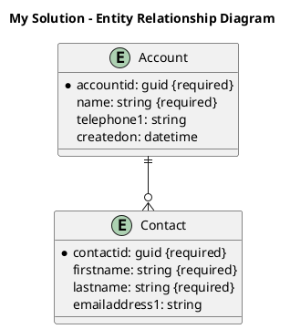
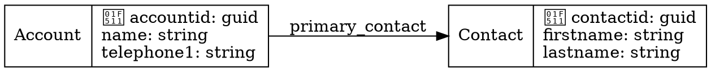

# Dataverse ERD Generator Implementation

**Date:** 2026-02-02  
**Summary:** Added comprehensive ERD Generator for Dataverse solutions, supporting multiple diagram formats with visual rendering capabilities.

## Overview

Implemented a full-featured Entity Relationship Diagram (ERD) generator for Dataverse solutions, inspired by the PPTB-Tools ERD Generator. Users can:
- Select any Dataverse environment and solution
- Generate ERDs in 4 formats: Mermaid, PlantUML, Graphviz (DOT), and Draw.io
- Configure diagram output (attributes, relationships, max attributes)
- View visual preview (Mermaid diagrams)
- Export diagrams (download or copy to clipboard)

## Features

### Supported Diagram Formats

| Format | Extension | Visual Preview | Use Case |
|--------|-----------|----------------|----------|
| **Mermaid** | `.mmd` | ✅ Yes | Documentation, GitHub, modern web |
| **PlantUML** | `.puml` | ❌ No | UML tools, enterprise documentation |
| **Graphviz** | `.dot` | ❌ No | Graph visualization, academic papers |
| **Draw.io** | `.drawio` | ❌ No | Editable diagrams, collaborative editing |

### Configuration Options

- **Include Attributes**: Show/hide table columns in diagram
- **Include Relationships**: Show/hide relationships between tables
- **Max Attributes**: Limit attributes per table (0 = show all)

### Export Options

- **Download**: Save diagram source to file
- **Copy to Clipboard**: Quick copy for pasting into other tools
- **View Mode Toggle** (Mermaid only): Switch between visual preview and source code

## File Structure

```
/src/app/power-platform/erd-generator/
├── page.tsx                           # Main UI component
├── types/
│   └── interfaces.ts                  # TypeScript interfaces
├── components/
│   └── ERDGenerator.ts                # ERD generation logic
/src/app/api/power-platform/erd-generator/
└── solution/
    └── route.ts                       # API endpoint for fetching solution data
/src/lib/
└── renderMermaid.ts                   # Mermaid diagram rendering utility
```

## Implementation Details

### 1. ERD Generator Component

**File:** `/src/app/power-platform/erd-generator/components/ERDGenerator.ts`

Core class that generates ERDs in multiple formats:

```typescript
export class ERDGenerator {
  constructor(config: Partial<ERDConfig>)
  public generate(solution: DataverseSolution): string
  
  // Format-specific generators
  private generateMermaid(solution: DataverseSolution): string
  private generatePlantUML(solution: DataverseSolution): string
  private generateGraphviz(solution: DataverseSolution): string
  private generateDrawio(solution: DataverseSolution): string
}
```

**Key Methods:**
- `generate()`: Main entry point, delegates to format-specific generators
- `generateMermaid()`: Creates Mermaid ER diagram syntax
- `generatePlantUML()`: Creates PlantUML entity notation
- `generateGraphviz()`: Creates DOT language graph
- `generateDrawio()`: Creates Draw.io XML format with mxGraph notation

**Helper Methods:**
- `sanitizeTableName()`: Remove special characters for diagram compatibility
- `mapToMermaidType()`: Convert Dataverse types to Mermaid types
- `mapMermaidRelationship()`: Convert relationship types to Mermaid cardinality
- `escapeXml()`: Escape XML special characters for Draw.io format

### 2. API Endpoint

**File:** `/src/app/api/power-platform/erd-generator/solution/route.ts`

**Endpoint:** `GET /api/power-platform/erd-generator/solution`

**Query Parameters:**
- `instanceUrl`: Dataverse environment URL
- `solution`: Solution unique name

**Response:**
```json
{
  "uniqueName": "MyCustomSolution",
  "displayName": "My Custom Solution",
  "version": "1.0.0.0",
  "publisherPrefix": "new",
  "tables": [
    {
      "logicalName": "new_customtable",
      "displayName": "Custom Table",
      "schemaName": "new_CustomTable",
      "isIntersect": false,
      "attributes": [
        {
          "logicalName": "new_name",
          "displayName": "Name",
          "type": "string",
          "isPrimaryId": false,
          "isPrimaryName": true,
          "isRequired": true
        }
        // ... more attributes
      ],
      "relationships": [
        {
          "schemaName": "new_account_new_customtable",
          "type": "ManyToOne",
          "relatedTable": "account"
        }
        // ... more relationships
      ]
    }
    // ... more tables
  ]
}
```

**Data Fetching Process:**
1. Fetch solution details by unique name
2. Fetch solution components (entities/tables)
3. For each table, fetch:
   - Entity metadata (LogicalName, DisplayName, SchemaName)
   - Attributes with metadata
   - OneToMany relationships
   - ManyToOne relationships
   - ManyToMany relationships
4. Process and normalize data into consistent structure
5. Filter out virtual attributes
6. Map Dataverse types to simplified types

**Type Mapping:**
```typescript
'String' → 'string'
'Integer' → 'int'
'Decimal' → 'decimal'
'DateTime' → 'datetime'
'Boolean' → 'boolean'
'Lookup' → 'lookup'
'Picklist' → 'picklist'
'Money' → 'money'
// ... etc
```

### 3. Main Page Component

**File:** `/src/app/power-platform/erd-generator/page.tsx`

**State Management:**
```typescript
// Environment & Solution Selection
const [environments, setEnvironments] = useState<Environment[]>([])
const [selectedEnvironment, setSelectedEnvironment] = useState<string>('')
const [solutions, setSolutions] = useState<Solution[]>([])
const [selectedSolution, setSelectedSolution] = useState<string>('')

// Output Configuration
const [selectedFormat, setSelectedFormat] = useState<'mermaid' | 'plantuml' | 'graphviz' | 'drawio'>('mermaid')
const [includeAttributes, setIncludeAttributes] = useState<boolean>(true)
const [includeRelationships, setIncludeRelationships] = useState<boolean>(true)
const [maxAttributesPerTable, setMaxAttributesPerTable] = useState<number>(10)

// Generated Diagrams Storage
const [generatedDiagrams, setGeneratedDiagrams] = useState<{
  mermaid: string
  plantuml: string
  graphviz: string
  drawio: string
}>({ mermaid: '', plantuml: '', graphviz: '', drawio: '' })

// View Mode
const [viewMode, setViewMode] = useState<'visual' | 'text'>('text')
```

**UI Layout:**
- **Left Sidebar (1/4 width):**
  - Environment selection dropdown
  - Solution selection dropdown
  - Format selection (Mermaid/PlantUML/Graphviz/Draw.io)
  - Configuration options (checkboxes, number input)
  - Generate ERD button
  - Export section (Download, Copy, View Mode toggle)

- **Main Content (3/4 width):**
  - Preview area
  - Visual diagram rendering (Mermaid)
  - Source code display (all formats)

**Key Functions:**
- `loadEnvironments()`: Fetch Power Platform environments
- `loadSolutions()`: Fetch solutions for selected environment
- `handleGenerateERD()`: Generate all diagram formats at once
- `handleDownload()`: Download current format to file
- `handleCopy()`: Copy current format to clipboard

### 4. Mermaid Rendering

**File:** `/src/lib/renderMermaid.ts`

**Rendering Strategy:**
Uses mermaid.ink API to convert Mermaid syntax to SVG image:
```typescript
export function renderMermaidDiagram(mermaidCode: string): string {
  return `
    
  `
}
```

**Benefits:**
- No client-side library loading required
- Server-side rendering for faster page load
- Works without JavaScript enabled
- Automatic diagram layout and styling

**Alternative Approach:**
Client-side rendering with mermaid.js CDN (available but not used):
```typescript
export function getMermaidScript(): string {
  return `
    <script type="module">
      import mermaid from 'https://cdn.jsdelivr.net/npm/mermaid@10/dist/mermaid.esm.min.mjs';
      mermaid.initialize({ startOnLoad: true, theme: 'default' });
    </script>
  `
}
```

## Diagram Format Examples

### Mermaid Example
```mermaid
erDiagram
    account {
        string accountid PK
        string name NOT_NULL
        string telephone1
        datetime createdon
    }
    contact {
        string contactid PK
        string firstname NOT_NULL
        string lastname NOT_NULL
        string emailaddress1
    }
    account ||--o{ contact : "primary_contact"
```

### PlantUML Example


### Graphviz (DOT) Example


### Draw.io Example
XML format with mxGraph notation for drag-and-drop editing in diagrams.net

## Route Registry Integration

**File:** `/src/lib/route-registry.ts`

Added route entry:
```typescript
'/power-platform/erd-generator': {
  title: 'ERD Generator',
  navigable: true,
  parent: '/power-platform',
},
```

## Workflow

### User Flow
1. Navigate to Power Platform > ERD Generator
2. System loads available environments
3. User selects environment from dropdown
4. System loads solutions for that environment
5. User selects solution from dropdown
6. User configures options:
   - Include Attributes (checkbox)
   - Include Relationships (checkbox)
   - Max Attributes per table (number input)
7. User selects output format (Mermaid/PlantUML/Graphviz/Draw.io)
8. User clicks "Generate ERD"
9. System fetches solution metadata from Dataverse
10. System generates diagrams in ALL 4 formats simultaneously
11. System displays preview (visual for Mermaid, source for others)
12. User can:
    - Switch between formats
    - Toggle visual/source view (Mermaid only)
    - Download diagram file
    - Copy source to clipboard

### Data Flow
```
User Selection
    ↓
API: Fetch Environments
    ↓
API: Fetch Solutions
    ↓
User Clicks Generate
    ↓
API: Fetch Solution Metadata
    (tables, attributes, relationships)
    ↓
ERDGenerator.generate()
    ↓
Generate all 4 formats:
    - generateMermaid()
    - generatePlantUML()
    - generateGraphviz()
    - generateDrawio()
    ↓
Store in state
    ↓
Display preview
    ↓
User exports (download/copy)
```

## Performance Optimizations

### 1. Batch Format Generation
All diagram formats are generated simultaneously when user clicks "Generate ERD":
```typescript
const mermaidDiagram = new ERDGenerator({ ...config, format: 'mermaid' }).generate(solution)
const plantumlDiagram = new ERDGenerator({ ...config, format: 'plantuml' }).generate(solution)
const graphvizDiagram = new ERDGenerator({ ...config, format: 'graphviz' }).generate(solution)
const drawioDiagram = new ERDGenerator({ ...config, format: 'drawio' }).generate(solution)
```

**Benefits:**
- Instant format switching without regeneration
- No loading delay when changing formats
- Better user experience

### 2. Parallel Metadata Fetching
Tables are fetched in parallel using `Promise.all()`:
```typescript
const tables = await Promise.all(
  tableIds.map(tableId => fetchTableMetadata(tableId))
)
```

**Benefits:**
- Faster data loading
- Reduced total API call time
- Better responsiveness

### 3. Relationship Filtering
Only include relationships where both tables exist in the solution:
```typescript
const tablesInSolution = new Set(solution.tables.map(t => t.logicalName))
for (const rel of table.relationships) {
  if (tablesInSolution.has(rel.relatedTable)) {
    // Include relationship in diagram
  }
}
```

**Benefits:**
- Cleaner diagrams
- No dangling relationships
- Accurate solution representation

## Security Considerations

### 1. Authentication
- Uses `getServerTokens()` for server-side Dataverse API calls
- HttpOnly session cookies for authentication
- No tokens exposed to client

### 2. Input Validation
- Instance URL validation
- Solution name sanitization
- SQL injection prevention (using OData filters)

### 3. Error Handling
- Graceful degradation on API failures
- Individual table fetch failures don't break entire solution
- User-friendly error messages

## Limitations & Future Enhancements

### Current Limitations
1. **No Custom Styling**: Diagrams use default styles for each format
2. **No Interactive Editing**: Diagrams are read-only exports
3. **No Layout Control**: Automatic layout only (no manual positioning)
4. **PlantUML/Graphviz**: No visual preview (source code only)
5. **Large Solutions**: May be slow for solutions with 100+ tables

### Future Enhancements
1. **Custom Styling**: Add color themes and custom styles
2. **Interactive Diagrams**: Click tables to view details
3. **Manual Layout**: Drag-and-drop positioning for Draw.io format
4. **PlantUML Rendering**: Add PlantUML server rendering for visual preview
5. **Pagination**: Handle large solutions with table grouping
6. **Export to PNG/SVG**: Direct image export
7. **Comparison View**: Compare ERDs from different solution versions
8. **Filter Tables**: Select specific tables to include in diagram
9. **Metadata Panel**: Show table/relationship details on hover
10. **Zoom & Pan**: Better navigation for large diagrams

## Dependencies

- **@heroicons/react**: UI icons
- **Next.js**: Framework and API routes
- **TypeScript**: Type safety
- **mermaid.ink API**: Mermaid diagram rendering

## Testing Checklist

- [ ] Environment selection loads correctly
- [ ] Solution dropdown populates after environment selection
- [ ] Generate button disabled when no solution selected
- [ ] All 4 diagram formats generate correctly
- [ ] Mermaid visual preview renders
- [ ] Source code displays for all formats
- [ ] Format switching works instantly (no regeneration)
- [ ] View mode toggle works for Mermaid
- [ ] Download creates correct file with proper extension
- [ ] Copy to clipboard works
- [ ] Configuration options affect diagram output:
  - [ ] Include Attributes checkbox
  - [ ] Include Relationships checkbox
  - [ ] Max Attributes limit works
- [ ] Error handling displays user-friendly messages
- [ ] Large solutions (50+ tables) generate successfully
- [ ] Relationships only shown for tables in solution
- [ ] UI is responsive on mobile/tablet
- [ ] Dark mode styling works correctly

## Documentation References

- **Mermaid Docs**: https://mermaid.js.org/syntax/entityRelationshipDiagram.html
- **PlantUML Docs**: https://plantuml.com/ie-diagram
- **Graphviz Docs**: https://graphviz.org/doc/info/lang.html
- **Draw.io Format**: https://www.diagrams.net/doc/
- **Dataverse Web API**: https://learn.microsoft.com/en-us/power-apps/developer/data-platform/webapi/overview
- **PPTB-Tools ERD Generator**: https://github.com/Power-Maverick/PPTB-Tools/tree/main/tools/erd-generator

## Conclusion

The Dataverse ERD Generator provides a powerful tool for visualizing and documenting Dataverse solutions. With support for multiple industry-standard diagram formats, configurable output options, and visual preview capabilities, it serves as a comprehensive solution for understanding and communicating database schemas in the Power Platform ecosystem.

The implementation follows best practices for security, performance, and user experience, while leaving room for future enhancements based on user feedback and evolving requirements.
