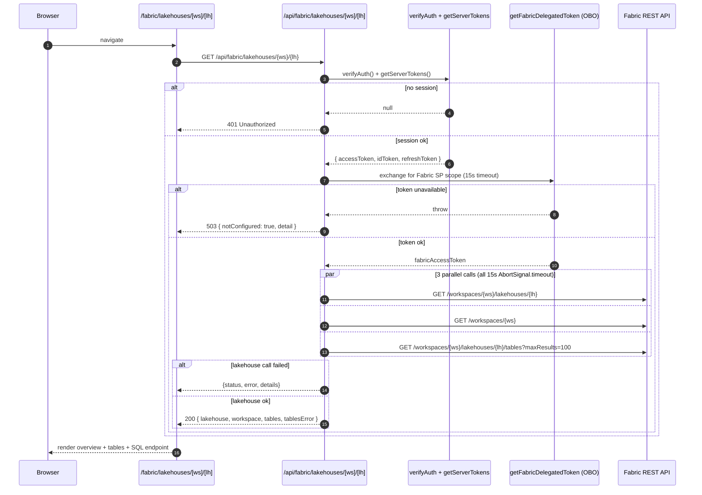

# Fabric Lakehouse Detail View

**Status:** Shipped
**Route:** `/fabric/lakehouses/[workspaceId]/[lakehouseId]`
**API:** `GET /api/fabric/lakehouses/{workspaceId}/{lakehouseId}`

Detail page for a single Microsoft Fabric lakehouse. Consolidates lakehouse
metadata, the parent workspace, the SQL analytics endpoint (with connection
string), OneLake `Tables/` and `Files/` paths, and the top 100 tables into one
view so an operator does not need to click through the Fabric portal to
diagnose access or find the connection string.

The lakehouse cards on `/fabric/lakehouses` now link into this page via the
optional `getItemHref` prop on `FabricItemsList`.

---

## What the page shows

| Section | Source | Notes |
|---|---|---|
| Overview | `GET /workspaces/{id}/lakehouses/{id}` | Display name, description, workspace, item ID |
| OneLake paths | Same call (`properties.oneLakeTablesPath`, `oneLakeFilesPath`) | Copy-to-clipboard for the ABFS URLs |
| SQL analytics endpoint | `properties.sqlEndpointProperties` | `provisioningStatus`, `connectionString`, `id` |
| Tables | `GET /workspaces/{id}/lakehouses/{id}/tables?maxResults=100` | Renders `tablesError` inline if this specific call fails but the lakehouse loaded |

---

## Request flow

The API route is a small fan-out over the Fabric REST API. It runs the three
Fabric calls in parallel behind a delegated Fabric token acquired via OBO from
the caller's session:



Key properties of the flow:

- **Auth is verified before any Fabric call.** The route follows the mandatory
  `verifyAuth` → `UNAUTHORIZED_RESPONSE` pattern from
  [`api-integration.md`](./api-integration.md).
- **Token acquisition has its own 15 s cap.** Wrapped in `Promise.race` so a
  hung Entra call cannot lock the request.
- **Each Fabric call has an independent 15 s `AbortSignal.timeout`.** They run
  in parallel, so total time is roughly `max(3 calls)`, not the sum.
- **Partial success is preserved.** If the workspace or tables call fails but
  the lakehouse call succeeds, the response still returns `200` and the tables
  error is surfaced as `tablesError` for the UI to render inline.
- **The token is never returned to the browser.** Only the parsed Fabric JSON
  shapes are.

---

## Response shape

```jsonc
{
  "lakehouse": {
    "id": "…",
    "displayName": "PaxLakehouse",
    "description": "…",
    "workspaceId": "…",
    "properties": {
      "oneLakeTablesPath": "abfss://…@onelake.dfs.fabric.microsoft.com/…/Tables",
      "oneLakeFilesPath": "abfss://…@onelake.dfs.fabric.microsoft.com/…/Files",
      "sqlEndpointProperties": {
        "connectionString": "…-npm5o7ldk6supelt536cujsxwq.datawarehouse.fabric.microsoft.com",
        "id": "…",
        "provisioningStatus": "Success"
      },
      "defaultSchema": "dbo"
    }
  },
  "workspace": { "id": "…", "displayName": "…", "capacityId": "…", … },
  "tables": [ { "name": "…", "type": "Managed", "format": "Delta", … } ],
  "tablesError": null
}
```

Error shapes:

| Status | Body | When |
|---|---|---|
| `400` | `{ error: "Missing workspaceId or lakehouseId" }` | Route params missing |
| `401` | `UNAUTHORIZED_RESPONSE` from `@/lib/api-auth` | No portal session |
| `503` | `{ error, detail, notConfigured: true }` | Fabric delegated token could not be issued (consent / permission / config) |
| `<fabric-status>` | `{ error, details }` | Fabric returned non-2xx for the lakehouse call itself |
| `500` | `{ error: "Internal server error", message }` | Unexpected throw |

---

## Permissions

- The signed-in user needs at least **Viewer** on the target Fabric workspace.
- The portal Entra app must have delegated **`Fabric.Item.Read.All`** (or
  broader) consented — the delegated Fabric scope is resolved centrally in
  `src/lib/ppToken.ts::getFabricDelegatedToken`.
- Callers who lack workspace access get a `403` from Fabric that is passed
  through with `status: 403` and `details` containing the Fabric error body,
  which the page renders verbatim.

---

## Related

- Fabric top-level nav: see `src/app/graph-explorer/nav-areas.ts` — Fabric was
  promoted from a sub-menu of "Data" to a top-level entry with Capacities /
  Workspaces / Warehouses / SQL databases / Notebooks / Semantic models /
  Reports / Domains / Lakehouses / etc.
- PAX consumers of the same SQL endpoint host: [`pax-integration.md`](./pax-integration.md).
- Route-registry entries: `src/lib/route-registry.ts` lines around
  `'/fabric/lakehouses/[workspaceId]/[lakehouseId]'`.
