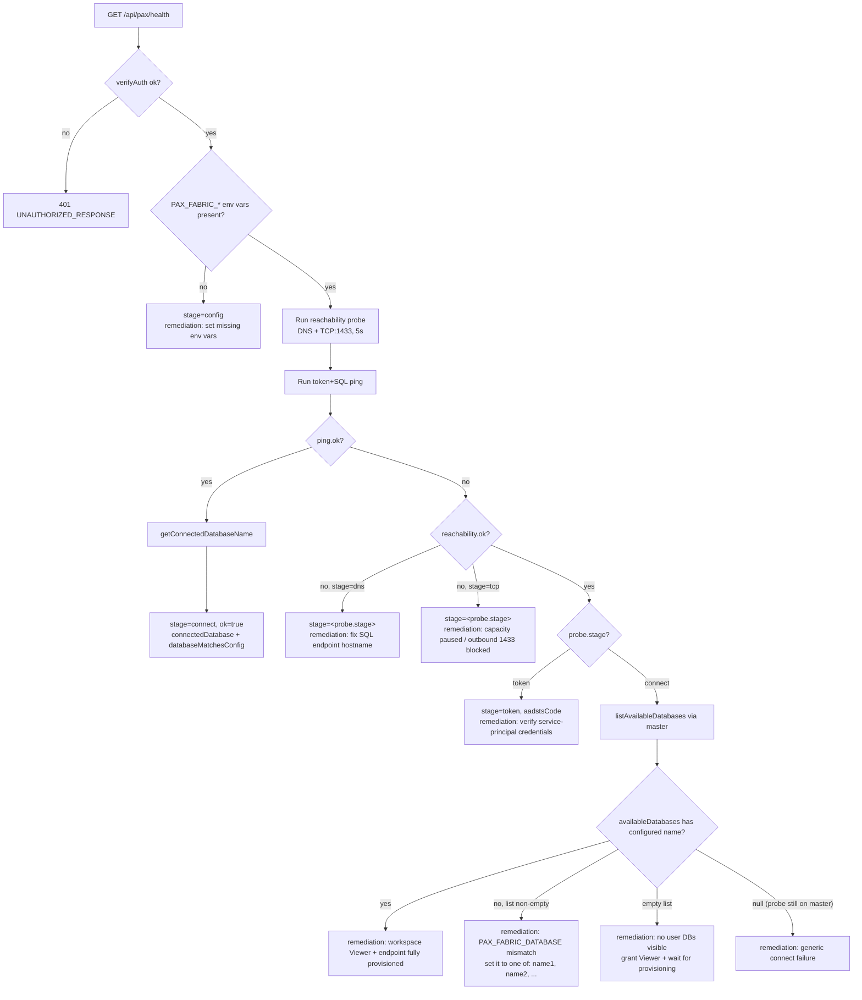

# PAX Integration

Portal 360° integrates **Microsoft PAX** (Portable Audit eXporter — <https://github.com/microsoft/PAX>) to
surface Purview Unified Audit Log, Microsoft 365 Copilot usage, and M365 usage analytics from a
PAX-populated Fabric Lakehouse.

## Architecture

PAX (run outside Portal 360°) writes Delta tables into a Microsoft Fabric Lakehouse in OneLake.
Portal 360° reads those Delta tables via the Fabric **SQL analytics endpoint** (T-SQL over TDS,
using the `mssql` npm client) with an app-only Entra token targeted at
`https://database.windows.net/`.

- No PAX runtime is deployed inside the portal — the portal is a read-only consumer.
- Every request executes as the dedicated PAX service principal via OAuth 2.0 client credentials.
- Only `SELECT`/`WITH` statements are allowed; identifiers come from a server-side allowlist.

## Required Fabric configuration

1. Have PAX populated into a Fabric Lakehouse in your workspace (per the PAX Cookbook).
2. Enable the Lakehouse SQL analytics endpoint.
3. In **Fabric admin portal > Tenant settings > Developer settings**, enable
   **Service principals can use Fabric APIs** for the security group containing
   the PAX service principal.
4. Grant the service principal either:
   - a Fabric workspace role such as **Viewer**, or
   - access to the specific Lakehouse SQL analytics endpoint with the required
     read permissions.

No delegated Azure SQL Database `user_impersonation` permission is used by this
integration.

## Environment variables

Set these in your Portal 360° environment (`.env.local` for local dev, App Service config or
Key Vault reference in Azure):

| Variable | Required | Description |
|---|---|---|
| `PAX_FABRIC_SQL_ENDPOINT` | ✅ | The Fabric SQL analytics endpoint host, e.g. `abc123-xyz.datawarehouse.fabric.microsoft.com`. **Auto-normalized** — the portal will strip `https://`, `tcp:`, `,1433`, `Server=` prefixes, and quotes, so pasting Fabric's full ADO.NET connection string (`Server=tcp:host,1433;`) works too. Preferred form is the bare FQDN. |
| `PAX_FABRIC_DATABASE` | ✅ | The lakehouse SQL database name (typically the lakehouse name) |
| `PAX_FABRIC_WORKSPACE_ID` | optional | Displayed in the UI for context |
| `PAX_FABRIC_LAKEHOUSE_ID` | optional | Displayed in the UI for context |
| `PAX_TABLE_AUDIT` | optional | Override the discovered audit-records table |
| `PAX_TABLE_USERS` | optional | Override the discovered users table |
| `PAX_TABLE_LICENSING` | optional | Override the discovered licensing table |
| `PAX_TABLE_USAGE` | optional | Override the discovered usage bundle table |
| `PAX_AZURE_TENANT_ID` | ✅ | Tenant containing the PAX service principal |
| `PAX_AZURE_CLIENT_ID` | ✅ | Application (client) ID of the PAX service principal |
| `PAX_AZURE_CLIENT_SECRET` | ✅ | Client secret **value** belonging to `PAX_AZURE_CLIENT_ID`; do not use the secret ID |
| `PAX_ACA_JOB_RESOURCE_ID` | optional | Full ARM resource ID of the Container Apps Job that runs the PAX export script (e.g. `/subscriptions/<sub>/resourceGroups/<rg>/providers/Microsoft.App/jobs/<name>`). Required only for `/pax/activity-config` (the activity-type picker UI); the rest of `/pax` works without it. |

If any required PAX setting is not set, the `/pax` section renders a "not configured" banner.
PAX credentials never fall back to the generic `AZURE_*` or Auth.js credentials.

## Choosing which activity types PAX exports

`/pax/activity-config` lets an admin pick which Purview activity types
(Copilot, Exchange, SharePoint/OneDrive, Teams chat, Teams meetings) PAX
exports, instead of editing the Container Apps Job's `-ActivityTypes` args by
hand via `az containerapp job update`. It reads and updates the job's
`args` array over ARM (`GET`/`PATCH /subscriptions/.../providers/Microsoft.App/jobs/<name>`,
`api-version=2025-01-01`) using the signed-in admin's delegated Azure token,
rewriting only the `-ActivityTypes <...values>` segment and dropping
`-IncludeM365Usage` (PAX's all-or-nothing 22-type bundle) in favor of the
explicit selection. Requires `PAX_ACA_JOB_RESOURCE_ID` and Contributor (or
Container Apps Contributor) access to the job for the signed-in admin.

## Table auto-discovery

PAX table names vary by recipe. On first use the client queries `INFORMATION_SCHEMA.TABLES` and
prefers combined/current targets such as `Purview_Audit_UsageActivity_CombinedActivityTypes`,
`Audit_Raw`, and `CopilotInteraction_Raw` before single-activity or legacy tables. Use the
`PAX_TABLE_*` overrides above when your recipe uses non-standard names.

The audit viewer normalizes both the processed PAX schema and the raw Graph wrapper schema
(`CreationDate`, `UserIds`, `Operations`, `AuditData`). If the selected source is a
single-activity table or lacks append provenance columns, the page shows configuration guidance.

### Audit table families

PAX v1.11+ can write one Delta table per Purview activity type
(`Purview_Audit_UsageActivity_CopilotInteraction`, `Purview_Audit_UsageActivity_FileAccessed`, …)
instead of one combined table. Because each of those tables holds a single `Workload`, reading
only the first match would report a single product on `/pax/audit-by-product`.

When the resolved audit table is a per-activity table, `/api/pax/audit-logs` and
`/api/pax/audit-logs/products` therefore query the `UNION ALL` of every per-activity sibling
(up to 40, largest first). Both responses report the tables actually read under `source`:

```jsonc
"source": {
  "mode": "single-activity",
  "tables": ["Purview_Audit_UsageActivity_CopilotInteraction", "..."],
  "tableCount": 7,
  "familySize": 7,
  "unioned": true,
  "truncated": false,
  "skipped": [{ "table": "...", "reason": "..." }]
}
```

Fan-out is deliberately skipped when a combined or raw export exists — those tables already
contain every activity type, so unioning the per-activity siblings on top would double-count.
Setting `PAX_TABLE_AUDIT` also pins the query to that single table.

A table is excluded from the union (and listed in `skipped`) when it cannot express a filter the
request asked for, such as a date range against a table with no `CreationTime`/`CreationDate`
column. That is preferable to silently returning unfiltered rows from it.

### Audit coverage and scheduled history

PAX defaults to `CopilotInteraction`, so a default run does not represent every Purview activity.
For a narrower pull, pass an explicit `-ActivityTypes` list. To collect every activity type PAX
supports — including the M365 usage bundle (Exchange,
SharePoint, OneDrive, Teams, Forms, Stream, Planner, Power Apps) alongside Copilot interactions —
pass `-IncludeM365Usage -CombineOutput` and omit `-Rollup`/`-RollupPlusRaw`/`-Dashboard`. Those
rollup switches drive a Power BI dashboard post-processor that reshapes and **deletes the raw
CSVs**, so they are only appropriate when the goal is a Copilot Analytics Lab dashboard input, not
a browsable set of raw Purview tables. With `-CombineOutput` PAX lands a single
`Purview_Audit_CombinedUsageActivity` Delta table that `classifyPaxAuditSource()` recognizes as
`mode: 'combined'`, so the portal reads it directly instead of unioning per-activity siblings.
The in-app **Report Builder** (`/pax/report-builder`) has a **Full Purview activity export**
preset that generates this exact command.

Fabric Delta output is overwritten by default: PAX derives the table name from the CSV leaf with
its `_<yyyyMMdd>_<HHmmss>` suffix stripped and writes it with Delta mode `overwrite`. Every
scheduled run therefore replaces the table, and only the latest window survives. The audit viewer
shows a warning banner when the `Date_Added` / `Latest_Append_Date` / `In_Latest_Append` provenance
columns are absent, because their absence means the table only holds the most recent run.

#### `-AppendFile` cannot target a Delta table (PAX v1.11.14)

This is the important constraint, and it is easy to get wrong. `-AppendFile` is a **CSV** merge, not
a Delta merge:

- The remote pre-flight resolves the append target by leaf name against the lakehouse **`Files/`**
  subtree only (`Get-RemoteFile-OneLake` hardcodes `/Files/` into the DFS path). If the download
  fails the run **throws and aborts** — there is no "create it on first run" fallback.
- In Delta mode PAX writes the CSV straight to `Tables/` via `Convert-CsvToDelta -Mode 'overwrite'`
  and never leaves a copy under `Files/`.
- `Write-DeltaAppend` — the one function that could append into a Delta table — is defined but
  never called anywhere in the script.

So pointing `-OutputPath` at a lakehouse root or `.../Tables/<schema>` **and** passing `-AppendFile`
aborts the run with `ERROR: Failed to download remote AppendFile`. Adding `-AppendFile` to an
otherwise-working Delta export breaks it.

Three configurations actually work:

| Goal | `-OutputPath` | Append | Result |
| --- | --- | --- | --- |
| Delta tables the portal can query | `.../Tables/dbo` (or lakehouse root) | none | Table replaced each run; retention = lookback window |
| Cumulative CSV with provenance | `.../Files/<folder>` | `-AppendFile <leaf>` | CSV accumulates with `Date_Added` etc.; needs a Fabric notebook/pipeline to land it as a Delta table |
| **Stateless rolling window + queryable Delta** | a **local** folder | none | What [`scripts/Invoke-PAXDaily.ps1`](../scripts/Invoke-PAXDaily.ps1) now does — see below |

The third option is the one this repo now ships. It is stateless, cloud-runner friendly, and still
publishes a Delta table the portal can query. See
[Daily stateless rolling window (Task Scheduler or GitHub Actions)](#daily-stateless-rolling-window-task-scheduler-or-github-actions).

If you need longer history, widen the rolling window (`-RollingDays`) while staying within Purview
retention (180 days on E5, up to 365 with the add-on).

**If you do use `-AppendFile`, it also requires single-file output.** PAX exits 1 with
`ERROR: -AppendFile requires single-file output mode` unless one of these holds:

- `-CombineOutput` is passed (all activity types merged into one file);
- exactly one `-ActivityTypes` value is in scope — including the implicit default of
  `CopilotInteraction`, but *not* the bundle `-IncludeM365Usage` expands to;
- `-Rollup` / `-RollupPlusRaw` is used, which implies `-CombineOutput` upstream.

So broadening beyond a single activity type means **`-AppendFile` and `-CombineOutput` together**.
Combining also collapses the per-activity tables into
`Purview_Audit_UsageActivity_CombinedActivityTypes`, which the portal reads directly instead of
fanning out a `UNION ALL` across siblings. The same collapse happens in Delta (overwrite) mode, so
`-CombineOutput` is useful on its own even when you are not appending.

The Portal 360 report builder exposes this as **Combine activity types into one output file**,
requires an append target when **Append for incremental export** is enabled, and blocks command
generation (with the reason shown under the preview) when append is requested for a multi-file run.

## Pages

| Route | Purpose |
|---|---|
| `/pax` | Landing page with configuration status and section tiles |
| `/pax/audit-logs` | Filterable Purview Unified Audit Log viewer |
| `/pax/copilot-usage` | Copilot adoption dashboards (KPIs, trend, by-app, top users) |
| `/pax/m365-usage` | M365 workload usage dashboards |
| `/pax/tables` | Raw table discovery and row counts |

Cross-link banners are also shown on the following pages **when PAX is configured**:

- `/audit-logs`
- `/copilot-interactions`
- `/microsoft365/copilot/user-count`
- `/fabric` (tile)

## Security notes

- All API routes call `verifyAuth()` first (per project convention).
- Fabric tokens are acquired server-side per request and never surfaced to the browser.
- Table and column identifiers come from a hard-coded allowlist; all user-supplied filter values
  flow through `mssql` parameterised inputs.
- The `runSelect` helper rejects any query that does not start with `SELECT` or `WITH`.
- Errors are logged server-side; clients see generic messages.


## Entra service principal

The portal uses a dedicated confidential client and
`acquireTokenByClientCredential()` to obtain an app-only token. It does not read
or exchange the signed-in portal user's access or refresh tokens.

The requested MSAL scope is `https://database.windows.net//.default`. Azure SQL
is a v1 resource whose identifier ends with `/`, so the double slash preserves
the required `https://database.windows.net/` token audience.

The SQL client must use `mssql` 12.7 or newer (which resolves `tedious` 19.1 or
newer). Earlier `tedious` releases don't emit the Fabric-compatible TDS prelogin
and Login7 payload. Fabric closes those connections during the handshake, which
surfaces as `ESOCKET: Connection lost - socket hang up` even when DNS, TCP 1433,
the token audience, database name, and workspace permissions are all correct.

### 1. Create the service principal

Create a single-tenant Entra app registration for PAX Fabric SQL access and add
a credential. Prefer a certificate or managed identity where the hosting model
supports it; the current integration accepts a client secret.

Fabric SQL authorizes the service principal through Fabric tenant, workspace,
item, and SQL permissions. Do not add delegated Azure SQL Database
`user_impersonation` permission for this integration.

### 2. Required secrets on App Service

| Variable | Purpose |
|---|---|
| `PAX_AZURE_TENANT_ID` | Tenant containing the service principal |
| `PAX_AZURE_CLIENT_ID` | Service principal application (client) ID |
| `PAX_AZURE_CLIENT_SECRET` | Client secret **value**, not the secret ID |

PAX-specific credentials are mandatory; the portal does not fall back to
Auth.js or generic `AZURE_*` credentials. A missing value surfaces on
`/api/pax/health` as a configuration-stage failure that names the missing
variable.

`AADSTS7000215` means Entra rejected the credential before Fabric was contacted.
Copy the **Value** shown once when the secret is created. The **Secret ID**
displayed later is not a credential. If the value was not retained, create a new
secret, update `PAX_AZURE_CLIENT_SECRET`, and restart the App Service.


## Diagnostics — `/api/pax/health`

An authenticated `GET /api/pax/health` returns a structured probe that
separates *configuration*, *token*, and *SQL-connect* failures:

### Success payload

```jsonc
{
  "ok": true,
  "stage": "connect",
  "serverTime": "2026-08-14T15:04:22.117Z",
  "tokenFlow": "client-credentials",
  "config": { "sqlEndpoint": "...", "database": "PaxLakehouse", "workspaceId": null, "lakehouseId": null },
  "endpoint": { "raw": "...", "normalized": "...", "wasNormalized": false },
  "reachability": { "ok": true, "host": "...", "port": 1433, "resolvedIp": "20.x.x.x" },
  "connectedDatabase": "PaxLakehouse",
  "databaseMatchesConfig": true
}
```

### Failure payload

```jsonc
{
  "ok": false,
  "stage": "connect",               // config | token | connect
  "error": "socket hang up [host=... dns=ok ip=... tcp=fail (ETIMEDOUT)] — App Service cannot reach the endpoint on 1433...",
  "aadstsCode": null,
  "tokenFlow": "client-credentials", // client-credentials | none
  "config": { "sqlEndpoint": "...", "database": "...", "workspaceId": null, "lakehouseId": null },
  "endpoint": {
    "raw": "Server=tcp:abc.datawarehouse.fabric.microsoft.com,1433;",
    "normalized": "abc.datawarehouse.fabric.microsoft.com",
    "wasNormalized": true
  },
  "reachability": {
    "ok": false,
    "host": "abc.datawarehouse.fabric.microsoft.com",
    "port": 1433,
    "resolvedIp": "20.x.x.x",
    "stage": "tcp",                 // dns | tcp (absent when ok)
    "error": "TCP connect timed out after 5000ms ..."
  },
  "availableDatabases": [           // only populated when stage == "connect"
    { "name": "paxLakehouse" },
    { "name": "master" }
  ],
  "remediation": "PAX_FABRIC_DATABASE=\"PaxLakehouse\" does not match any database the endpoint exposes. Set it to one of: paxLakehouse, master (case-sensitive) and restart the App Service."
}
```

Fields:

- **`stage`** — top-level failure category. `config` = missing env vars, `token` = Entra couldn't issue a Fabric SQL token, `connect` = token OK but SQL / network failed.
- **`endpoint.wasNormalized`** — `true` when your `PAX_FABRIC_SQL_ENDPOINT` value had a prefix/suffix stripped. Compare `raw` and `normalized` to see exactly what host is being used.
- **`reachability`** — independent DNS + TCP-connect probe on port 1433. Runs even when the token flow works, so you can tell "endpoint hostname wrong" (`stage: dns`) from "outbound 1433 blocked / capacity paused" (`stage: tcp`) from "TDS handshake failed" (reachability `ok: true` but overall `stage: connect`).
- **`tokenFlow`** — which acquisition path succeeded. `client-credentials` is the expected app-only path; `none` means credentials were unavailable before MSAL could run.
- **`aadstsCode`** — extracted AADSTS error code when the token flow failed; use it to look up the row in the table below.
- **`connectedDatabase`** *(success only)* — the database name the server reports we are actually connected to, from `DB_NAME()` on `master`. Catches casing / whitespace / hyphen mismatches that are otherwise invisible.
- **`databaseMatchesConfig`** *(success only)* — `true` when `connectedDatabase === PAX_FABRIC_DATABASE`. When the ping succeeds but this is `false`, the SQL endpoint fell back to `master` and every query the portal issues will fail with "invalid object name". Fix `PAX_FABRIC_DATABASE`.
- **`availableDatabases`** *(connect-stage failure only)* — the list of database names the SQL endpoint exposes to the caller, gathered by connecting to `master` and querying `sys.databases`. Populated so the remediation text can name the exact valid values (e.g., `paxLakehouse` vs. the configured `PaxLakehouse`); `null` when the failure was earlier than SQL login, or when the master connection itself failed.
- **`remediation`** — human-readable next step, layered so it addresses the network failure first when there is one. When `availableDatabases` is set, this string will explicitly list the valid values and whether the configured one matches (case-sensitive).

The token itself is **never** returned — only the flow name and the failure
reason.

### Decision tree the probe walks

The `/api/pax/health` handler evaluates the environment in strict order and
returns the first failure it can localise. The layered remediation in the
response follows the same order.



The `/pax` status banner (`PaxStatusBanner.tsx`) surfaces the same information
inline; the health route is for support scenarios where an operator needs the
raw AADSTS code.


## Troubleshooting — common AADSTS codes

| Code | Meaning | Fix |
|---|---|---|
| `AADSTS7000215` | Invalid client secret | Set `PAX_AZURE_CLIENT_SECRET` to the secret **value**, not the secret ID. Create a new secret if the value is unavailable. |
| `AADSTS700016` | Application not found in the tenant | Verify `PAX_AZURE_CLIENT_ID` and `PAX_AZURE_TENANT_ID` identify the same app registration. |
| `AADSTS7000222` | Client secret expired | Create a new credential, update the App Service setting, and restart the app. |
| `AADSTS70011` | Invalid scope | The code must request `https://database.windows.net//.default`; verify the deployed version includes the app-only token change. |
| `AADSTS90002` | Tenant not found | Verify `PAX_AZURE_TENANT_ID` matches the PAX app tenant GUID. |

If the banner reports **"Cannot connect to Fabric SQL endpoint"** (stage
`connect`) instead of a token stage, the token was acquired successfully but
the SQL endpoint rejected the connection. Check:

- `PAX_FABRIC_SQL_ENDPOINT` matches the SQL analytics endpoint host in Fabric
  (Lakehouse → **Settings → SQL analytics endpoint → Server** — should look
  like `...-npm5o7ldk6supelt536cujsxwq.datawarehouse.fabric.microsoft.com`).
- `PAX_FABRIC_DATABASE` matches the SQL analytics endpoint database name.
- **Service principals can use Fabric APIs** is enabled for the principal in
  Fabric tenant settings.
- The service principal has a workspace role or access to the SQL analytics
  endpoint item.
- The deployed build uses `mssql` 12.7 or newer. `mssql` 11 resolves
  `tedious` 18, which can't complete the Fabric-specific TDS handshake and
  reports `ESOCKET: Connection lost - socket hang up`.
- The Fabric capacity is not paused.
- Outbound TCP 1433 is not blocked from App Service. From Kudu bash:
  ```bash
  timeout 5 bash -c 'cat < /dev/tcp/<endpoint-host>/1433' && echo OK
  ```
  A hang or `Connection timed out` means a VNet/NSG/firewall is dropping the
  connection. In that case either remove the outbound restriction or add
  `*.datawarehouse.fabric.microsoft.com:1433` to the allowed set.

Hit `/api/pax/health` and read the `reachability` and `endpoint` blocks first
— they tell you which of the above is failing without any log-stream access.


## Operational setup — running PAX to populate the lakehouse

Portal 360° is a read-only consumer. To populate the lakehouse, run the PAX
script periodically. Two operational paths are documented below:

- **This section (host-based)** — running the script directly from a
  Windows runner/Task Scheduler, as originally set up in this deployment.
- **[Azure Container Apps Job (`infra/`)](#azure-container-apps-job--scheduled-daily-export)**
  — a fully unattended, managed-identity-based daily export hosted in Azure,
  provisioned by this repository's `azure.yaml` + `infra/main.bicep` using
  AZD and Azure Verified Modules. **Recommended** for production.

### Prerequisites (one-time)

1. **Fabric capacity** — an active Fabric capacity (`fabriccapruss` here). Pause it
   between backfills to control cost; unpause before scheduled runs.
2. **Workspace + Lakehouse** — a Fabric workspace (`PAX`) with a lakehouse
   (`paxLakehouse`). Note their IDs — they map to `PAX_FABRIC_WORKSPACE_ID` /
   `PAX_FABRIC_LAKEHOUSE_ID`.
3. **Entra app registration for the exporter** — either the Portal 360 app (it already holds
   `AuditLogsQuery.Read.All`) or a dedicated least-privilege app:
   - Name: `PAX Audit Exporter`
   - Microsoft Graph **application** permissions (admin-consented):
     `AuditLogsQuery.Read.All`, `AuditLogsQuery-CRM.Read.All`,
     `AuditLogsQuery-Exchange.Read.All`, `AuditLogsQuery-Endpoint.Read.All`,
     `AuditLogsQuery-OneDrive.Read.All`, `AuditLogsQuery-SharePoint.Read.All`.
   - Client secret (store in Key Vault or Windows Credential Manager).
   - Assign the service principal as **Contributor** on the Fabric workspace so
     it can write to OneLake.
   - See [Credentials (runner)](#credentials-runner) for how the script picks one.
4. **Runner host** — Windows Server or workstation with:
   - PowerShell 7.4+
   - `Microsoft.Graph.Authentication` and `Microsoft.Graph.Security` (PAX installs a
     matching pair itself on first run if they are missing)
   - Python 3.11+ with `pyarrow` and `deltalake`
   - `Az.Accounts` is **not** required by `Invoke-PAXDaily.ps1`, which acquires tokens from the
     Entra token endpoint directly. It is only needed if you run PAX against a OneLake
     `-OutputPath` yourself, and version 5.x conflicts with `Microsoft.Graph.Authentication`
     2.38.x — see "Known issues" below.

### Credentials (runner)

The exporter needs an app registration with Graph **application** permission
`AuditLogsQuery.Read.All` and **Contributor** on the Fabric workspace. The Portal 360 app
registration already satisfies both, so a dedicated exporter app is optional.

`Invoke-PAXDaily.ps1` resolves credentials in this order, first hit wins:

1. `-TenantId` / `-ClientId` / `-ClientSecret`
2. `GRAPH_TENANT_ID` / `GRAPH_CLIENT_ID` / `GRAPH_CLIENT_SECRET` — dedicated exporter app
3. `AZURE_TENANT_ID` / `AZURE_CLIENT_ID` / `AZURE_CLIENT_SECRET` — the Portal 360 app
4. `-EnvFile <path>` — reads either name pair out of a `.env` file, e.g. the portal's `.env.local`

Each is checked in Process, User, then Machine scope. The run logs which source supplied the
client id (never the secret).

Set them as User-scope env vars on the runner so the scheduled task does not depend on a file:

```powershell
[Environment]::SetEnvironmentVariable('AZURE_TENANT_ID',    '<tenant guid>',   'User')
[Environment]::SetEnvironmentVariable('AZURE_CLIENT_ID',    '<app id>',        'User')
[Environment]::SetEnvironmentVariable('AZURE_CLIENT_SECRET','<secret>',        'User')
```

Prefer `-EnvFile` only for ad-hoc runs. Pointing it at a git worktree's `.env.local` is fragile
because worktrees get deleted.

**Least privilege vs. convenience.** Reusing the portal app is the fastest path and adds no new
secret, but that app holds several other Graph app roles. A dedicated `PAX Audit Exporter` app with
only `AuditLogsQuery.Read.All` (plus the granular `AuditLogsQuery-Exchange/-SharePoint/-OneDrive/`
`-Endpoint/-CRM.Read.All` scopes if you want per-workload separation) limits blast radius. Use
`GRAPH_*` for that app; it takes precedence over `AZURE_*`.

### First backfill (last 30 days)

```powershell
$env:GRAPH_TENANT_ID     = [Environment]::GetEnvironmentVariable('GRAPH_TENANT_ID','User')
$env:GRAPH_CLIENT_ID     = [Environment]::GetEnvironmentVariable('GRAPH_CLIENT_ID','User')
$env:GRAPH_CLIENT_SECRET = [Environment]::GetEnvironmentVariable('GRAPH_CLIENT_SECRET','User')

$start = (Get-Date).AddDays(-30).ToString('yyyy-MM-dd')
$end   = (Get-Date).AddDays(-1).ToString('yyyy-MM-dd')

& C:\PAX\PAX_Purview_Audit_Log_Processor_v1.11.14.ps1 `
  -TenantId $env:GRAPH_TENANT_ID -ClientId $env:GRAPH_CLIENT_ID `
  -ClientSecret $env:GRAPH_CLIENT_SECRET -Auth AppRegistration `
  -StartDate $start -EndDate $end `
  -OutputPath 'https://onelake.dfs.fabric.microsoft.com/<workspace>/<lakehouse>.Lakehouse/Tables/dbo' `
  -Delimiter Comma
```

### Daily stateless rolling window (Task Scheduler or GitHub Actions)

Copy [`scripts/Invoke-PAXDaily.ps1`](../scripts/Invoke-PAXDaily.ps1) to `C:\PAX\` and register it
as a daily task (Task Scheduler or GitHub Actions). It tees its log to
`C:\PAX\logs\pax-daily-<yyyy-MM-dd_HHmmss>.log`.

The script is now **stateless** and still publishes a queryable Delta table:

1. **Collect** — PAX writes a run CSV to a **local** folder (`-DataRoot`, default `C:\PAX\data`)
   for a fixed rolling window (`-RollingDays`, default `1`).
2. **Publish** — that run CSV is written to `-OutputRoot` (default
   `.../Tables/dbo`) as a Delta table via `deltalake`, replicating PAX's own write settings
   (all columns cast to string, `schema_mode='merge'`, the same column-name sanitizer). Overwriting
   means the table always reflects the configured rolling window.

Window selection is fixed each run:

- `StartDate = today - RollingDays`
- `EndDate = today` (exclusive, per PAX semantics)

```powershell
powershell.exe -NoProfile -ExecutionPolicy Bypass -File C:\PAX\Invoke-PAXDaily.ps1
```

To hedge late-arriving Purview records without watermarking, use a wider stateless
window (for example 3 days):

```powershell
powershell.exe -NoProfile -ExecutionPolicy Bypass -File C:\PAX\Invoke-PAXDaily.ps1 -RollingDays 3
```

By default the script collects `CopilotInteraction` **plus PAX's curated M365 usage bundle**
(`-IncludeM365Usage`): 22 activity types covering Exchange mail access, SharePoint/OneDrive file
access, Teams chat and meeting lifecycle, and `ConnectedAIAppInteraction`. Everything lands in the
single `Purview_Audit_UsageActivity_CombinedActivityTypes` table, which the portal reads directly
instead of fanning out a `UNION ALL` across per-activity siblings.

Narrow it with `-IncludeM365Usage:$false` and an explicit list:

```powershell
powershell.exe -NoProfile -ExecutionPolicy Bypass -File C:\PAX\Invoke-PAXDaily.ps1 `
  -IncludeM365Usage:$false -ActivityTypes CopilotInteraction
```

`-CombineOutput` is passed automatically whenever more than one type is in scope. This matters for
unattended runs: a multi-type run *without* it drops into an interactive
"separate files or combined?" prompt, which would hang a scheduled task. Each distinct
activity-type set can produce different output file names, so the script auto-discovers
the latest matching CSV before publish.

Useful switches:

| Switch | Effect |
| --- | --- |
| `-RollingDays <n>` | Rolling stateless window to collect each run (default `1`). |
| `-PaxScriptPath <path>` | Path to `PAX_Purview_Audit_Log_Processor_v1.11.14.ps1` (default `C:\PAX\...`). |
| `-PublishOnly` | Re-publish without calling PAX. Uses `-PublishInputCsv` when provided, otherwise the latest matching CSV in `-DataRoot`. |
| `-PublishInputCsv <path>` | Explicit CSV path to publish (typically with `-PublishOnly`). |
| `-SkipPublish` | Collect only. |

The script authenticates with the same app registration PAX uses (`GRAPH_TENANT_ID`,
`GRAPH_CLIENT_ID`, `GRAPH_CLIENT_SECRET` user environment variables, overridable with
`-TenantId`/`-ClientId`/`-ClientSecret`). It acquires the OneLake storage token by calling the Entra
token endpoint directly rather than through `Az.Accounts`, so **the Az modules are not required** —
which also sidesteps the Az/Graph conflict described below.

### Known issues encountered

1. **OneLake DFS append truncates to 0 bytes / flush returns HTTP 400
   "position not equal to length"** — PAX 1.11.14 constructs the checkpoint
   append body with a scriptblock expression `$slice = if (...) { $buffer }
   else { ... $s }`, and PowerShell **unrolls the returned `byte[]` into
   `object[]`** as it flows out of the expression. `Invoke-WebRequest -Body`
   then serializes the `object[]` as a space-separated ASCII string, so the
   append accepts (say) `48 32 49 32 ...` for the byte sequence `0 1 2 ...` and
   commits nothing. Flush at the declared position then 400s.
   **Fix**: assign `$slice` inside each branch of the `if/else` explicitly
   (or use `,$buffer` to prevent pipeline enumeration). Patch in this repo
   under `C:\PAX\PAX_Purview_Audit_Log_Processor_v1.11.14.ps1` around line
   12677.

2. **`Az.Accounts` 5.x + `Microsoft.Graph.Authentication` 2.38.x → "Entry
   point was not found."** on `Connect-MgGraph`. Assembly conflict on
   `Microsoft.Identity.Client`. **Fix**: pin Az.Accounts to 2.19.0 for the
   runner host, and hide/uninstall newer versions from `$PSModulePath`.

3. **`Az.Accounts` "Assembly with same name is already loaded"** when both
   2.19.0 and 5.5.1 sit in `$PSModulePath`. Only one Az.Accounts version can
   be loaded per process. Hide the 5.5.1 folder by renaming it, or set
   `$env:PSModulePath` to exclude the newer path for the runner shell.


### First backfill (continued)

```powershell
& C:\PAX\PAX_Purview_Audit_Log_Processor_v1.11.14.ps1 `
    -TenantId $env:GRAPH_TENANT_ID `
    -ClientId $env:GRAPH_CLIENT_ID `
    -ClientSecret $env:GRAPH_CLIENT_SECRET `
    -Auth AppRegistration `
    -StartDate $start `
    -EndDate $end `
    -OutputPath 'https://onelake.dfs.fabric.microsoft.com/PAX/paxLakehouse.Lakehouse/Tables/dbo' `
    -Delimiter Comma
```

Detached (survives shell time limits — recommended for backfills > 15 min):

```powershell
Start-Process pwsh -WindowStyle Hidden -PassThru -ArgumentList @(
    '-NoProfile','-ExecutionPolicy','Bypass','-File','C:\PAX\_launch_pax.ps1'
)
```

### After each run — refresh the Fabric SQL endpoint metastore

The Fabric Lakehouse SQL analytics endpoint does **not** auto-discover new
Delta tables in real time. Trigger a metadata refresh after each successful
run so the portal can query them:

```powershell
$wsId    = $env:PAX_FABRIC_WORKSPACE_ID
$sqlEpId = $env:PAX_FABRIC_SQL_ENDPOINT_ID
$tok = (Get-AzAccessToken -ResourceUrl 'https://api.fabric.microsoft.com').Token
Invoke-RestMethod -Method Post `
    -Uri "https://api.fabric.microsoft.com/v1/workspaces/$wsId/sqlEndpoints/$sqlEpId/refreshMetadata" `
    -Headers @{ Authorization = "Bearer $tok"; 'Content-Type' = 'application/json' } `
    -Body '{}'
```

The response lists every table synced with a `Success` / `Failure` status.
`Invoke-PAXDaily.ps1` runs this automatically as its final step (and acquires the token via the
Entra token endpoint rather than `Get-AzAccessToken`, so it needs no Az modules).

## Known issues in PAX v1.11.14 (patched in this deployment)

Two bugs were hit during the initial rollout — both patched in the local copy
at `C:\PAX\PAX_Purview_Audit_Log_Processor_v1.11.14.ps1` and captured in
`pax-onelake-bugfix.md` for an upstream issue.

### 1. `Send-FileToOneLake` sends `byte[]` as ASCII text (HTTP 400)

**Symptom**: `Sync-FabricResumeMirror` fails with HTTP 400 uploading resume
files. Inspection shows the body arrives on the wire as `"0 1 2 3 ..."`
(space-separated ASCII decimals) instead of raw bytes.

**Cause**: PowerShell unrolls a `byte[]` into `object[]` when it flows through
the `= if (...) { $buffer } else { $buffer[$offset..($offset+$n-1)] }`
expression, because the pipeline treats the array as an enumerable. Once
converted to `object[]`, `Invoke-WebRequest -Body` no longer recognizes it as
binary and stringifies each element.

**Fix**: assign `$slice` inside each `if/else` branch explicitly (see PAX
line ~12680):

```powershell
if ($n -eq $buffer.Length -and $offset -eq 0) {
    $slice = $buffer
} else {
    $sub = New-Object byte[] $n
    [Array]::Copy($buffer, $offset, $sub, 0, $n)
    $slice = $sub
}
```

### 2. `Convert-CsvToDelta` fails with `Unknown scheme: https` (deltalake ≥ 1.0)

**Symptom**: PAX writes CSVs successfully into `Files/` but fails at the
Delta-conversion step with `Convert-CsvToDelta: write failed: Unknown scheme:
https. Known schemes: azblob,memory,cos,dbfs,...abfss`. Tables/ stays empty
and the SQL endpoint has nothing to query.

**Cause**: `deltalake` ≥ 1.0 removed the `https://onelake...` shortcut URI.
Only `abfss://` is accepted for Fabric OneLake.

**Fix**: translate the URI just before `write_deltalake` (PAX line ~11553):

```python
if out_uri.startswith('https://onelake.dfs.fabric.microsoft.com/'):
    _rest = out_uri[len('https://onelake.dfs.fabric.microsoft.com/'):]
    _parts = _rest.split('/', 1)
    if len(_parts) == 2:
        out_uri = f'abfss://{_parts[0]}@onelake.dfs.fabric.microsoft.com/{_parts[1]}'
```

### 3. `Az.Accounts` 5.x conflicts with `Microsoft.Graph.Authentication` 2.38.x

**Symptom**: `Microsoft.Identity.Client` type-load exception on
`Connect-MgGraph`.

**Fix**: pin `Az.Accounts` to `2.19.0` on the runner host; hide/uninstall
`5.x` from `$PSModulePath`.

## Azure Container Apps Job — scheduled daily export

This repository provisions a **production, cost-optimized** Azure Container
Apps Job that runs PAX unattended once daily, using the **official
Microsoft-published container pattern** for PAX (the `fabric_resources/`
folder in <https://github.com/microsoft/PAX>) rather than a bespoke image.
It follows this repo's AVM/Bicep conventions and is deployed with
[AZD](https://learn.microsoft.com/azure/developer/azure-developer-cli/).

### Portal 360 report experience

The **Microsoft Fabric > PAX Insights** navigation group and the PAX report
selector expose:

- the Fabric-backed Purview audit explorer, Copilot usage report, M365 usage
  report, and landed-table inventory;
- an **All reports** catalog containing every official Mini-Kitchen starter:
  AI-in-One, AI Business Value, M365 Usage, Entra user information, Microsoft
  Agent 365 catalog, custom audit export, and portable recipe import;
- a report builder that generates the official PAX PowerShell switches,
  computes the required Microsoft Graph permissions, saves recipes in the
  current browser, and imports/exports Cookbook-compatible `.paxlite` files.

Recipe generation never executes PAX and never stores credentials. Scheduled
tenant access remains in the managed-identity Container Apps Job, while Portal
360 reads the resulting Fabric SQL data through its authenticated BFF routes.

- **AZD project file:** `azure.yaml` (infra-only; no `services` — the
  Portal 360° web app has its own deployment pipeline).
- **Bicep template:** `infra/main.bicep` (resource-group scoped; parameters
  in `infra/main.bicepparam`).

### What gets deployed

| Resource | AVM module | Purpose |
|---|---|---|
| Log Analytics workspace | `avm/res/operational-insights/workspace` | Diagnostics sink for the ACA environment, ACR, and job execution logs |
| Azure Container Registry (**Basic**) | `avm/res/container-registry/registry` | Hosts the PAX image; `AcrPull` granted to the job's managed identity |
| User-assigned managed identity | `avm/res/managed-identity/user-assigned-identity` | ACR pull + PAX `-Auth ManagedIdentity` — no secrets stored anywhere |
| Storage account + Azure Files share | `avm/res/storage/storage-account` | Backs the PAX bootstrap-log durable mount at `/pax-logs`, matching the official `Deploy-PAXAcaJob.ps1` pattern |
| Container Apps managed environment | `avm/res/app/managed-environment` | Consumption-only, public ingress, linked to the Log Analytics workspace |
| Container Apps Job | `avm/res/app/job` | `triggerType: Schedule`, cron `0 6 * * *` (06:00 UTC daily), `parallelism: 1`, bounded `replicaRetryLimit`, long `replicaTimeout` |

None of these resources are Azure Policy–restricted in the approved
subscription/region (East US 2), and outputs never include secrets — the
managed identity's client ID is not sensitive, and no image registry
credentials, client secrets, or tenant identifiers are emitted.

### Build and push the PAX image

> **This step is mandatory.** `infra/main.bicepparam` defaults
> `paxContainerImage` to `mcr.microsoft.com/azuredocs/containerapps-helloworld:latest`,
> a public Microsoft sample that has nothing to do with PAX. A job running that
> placeholder starts, serves a "Welcome to Container Apps" page, exits 0, and
> exports **nothing** — with no error, no failed execution, and no empty-table
> signal in Fabric to alert you. Until you complete this section and update
> `PAX_CONTAINER_IMAGE`, the daily schedule is silently a no-op.
>
> The default is a real, publicly resolvable image on purpose: Container Apps
> Jobs resolve the image reference by DNS **at ARM deploy time**, not deferred
> to job execution, so an obviously-fake placeholder would fail the entire
> `azd provision` with `InvalidParameterValueInContainerTemplate` rather than
> just the job run. The trade-off is that provisioning succeeds and looks
> healthy while exporting nothing.

The Bicep template does **not** build or publish a container image — it only
creates the registry the image is pushed to. Use `az acr build`, which uploads
the build context to ACR Tasks and builds server-side: no local Docker daemon,
and the `linux/amd64` platform Container Apps requires is produced regardless
of your workstation's architecture. ACR Tasks is available on the **Basic** SKU
this template provisions.

The official Dockerfile is self-contained — it downloads the pinned PAX release
from GitHub during the build, so you never clone the PAX repo:

| What | Value |
|---|---|
| Repo | <https://github.com/microsoft/PAX> |
| Branch | `release` (the raw `main` path 404s — pin to `release`) |
| Dockerfile | `fabric_resources/Dockerfile/PAX.Dockerfile` |
| Base image | `mcr.microsoft.com/powershell:lts-7.4-ubuntu-22.04` |
| Required build arg | `SCRIPT_VERSION` (no default; the build fails fast without it) |
| Optional build arg | `SCRIPT_SHA256` (defaults to `""` = verification skipped with a warning) |

```powershell
# 1. Download the official, self-contained Dockerfile into an EMPTY directory.
#    `az acr build` uploads its context directory to Azure — building from the
#    repo root would upload the whole repo. The Dockerfile needs no other files.
New-Item -ItemType Directory -Force -Path .\pax-build | Out-Null
Invoke-WebRequest `
  -Uri "https://raw.githubusercontent.com/microsoft/PAX/release/fabric_resources/Dockerfile/PAX.Dockerfile" `
  -OutFile .\pax-build\PAX.Dockerfile

# 2. Pick a version from https://github.com/microsoft/PAX/releases
#    Pass the BARE x.y.z version. The Dockerfile builds the release tag itself as
#    purview-v${SCRIPT_VERSION}; passing 'purview-v1.11.15' yields purview-vpurview-v1.11.15
#    and the in-build download 404s.
$ver = '1.11.15'

# 3. Compute the SHA-256 yourself for supply-chain verification.
#    Releases publish ONLY the .ps1 asset — there is no sidecar .sha256 file to
#    copy a digest from, despite what the Dockerfile header comment implies.
$asset = "PAX_Purview_Audit_Log_Processor_v$ver.ps1"
Invoke-WebRequest `
  -Uri "https://github.com/microsoft/PAX/releases/download/purview-v$ver/$asset" `
  -OutFile ".\$asset"
$hash = (Get-FileHash ".\$asset" -Algorithm SHA256).Hash.ToLower()
$hash   # 1.11.15 => 13a8d41a70c462650207e452eb0ccab274729eb65b0d640bc0a52d6a40ad46c9

# 4. Build and push in one server-side step. Use the `containerRegistryName`
#    output from `azd provision` (the short name, NOT the login server FQDN).
az acr build `
  --registry <containerRegistryName> `
  --image pax-purview:$ver `
  --file PAX.Dockerfile `
  --build-arg SCRIPT_VERSION=$ver `
  --build-arg SCRIPT_SHA256=$hash `
  .\pax-build

# 5. Confirm the tag landed.
az acr repository show-tags --name <containerRegistryName> --repository pax-purview -o table
```

Pin `SCRIPT_SHA256` for anything you ship. Omitting it still builds, but the
image then silently accepts whatever bytes the download returned. If you fork or
patch the PAX script, pin your **own** digest — the stock vendor digest will
(correctly) fail the build once the file differs.

The ACR Tasks build agent needs outbound HTTPS to `github.com` to fetch the
release asset. That works on the default Basic-SKU configuration; it will fail
if you later place the registry behind a private endpoint with restricted
egress, in which case build locally with `docker build` and `docker push`
instead.

Then point the job at the real image and redeploy — pushing the image alone
does not change a job that was already provisioned against the placeholder:

```powershell
azd env set PAX_CONTAINER_IMAGE '<containerRegistryLoginServer>/pax-purview:1.11.15'
azd provision
```

### Deploying with AZD

```powershell
azd auth login

# Required — no default resolves to a working image or destination.
azd env set PAX_CONTAINER_IMAGE   '<containerRegistryLoginServer>/pax-purview:1.11.15'

# This lands every Purview activity type PAX supports — the M365 usage bundle
# (Exchange, SharePoint, OneDrive, Teams, Forms, Stream, Planner, Power Apps)
# plus Copilot interactions — as one combined, browsable Purview_Audit_CombinedUsageActivity
# Delta table. Avoid -Rollup/-RollupPlusRaw/-Dashboard here: those reshape output for a
# Power BI dashboard and delete the raw tables, so the portal would have nothing to read.
azd env set PAX_SCRIPT_ARGS_JSON  '["-OutputPath","https://onelake.dfs.fabric.microsoft.com/<workspace>/<lakehouse>.Lakehouse/Tables/dbo","-OutputPathLog","https://onelake.dfs.fabric.microsoft.com/<workspace>/<lakehouse>.Lakehouse/Files/pax_logs","-Auth","ManagedIdentity","-IncludeM365Usage","-CombineOutput"]'

azd env set AZURE_LOCATION 'eastus2'
azd provision
```

If `PAX_CONTAINER_IMAGE` is left unset, the template falls back to the
non-functional `containerapps-helloworld` placeholder so the ARM deployment
itself still succeeds — the job then runs and exports nothing, silently. See
[Build and push the PAX image](#build-and-push-the-pax-image) above for why the
placeholder has to be a real resolvable image and how to replace it.

Until `PAX_SCRIPT_ARGS_JSON` is set (empty array by default), PAX itself
fails parameter validation at runtime — a safe, explicit failure rather than
silently pretending an export ran.

### Granting the managed identity Graph + Fabric access

After `azd provision`, the managed identity printed by the
`managedIdentityClientId` / `managedIdentityPrincipalId` outputs still needs
the same Microsoft Graph application permissions and Fabric workspace role
documented in
[`fabric_resources/Prereqs/README.md`](https://github.com/microsoft/PAX/blob/release/fabric_resources/Prereqs/README.md)
(`AuditLogsQuery.Read.All`, `User.Read.All`, `Organization.Read.All`,
`GroupMember.Read.All`, plus the `-IncludeM365Usage` / Fabric-specific scopes
as needed), admin-consented, and **Contributor** on the target Fabric
workspace. Grant these with the official `Grant-PAXPermissions.ps1` script
(pointed at the `managedIdentityResourceId` output) or manually via the
Entra and Fabric portals — this repository does not automate tenant-level
Graph consent, since that is Entra configuration, not infrastructure.

### Operating the job

```powershell
# Manual on-demand run (outside the daily schedule):
az containerapp job start --name <containerAppJobName> --resource-group <resourceGroup>

# Inspect recent executions:
az containerapp job execution list --name <containerAppJobName> --resource-group <resourceGroup> -o table

# Query bootstrap/run logs in Log Analytics (ContainerAppConsoleLogs_CL):
az monitor log-analytics query --workspace <logAnalyticsWorkspaceResourceId> `
  --analytics-query "ContainerAppConsoleLogs_CL | where ContainerAppName_s == '<containerAppJobName>' | order by TimeGenerated desc | take 200"
```
