# Portal 360° — Current Architecture Diagram

> Generated: 2026-05-14  
> Repository: russrimm/PortalofPortals  
> Stack: Next.js 16 (App Router) · TypeScript · NextAuth v5 · MSAL Node · Redis · CosmosDB · Azure App Insights

---

## Architecture Diagram

```mermaid
graph TB
    %% ─────────────────────────────────────────────
    %% BROWSER / CLIENT
    %% ─────────────────────────────────────────────
    subgraph Browser["🌐 Browser (Client)"]
        direction TB
        UI["Next.js React UI<br/>(App Router SSR/RSC)"]
        Cookie["HttpOnly Session Cookie<br/>__Host-bff_session"]
        SWR["SWR / TanStack Query<br/>Client-side data fetching"]
    end

    %% ─────────────────────────────────────────────
    %% NEXT.JS APPLICATION (SERVER)
    %% ─────────────────────────────────────────────
    subgraph NextJS["⚙️ Next.js Server (BFF)"]
        direction TB

        subgraph Middleware["middleware.ts"]
            CSP["CSP Nonce Generation<br/>Security Headers<br/>HSTS · X-Frame-Options"]
        end

        subgraph Auth["Authentication Layer"]
            NextAuth["NextAuth v5<br/>/api/auth/[...nextauth]"]
            AuthConfig["auth.ts / authConfig.ts<br/>Entra ID OIDC Provider"]
            AuthCookies["authCookies.ts<br/>HttpOnly Cookie Helpers"]
        end

        subgraph DAL["Data Access Layer (DAL)"]
            DalSession["dal/session.ts<br/>verifySession() cache()"]
            DalUserSettings["dal/userSettings.ts"]
            DalAuditLogs["dal/auditLogs.ts"]
            DalAzureSubs["dal/azure-subscriptions.ts"]
            DalPPEnvs["dal/power-platform-environments.ts"]
            DalAIInstances["dal/application-insights-instances.ts"]
        end

        subgraph APIAuth["API Auth Guard"]
            ApiAuthLib["api-auth.ts<br/>verifyAuth()<br/>UNAUTHORIZED_RESPONSE"]
            RBAC["rbac.ts<br/>Portal Role Checks<br/>Permission Matrix"]
        end

        subgraph TokenLayer["Token Management"]
            TokenStore["tokenStore.ts<br/>Redis (prod) / Memory (dev)<br/>server-side token cache"]
            GetServerToken["getServerToken.ts<br/>getServerTokens()<br/>getServerAccessToken()"]
            OBO["obo.ts<br/>On-Behalf-Of Flow<br/>msal-node CCA"]
        end

        subgraph APIRoutes["API Routes (/app/api/**)"]
            direction TB
            AuthRoutes["Auth<br/>/api/auth/**<br/>/api/clear-session"]

            subgraph GraphAPIs["Microsoft Graph APIs"]
                UsersAPI["Users · Groups · Devices<br/>/api/users · /api/groups<br/>/api/device-management/**"]
                AppsAPI["Applications · Service Principals<br/>/api/applications/**<br/>/api/enterprise-applications/**"]
                SecurityAPI["Security<br/>/api/security-alerts<br/>/api/risky-users<br/>/api/secure-score/**"]
                EntitlementsAPI["Entitlements<br/>/api/azure/subscribed-skus<br/>/api/azure/license-usage"]
                IdentityAPI["Identity<br/>/api/conditional-access/**<br/>/api/authentication-contexts/**<br/>/api/mfa-signins/**"]
                AuditAPI["Audit & Compliance<br/>/api/audit-log-queries/**<br/>/api/audit-log-storage<br/>/api/provisioning-logs"]
                ReportsAPI["Reports<br/>/api/reports/**<br/>/api/user-registration-details"]
                ExchangeAPI["Exchange / SharePoint<br/>/api/exchange/**<br/>/api/sharepoint/**"]
            end

            subgraph AzureAPIs["Azure Management APIs"]
                ResourcesAPI["Resources & Subscriptions<br/>/api/azure/resources<br/>/api/azure/resourceGroups<br/>/api/azure/subscriptions"]
                CostAPI["Cost Management<br/>/api/azure/billing/**<br/>/api/azure/costs/**<br/>/api/azure/forecasts"]
                PolicyAPI["Policy & Compliance<br/>/api/azure/policy/**<br/>/api/azure/security/**"]
                BicepAPI["Bicep Tooling<br/>/api/azure/bicep/**"]
                VMsAPI["Compute<br/>/api/azure/virtual-machines/**<br/>/api/azure/virtual-desktop/**"]
                NetworkAPI["Networking<br/>/api/azure/virtual-networks<br/>/api/azure/subnets<br/>/api/azure/private-endpoints"]
                AdvisorAPI["Advisor & Health<br/>/api/azure-advisor-*<br/>/api/azure/service-health-events<br/>/api/azure/emerging-issues"]
                AppInsightsAPI["Application Insights<br/>/api/application-insights-*"]
                AIFoundryAPI["AI Foundry<br/>/api/azure/ai-foundry/**<br/>/api/azure/ai-diagnostics"]
            end

            subgraph PPAPIs["Power Platform APIs"]
                PPEnvsAPI["Environments<br/>/api/power-platform/environments/**"]
                PPFlowsAPI["Flows<br/>/api/power-platform/flows/**<br/>/api/analyze-flow"]
                PPAppsAPI["Apps · Copilot Studio<br/>/api/power-platform/apps<br/>/api/copilot-studio/**"]
                DataverseAPI["Dataverse<br/>/api/dataverse/**"]
            end

            subgraph DevOpsAPIs["Azure DevOps APIs"]
                DevOpsProj["Projects · Repos · Pipelines<br/>/api/devops/projects/**<br/>/api/devops/pipelines/**<br/>/api/devops/repositories/**"]
                DevOpsSec["Security · Permissions<br/>/api/devops/permissions/**<br/>/api/devops/groups/**"]
                DevOpsWork["Work · Boards · Test<br/>/api/devops/boards/**<br/>/api/devops/sprints<br/>/api/devops/test-plans/**"]
            end

            subgraph DefenderAPIs["Defender APIs"]
                DefenderATP["Defender for Endpoint<br/>/api/defender-atp"]
                DefenderCloud["Defender Cloud Apps<br/>/api/defender-cloud-apps/**"]
            end

            subgraph AIAPIs["AI / LLM APIs"]
                ChatAPI["Chat<br/>/api/chat · /api/chat/aoai"]
                AICost["AI Cost Assessment<br/>/api/ai/cost-assessment"]
                AIIncident["AI Incident Assistant<br/>/api/ai/incident-assistant"]
                AIHealth["AI Service Health<br/>/api/ai/service-health-summary"]
                AITenant["AI Tenant Summary<br/>/api/ai/tenant-summary"]
                AzureAIChat["Azure AI Chat<br/>/api/azure-ai-chat"]
            end

            AdminAPIs["Admin<br/>/api/admin/**"]
        end

        subgraph LibLayer["Library Layer"]
            GraphClient["graphClient.ts<br/>getDelegatedGraphClient()<br/>Graph API builder"]
            ArmFetch["armFetch.ts<br/>Azure ARM fetch wrapper"]
            PPAuth["powerPlatformAuth.ts / ppToken.ts<br/>Power Platform token"]
            DefenderToken["defenderToken.ts"]
            DataverseClient["dataverseClient.ts"]
            DevopsClient["devopsClient.ts"]
            Cache["cache.ts<br/>In-process caching<br/>stale-while-revalidate"]
            Retry["retry.ts<br/>Exponential backoff"]
            CSRF["csrf.ts / csrf-client.ts<br/>CSRF token validation"]
            AppInsightsLib["appInsights.ts<br/>Application Insights SDK"]
            AITelLib["ai-telemetry.ts<br/>AI usage tracking"]
            ActivityTel["activity-telemetry.ts<br/>User activity events"]
            RouteRegistry["route-registry.ts<br/>Breadcrumb source of truth"]
            CosmosClient["cosmos/cosmosClient.ts"]
        end

        subgraph Pages["UI Pages (App Router)"]
            direction LR
            subgraph IdentityPages["Identity & Access"]
                P_Users["/users<br/>User 360°"]
                P_Groups["/groups"]
                P_Apps["/applications<br/>/enterprise-applications"]
                P_CA["/conditional-access<br/>/authentication-*<br/>/named-locations"]
                P_Roles["/azure/roles"]
                P_AccessRev["/access-reviews"]
                P_Lifecycle["/lifecycle-workflows"]
                P_MFA["/mfa-signins/**"]
                P_Risky["/risky-users<br/>/risky-service-principals"]
            end
            subgraph AzurePages["Azure"]
                P_Resources["/azure-resources<br/>/azure/**"]
                P_Billing["/billing"]
                P_Devops["/devops"]
                P_AI["/azure/ai-foundry/**"]
            end
            subgraph M365Pages["Microsoft 365"]
                P_Licensing["/licensing<br/>/azure/subscribed-skus"]
                P_Exchange["/exchange/**"]
                P_SharePoint["/sharepoint-sites<br/>/sharepoint/**"]
                P_Reports["/reports/**"]
                P_MsgCenter["/message-center"]
                P_CopilotUsage["/microsoft365/copilot/**"]
            end
            subgraph SecurityPages["Security"]
                P_Defender["/defender-atp<br/>/defender-cloud-apps"]
                P_Alerts["/security-alerts"]
                P_SecScore["/secure-score/**"]
                P_Purview["/purview-compliance"]
                P_NVD["/nvd"]
            end
            subgraph PPPages["Power Platform"]
                P_PP["/power-platform/**"]
            end
            subgraph DevicesPages["Devices & Infra"]
                P_Devices["/devices<br/>/device-management/**"]
                P_WinUpdates["/windows-updates"]
            end
            subgraph OtherPages["Tools & Admin"]
                P_Dashboard["/dashboard"]
                P_GraphExp["/graph-explorer"]
                P_AuditLog["/audit-logs<br/>/audit-log-queries"]
                P_ServiceHealth["/service-health"]
                P_Learn["/learn-catalog"]
                P_Playbooks["/playbooks"]
                P_GovHub["/governance-hub"]
            end
        end
    end

    %% ─────────────────────────────────────────────
    %% EXTERNAL: MICROSOFT IDENTITY
    %% ─────────────────────────────────────────────
    subgraph EntraID["🔐 Microsoft Entra ID"]
        OIDC["OIDC / OAuth 2.0<br/>Authorization Code + PKCE"]
        OBOFlow["On-Behalf-Of Flow<br/>Delegated Permissions"]
        AppOnly["App-Only Flow<br/>Client Credentials<br/>(background jobs only)"]
    end

    %% ─────────────────────────────────────────────
    %% EXTERNAL: MICROSOFT APIs
    %% ─────────────────────────────────────────────
    subgraph MicrosoftAPIs["☁️ Microsoft APIs"]
        GraphAPI["Microsoft Graph API<br/>v1.0 + beta"]
        ARM["Azure Resource Manager<br/>management.azure.com"]
        BillingAPI["Azure Cost Management<br/>Billing APIs"]
        DefenderAPI["Microsoft Defender XDR<br/>api.securitycenter.microsoft.com"]
        PPAdminAPI["Power Platform Admin API<br/>api.bap.microsoft.com"]
        DataverseAPI2["Dataverse Web API<br/>*.crm.dynamics.com"]
        DevOpsAPIExt["Azure DevOps REST API<br/>dev.azure.com"]
        LogAnalyticsAPI["Log Analytics / Monitor<br/>api.loganalytics.io<br/>(also serves App Insights)"]
        FoundryAPI["Azure AI Foundry API<br/>cognitiveservices.azure.com"]
        CopilotStudioAPI["Copilot Studio<br/>Direct Line API"]
        AzureOpenAI["Azure OpenAI Service<br/>openai.azure.com"]
        GitHubModels["GitHub Models API<br/>models.github.ai"]
    end

    %% ─────────────────────────────────────────────
    %% INFRASTRUCTURE / PERSISTENCE
    %% ─────────────────────────────────────────────
    subgraph Infra["🗄️ Infrastructure"]
        Redis["Azure Cache for Redis<br/>Token Store (prod)<br/>@redis/entraid + Entra Auth"]
        CosmosDB["Azure Cosmos DB<br/>audit-logs container<br/>user-settings container"]
        AppInsightsInfra["Azure Application Insights<br/>Telemetry · Traces · Exceptions"]
        KeyVault["Azure Key Vault<br/>Secrets & Connection Strings<br/>(via env / managed identity)"]
    end

    %% ─────────────────────────────────────────────
    %% CONNECTIONS
    %% ─────────────────────────────────────────────

    %% Browser ↔ Next.js
    UI -->|"HTTPS + HttpOnly Cookie"| Middleware
    Cookie -.->|"Session ID"| NextAuth
    SWR -->|"Fetch /api/**"| APIRoutes

    %% Middleware → Auth → DAL
    Middleware --> Auth
    Auth --> DAL
    DAL -->|"verifySession()"| DalSession
    DalSession -->|"reads cookie"| AuthCookies

    %% API Routes → Auth Guard
    APIRoutes -->|"verifyAuth() first"| ApiAuthLib
    ApiAuthLib --> RBAC
    ApiAuthLib --> DalSession

    %% API Routes → Token Layer
    APIRoutes --> GetServerToken
    GetServerToken --> TokenStore
    TokenStore -->|"prod"| Redis
    GetServerToken --> OBO

    %% Lib Clients
    GraphAPIs -->|"getDelegatedGraphClient()"| GraphClient
    AzureAPIs -->|"armFetch()"| ArmFetch
    PPAPIs --> PPAuth
    DefenderAPIs --> DefenderToken
    DevOpsAPIs --> DevopsClient
    DataverseAPI --> DataverseClient
    AIAPIs --> Cache

    %% Caching & Resilience
    GraphClient --> Cache
    ArmFetch --> Cache
    Cache --> Retry

    %% Security
    APIRoutes --> CSRF

    %% Auth → Entra ID
    NextAuth -->|"OIDC login flow"| OIDC
    OBO -->|"OBO grant"| OBOFlow
    GraphClient -->|"app-only (background jobs only)"| AppOnly

    %% Graph to Microsoft Graph API
    GraphClient --> GraphAPI
    ArmFetch --> ARM
    PPAuth --> PPAdminAPI
    DefenderToken --> DefenderAPI
    DataverseClient --> DataverseAPI2
    DevopsClient --> DevOpsAPIExt
    ArmFetch --> BillingAPI
    AppInsightsAPI --> LogAnalyticsAPI
    AIFoundryAPI --> FoundryAPI
    PPFlowsAPI --> CopilotStudioAPI
    ChatAPI --> AzureOpenAI
    ChatAPI --> GitHubModels

    %% Cosmos / AppInsights
    CosmosClient --> CosmosDB
    DalAuditLogs --> CosmosClient
    DalUserSettings --> CosmosClient
    AppInsightsLib --> AppInsightsInfra
    AITelLib --> AppInsightsInfra
    ActivityTel --> AppInsightsInfra

    %% Pages → BFF
    Pages -->|"RSC / client fetch"| APIRoutes
    Pages --> DAL

    %% Style
    classDef browser fill:#1e3a5f,stroke:#4a90d9,color:#e8f4fd
    classDef nextjs fill:#0d1117,stroke:#30363d,color:#c9d1d9
    classDef auth fill:#2d1b69,stroke:#7c3aed,color:#ddd6fe
    classDef api fill:#0f2027,stroke:#0ea5e9,color:#bae6fd
    classDef lib fill:#1a1a2e,stroke:#4ade80,color:#bbf7d0
    classDef infra fill:#1c1917,stroke:#f59e0b,color:#fef3c7
    classDef external fill:#1a0a00,stroke:#ef4444,color:#fecaca
    classDef pages fill:#0a1628,stroke:#6366f1,color:#c7d2fe

    class UI,Cookie,SWR browser
    class Middleware,Auth,NextAuth,AuthConfig,AuthCookies nextjs
    class DAL,DalSession,DalUserSettings,DalAuditLogs,DalAzureSubs,DalPPEnvs,DalAIInstances auth
    class APIRoutes,GraphAPIs,AzureAPIs,PPAPIs,DevOpsAPIs,DefenderAPIs,AIAPIs api
    class ApiAuthLib,RBAC,TokenLayer,TokenStore,GetServerToken,OBO,LibLayer,GraphClient,ArmFetch,PPAuth,DefenderToken,DataverseClient,DevopsClient,Cache,Retry,CSRF,AppInsightsLib,AITelLib,ActivityTel,RouteRegistry,CosmosClient lib
    class Redis,CosmosDB,AppInsightsInfra,KeyVault infra
    class EntraID,OIDC,OBOFlow,AppOnly,MicrosoftAPIs,GraphAPI,ARM,BillingAPI,DefenderAPI,PPAdminAPI,DataverseAPI2,DevOpsAPIExt,LogAnalyticsAPI,FoundryAPI,CopilotStudioAPI,AzureOpenAI,GitHubModels external
    class Pages,IdentityPages,AzurePages,M365Pages,SecurityPages,PPPages,DevicesPages,OtherPages,P_Users,P_Groups,P_Apps,P_CA,P_Roles,P_AccessRev,P_Lifecycle,P_MFA,P_Risky,P_Resources,P_Billing,P_Devops,P_AI,P_Licensing,P_Exchange,P_SharePoint,P_Reports,P_MsgCenter,P_CopilotUsage,P_Defender,P_Alerts,P_SecScore,P_Purview,P_NVD,P_PP,P_Devices,P_WinUpdates,P_Dashboard,P_GraphExp,P_AuditLog,P_ServiceHealth,P_Learn,P_Playbooks pages
```



---

## Layer Summary

| Layer | Technology | Purpose |
|-------|-----------|---------|
| **Browser** | React 19, SWR, Tailwind v4 | SSR shell + client-side data fetching |
| **Middleware** | `middleware.ts` | CSP nonce, security headers, HSTS |
| **Authentication** | NextAuth v5, Entra ID OIDC | Session management, HttpOnly cookie |
| **DAL** | `server-only` + React `cache()` | Authenticated data access, session deduplication |
| **API Auth Guard** | `api-auth.ts`, `rbac.ts` | Every route verifies auth before business logic |
| **Token Management** | `tokenStore.ts`, `obo.ts`, MSAL Node | Server-side token lifecycle (Redis prod / memory dev) |
| **API Routes** | Next.js route handlers | BFF endpoints — ~150+ routes across 8 provider domains |
| **Library Layer** | Custom clients + helpers | Graph client, ARM fetch, PP/Defender/DevOps tokens, cache, retry, CSRF |
| **Persistence** | Azure Cosmos DB | Audit logs, user settings |
| **Observability** | Azure Application Insights | Request traces, AI telemetry, activity events |
| **Secrets** | Azure Key Vault | Credentials via env / managed identity |
| **Token Cache** | Azure Cache for Redis | Server-side token storage (Entra auth via `@redis/entraid`) |

---

## API Surface (Provider Domains)

| Domain | Route Prefix | Upstream API |
|--------|-------------|-------------|
| Microsoft Graph | `/api/users`, `/api/groups`, `/api/applications`, `/api/security-alerts`, `/api/mfa-signins`, `/api/audit-log-*`, `/api/reports/**` | Microsoft Graph v1.0 / beta |
| Azure Resource Manager | `/api/azure/resources`, `/api/azure/resourceGroups`, `/api/azure/subscriptions`, `/api/azure/virtual-*`, `/api/azure/policy/**` | ARM `management.azure.com` |
| Azure Cost Management | `/api/azure/billing/**`, `/api/azure/costs/**`, `/api/azure/forecasts`, `/api/azure/budgets` | Cost Management API |
| Azure Advisor & Health | `/api/azure-advisor-*`, `/api/azure/service-health-events`, `/api/azure/emerging-issues` | Advisor + Resource Health |
| Azure AI Foundry | `/api/azure/ai-foundry/**`, `/api/azure/ai-diagnostics` | Foundry / Cognitive Services |
| Application Insights | `/api/application-insights-*` | Monitor + Log Analytics |
| Bicep | `/api/azure/bicep/**` | Bicep SDK |
| Power Platform | `/api/power-platform/**`, `/api/analyze-flow` | BAP API, Dataverse |
| Azure DevOps | `/api/devops/**` | Azure DevOps REST API |
| Microsoft Defender | `/api/defender-atp`, `/api/defender-cloud-apps/**` | Defender XDR API |
| AI / LLM | `/api/chat/**`, `/api/azure-ai-chat`, `/api/ai/**` | Azure OpenAI, GitHub Models |
| Admin | `/api/admin/**` | Internal portal config |

---

## Security Architecture (BFF Pattern)

```
Browser → HttpOnly Cookie → Next.js BFF → Token Store (Redis) → Microsoft APIs
                                                ↑
                              NEVER sends tokens to browser
```

- **Tokens**: Stored server-side in Redis (prod) or in-memory Map (dev), keyed by JWT `jti`
- **Session**: Opaque HttpOnly cookie — browser never sees access/refresh tokens  
- **Auth check**: Every `/api/**` route calls `verifyAuth()` as first line before any logic
- **OBO**: Delegated flows use msal-node On-Behalf-Of grant for user-scoped Graph calls
- **CSRF**: All mutations validate CSRF tokens + Origin/Referer
- **CSP**: Per-request nonces generated in middleware; `strict-dynamic`, no `unsafe-inline`
