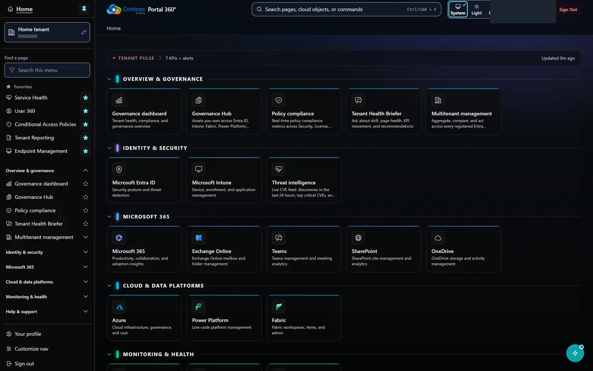
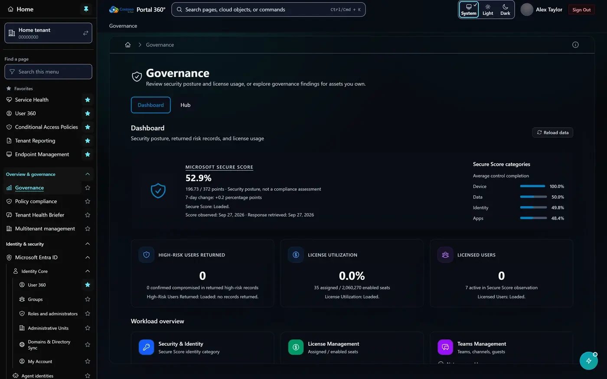
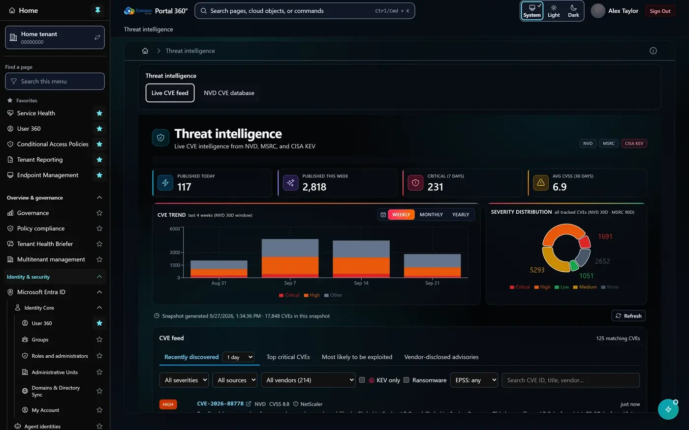
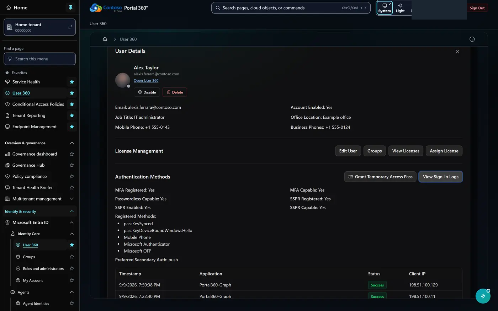
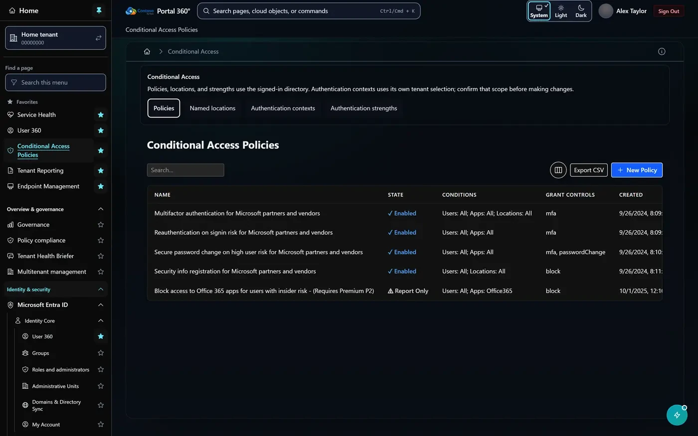
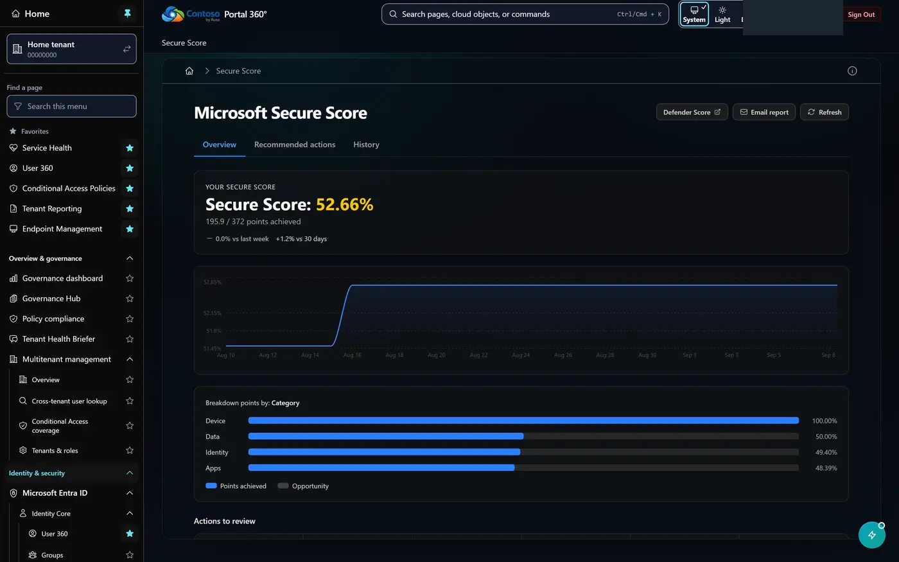
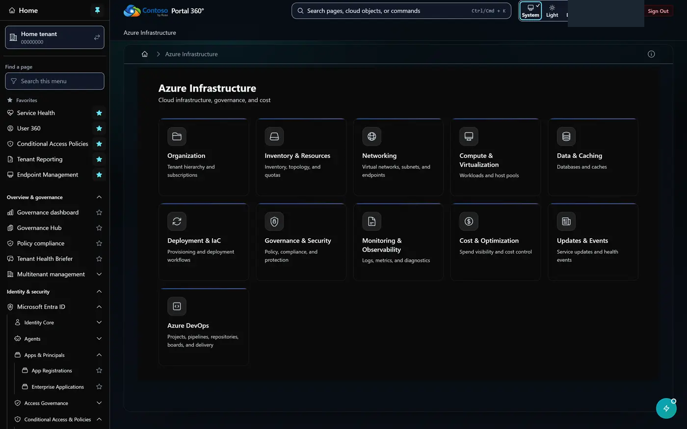
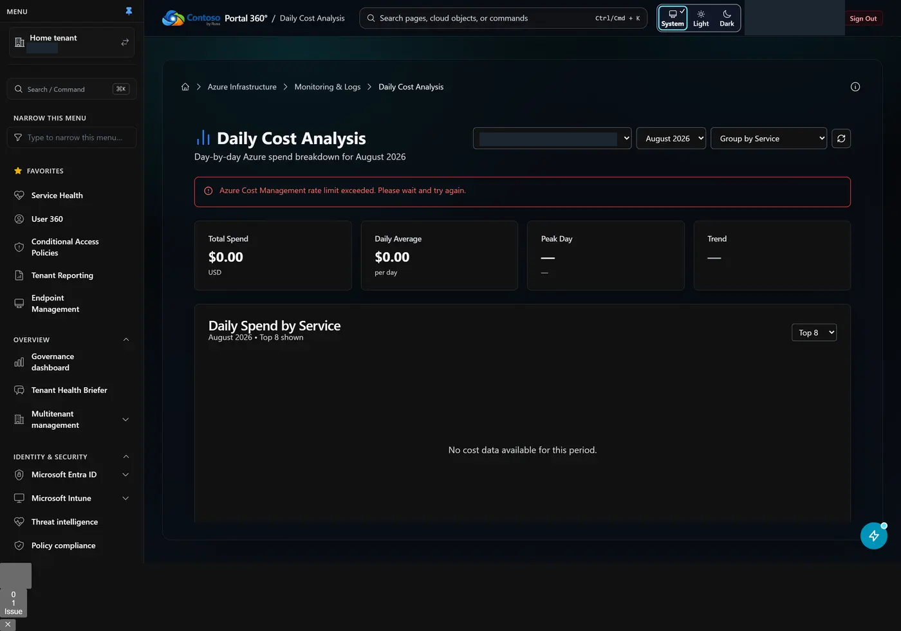
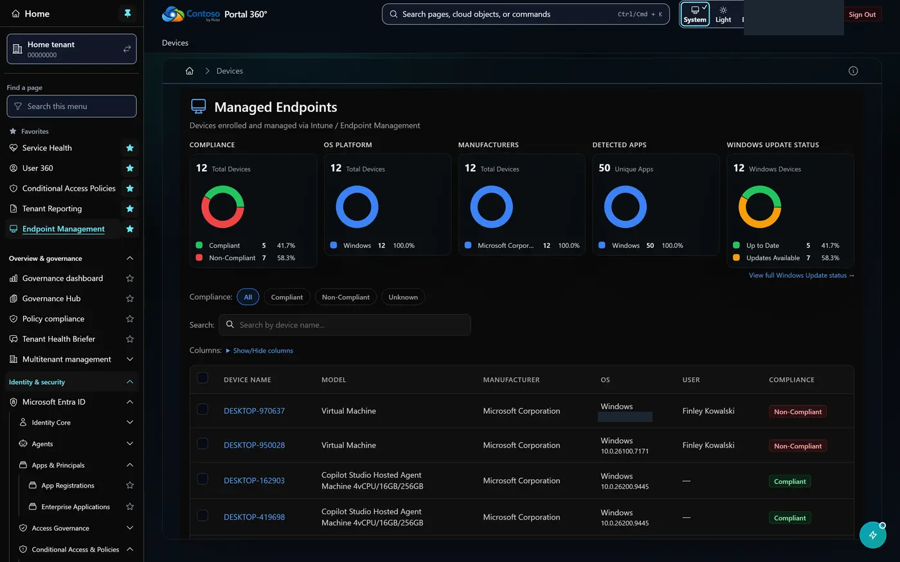
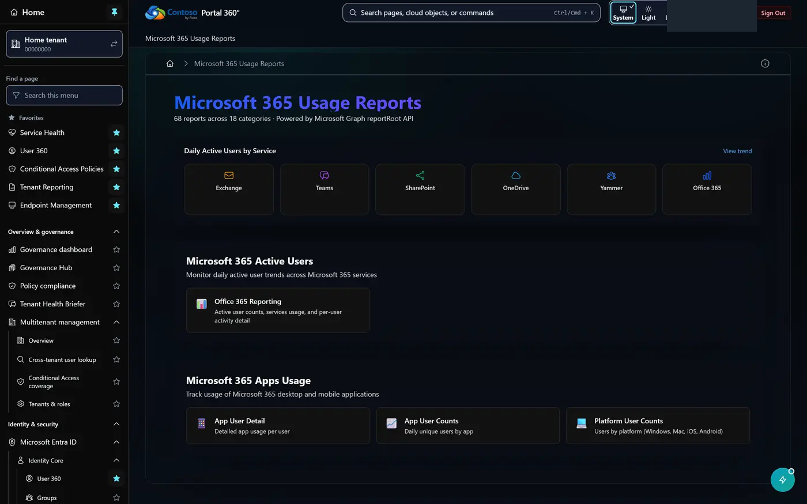

# Portal 360° screenshot gallery

A visual tour of every page in Portal 360°, the unified administration portal for
Microsoft Entra ID, Microsoft 365, Intune, Azure, Power Platform, Microsoft Fabric,
and Azure DevOps.

**310 of 449 pages** are pictured below in 314 screenshots, captured from the authenticated app in dark mode.

This refresh accepted 75 screenshots with strict loading, error, and redaction gates.
239 previously published images were retained; their presence does not establish that those pages passed this refresh.

For a shorter, narrative walkthrough of the marquee pages, see the
[product tour](TOUR.md).

Ready upload tools, chat panels, and creation wizards are marked **initial form**.
These show the loaded starting interface, not a completed operation or invented results.

> **All tenant data in these images is redacted.** Email addresses, user and device
> names, GUIDs, IP and MAC addresses, phone numbers, serial numbers, and tenant
> domains are replaced with deterministic fictional stand-ins at capture time, and
> profile photos are blurred. See `scripts/screenshot-redaction.mjs`.

## Highlights

### Home

`/`



### Governance

`/dashboard`



### Threat intelligence

`/security-pulse`



### User 360 — User details — Sign-In Logs

`/users`



### Conditional Access Policies

`/conditional-access`



### Secure Score

`/secure-score`



### Azure Infrastructure

`/azure/infrastructure`



### Daily Cost Analysis

`/azure/daily-costs`



### Devices

`/device-management/devices`



### Microsoft 365 Usage Reports

`/reports`



## Every page

Click any page name to open its full screenshot.

### Overview

| Page | Route | Screenshot | Refresh status |
| --- | --- | --- | --- |
| Home | `/` | [View](home.webp) | Updated |
| About Portal 360° | `/about` | [View](about.webp) | Updated |
| Governance | `/dashboard` | [View](dashboard.webp) | Updated |
| Policy compliance | `/playbooks` | [View](playbooks.webp) | Previous image retained; not refreshed |
| Threat intelligence | `/security-pulse` | [View](security-pulse.webp) | Updated |
| CVE | `/security-pulse/cve` | [View](security-pulse-cve.webp) | Previous image retained; not refreshed |

### Microsoft 365 & Copilot

| Page | Route | Screenshot | Refresh status |
| --- | --- | --- | --- |
| M365 Activity | `/microsoft365/activity` | [View](microsoft365-activity.webp) | Previous image retained; not refreshed |
| Agent Identities | `/microsoft365/agent-identity` | [View](microsoft365-agent-identity.webp) | Previous image retained; not refreshed |
| Agent Identity Blueprints | `/microsoft365/agent-identity-blueprints` | [View](microsoft365-agent-identity-blueprints.webp) | Updated |
| Agent Users | `/microsoft365/agent-users` | [View](microsoft365-agent-users.webp) | Updated |
| Copilot | `/microsoft365/copilot` | [View](microsoft365-copilot.webp) | Previous image retained; not refreshed |
| Copilot Agents | `/microsoft365/copilot/agents` | [View](microsoft365-copilot-agents.webp) | Updated |
| Copilot Chat | `/microsoft365/copilot/chat` | [View](microsoft365-copilot-chat.webp) | Previous image retained; not refreshed |
| Copilot Readiness | `/microsoft365/copilot/readiness` | [View](microsoft365-copilot-readiness.webp) | Updated |
| Copilot Usage | `/microsoft365/copilot/user-count` | [View](microsoft365-copilot-user-count.webp) | Updated |
| Microsoft 365 Updates | `/microsoft365/updates` | [View](microsoft365-updates.webp) | Previous image retained; not refreshed |
| Work IQ Chat | `/microsoft365/work-iq` | [View](microsoft365-work-iq.webp) | Updated |
| Work IQ Governance | `/microsoft365/work-iq/governance` | [View](microsoft365-work-iq-governance.webp) | Previous image retained; not refreshed |

### Identity & Access

| Page | Route | Screenshot | Refresh status |
| --- | --- | --- | --- |
| Access Reviews | `/access-reviews` | [View](access-reviews.webp) | Previous image retained; not refreshed |
| App Registrations | `/applications` | [View](applications.webp) | Updated |
| Enterprise Applications | `/enterprise-applications` | [View](enterprise-applications.webp) | Updated |
| Access Packages | `/entitlement/access-packages` | [View](entitlement-access-packages.webp) | Previous image retained; not refreshed |
| Catalogs | `/entitlement/catalogs` | [View](entitlement-catalogs.webp) | Previous image retained; not refreshed |
| My Access | `/entitlement/my-access` | [View](entitlement-my-access.webp) | Previous image retained; not refreshed |
| Admin consent requests | `/entra/admin-consent-requests` | [View](entra-admin-consent-requests.webp) | Updated |
| Administrative units | `/entra/administrative-units` | [View](entra-administrative-units.webp) | Updated |
| Domains & directory sync | `/entra/domains` | [View](entra-domains.webp) | Updated |
| Roles and administrators | `/entra/roles-and-administrators` | [View](entra-roles-and-administrators.webp) | Previous image retained; not refreshed |
| Groups | `/groups` | [View](groups.webp) | Updated |
| Lifecycle Workflows | `/lifecycle-workflows` | [View](lifecycle-workflows.webp) | Previous image retained; not refreshed |
| Assign Roles | `/pim/assign-roles` | [View](pim-assign-roles.webp) | Previous image retained; not refreshed |
| My Roles | `/pim/my-roles` | [View](pim-my-roles.webp) | Previous image retained; not refreshed |
| Role Assignments | `/pim/role-assignments` | [View](pim-role-assignments.webp) | Previous image retained; not refreshed |
| My Profile | `/profile` | [View](profile.webp) | Updated |
| User 360 | `/users` | [View](users.webp) | Updated |
| User 360 — User details | `/users` | [View](users--user-details.webp) | Previous image retained; not refreshed |
| User 360 — User details — Groups | `/users` | [View](users--user-details-groups.webp) | Previous image retained; not refreshed |
| User 360 — User details — Licenses | `/users` | [View](users--user-details-licenses.webp) | Previous image retained; not refreshed |
| User 360 — User details — Sign-In Logs | `/users` | [View](users--user-details-signin-logs.webp) | Previous image retained; not refreshed |
| User 360 | `/users/360` | [View](users-360.webp) | Previous image retained; not refreshed |
| Create User | `/users/create-user` | [View](users-create-user.webp) | Previous image retained; not refreshed |
| Invite Guest | `/users/invite-guest` | [View](users-invite-guest.webp) | Previous image retained; not refreshed |

### Conditional Access & Policy

| Page | Route | Screenshot | Refresh status |
| --- | --- | --- | --- |
| App Management Policies | `/app-management-policies` | [View](app-management-policies.webp) | Previous image retained; not refreshed |
| Authentication Contexts | `/authentication-contexts` | [View](authentication-contexts.webp) | Updated |
| Authentication Strength Policies | `/authentication-strength` | [View](authentication-strength.webp) | Previous image retained; not refreshed |
| Authorization Policy | `/authorization-policy` | [View](authorization-policy.webp) | Previous image retained; not refreshed |
| Conditional Access Policies | `/conditional-access` | [View](conditional-access.webp) | Updated |
| Cross Tenant Access | `/cross-tenant-access` | [View](cross-tenant-access.webp) | Previous image retained; not refreshed |
| Security Defaults | `/security-defaults` | [View](security-defaults.webp) | Previous image retained; not refreshed |
| Token Lifetime Policies | `/token-lifetime-policies` | [View](token-lifetime-policies.webp) | Previous image retained; not refreshed |

### Security & Risk

| Page | Route | Screenshot | Refresh status |
| --- | --- | --- | --- |
| Defender for Endpoint | `/defender-atp` | [View](defender-atp.webp) | Updated |
| Discovered Cloud Apps | `/defender-cloud-apps/discovered-apps` | [View](defender-cloud-apps-discovered-apps.webp) | Previous image retained; not refreshed |
| Legacy Authentication | `/insights/legacy-auth` | [View](insights-legacy-auth.webp) | Previous image retained; not refreshed |
| MFA Registration Gap | `/insights/mfa-gap` | [View](insights-mfa-gap.webp) | Previous image retained; not refreshed |
| Stale Licensed Users | `/insights/stale-users` | [View](insights-stale-users.webp) | Previous image retained; not refreshed |
| NIST NVD (CVE Database) | `/nvd` | [View](nvd.webp) | Previous image retained; not refreshed |
| Risky Service Principals | `/risky-service-principals` | [View](risky-service-principals.webp) | Previous image retained; not refreshed |
| Risky Users | `/risky-users` | [View](risky-users.webp) | Updated |
| Secure Score | `/secure-score` | [View](secure-score.webp) | Previous image retained; not refreshed |
| Defender Secure Score | `/secure-score/defender` | [View](secure-score-defender.webp) | Previous image retained; not refreshed |
| Security Alerts | `/security-alerts` | [View](security-alerts.webp) | Updated |

### Sign-in & Audit Logs

| Page | Route | Screenshot | Refresh status |
| --- | --- | --- | --- |
| Audit Log Queries | `/audit-log-queries` | [View](audit-log-queries.webp) | Updated |
| Audit Logs | `/audit-logs` | [View](audit-logs.webp) | Previous image retained; not refreshed |
| Blocked Sign-ins | `/conditional-access-blocked-signins` | [View](conditional-access-blocked-signins.webp) | Previous image retained; not refreshed |
| MFA Sign-ins | `/mfa-signins` | [View](mfa-signins.webp) | Previous image retained; not refreshed |
| Provisioning Logs | `/provisioning-logs` | [View](provisioning-logs.webp) | Previous image retained; not refreshed |
| Service Principal Sign-Ins | `/service-principal-signins` | [View](service-principal-signins.webp) | Updated |
| User Registration Details | `/user-registration-details` | [View](user-registration-details.webp) | Previous image retained; not refreshed |

### Azure

| Page | Route | Screenshot | Refresh status |
| --- | --- | --- | --- |
| App Insights AI Analysis | `/application-insights-exceptions` | [View](application-insights-exceptions.webp) | Previous image retained; not refreshed |
| Azure resources | `/azure` | [View](azure.webp) | Previous image retained; not refreshed |
| Advisor | `/azure/advisor` | [View](azure-advisor.webp) | Updated |
| Microsoft Foundry | `/azure/ai-foundry` | [View](azure-ai-foundry.webp) | Previous image retained; not refreshed |
| Projects | `/azure/ai-foundry/account-projects` | [View](azure-ai-foundry-account-projects.webp) | Previous image retained; not refreshed |
| All Resources | `/azure/ai-foundry/accounts` | [View](azure-ai-foundry-accounts.webp) | Previous image retained; not refreshed |
| Agent Chat | `/azure/ai-foundry/agent-chat` | [View](azure-ai-foundry-agent-chat.webp) | Updated |
| List Agents | `/azure/ai-foundry/agents` | [View](azure-ai-foundry-agents.webp) | Previous image retained; not refreshed |
| Model Deployments | `/azure/ai-foundry/deployments` | [View](azure-ai-foundry-deployments.webp) | Previous image retained; not refreshed |
| Available Models | `/azure/ai-foundry/models` | [View](azure-ai-foundry-models.webp) | Previous image retained; not refreshed |
| Costs & Quotas | `/azure/ai-foundry/usage` | [View](azure-ai-foundry-usage.webp) | Previous image retained; not refreshed |
| Allowed Connections | `/azure/allowed-connections` | [View](azure-allowed-connections.webp) | Previous image retained; not refreshed |
| Bicep Tools | `/azure/bicep` | [View](azure-bicep.webp) | Previous image retained; not refreshed |
| Budgets | `/azure/budgets` | [View](azure-budgets.webp) | Previous image retained; not refreshed |
| Cost Overview | `/azure/cost-management` | [View](azure-cost-management.webp) | Previous image retained; not refreshed |
| Daily Cost Analysis | `/azure/daily-costs` | [View](azure-daily-costs.webp) | Previous image retained; not refreshed |
| Bicep Export | `/azure/deploy` | [View](azure-deploy.webp) | Previous image retained; not refreshed |
| Deployment Stacks | `/azure/deployment-stacks` | [View](azure-deployment-stacks.webp) | Previous image retained; not refreshed |
| Emerging Issues | `/azure/emerging-issues` | [View](azure-emerging-issues.webp) | Previous image retained; not refreshed |
| Forecasts | `/azure/forecasts` | [View](azure-forecasts.webp) | Previous image retained; not refreshed |
| Health & Compliance | `/azure/health-compliance` | [View](azure-health-compliance.webp) | Updated |
| Azure Infrastructure | `/azure/infrastructure` | [View](azure-infrastructure.webp) | Previous image retained; not refreshed |
| License Usage | `/azure/license-usage` | [View](azure-license-usage.webp) | Previous image retained; not refreshed |
| Azure Monitor Metrics | `/azure/metrics` | [View](azure-metrics.webp) | Previous image retained; not refreshed |
| Azure Monitor alerts | `/azure/monitor-alerts` | [View](azure-monitor-alerts.webp) | Updated |
| Azure Monitor API Coverage | `/azure/monitor-api-coverage` | [View](azure-monitor-api-coverage.webp) | Previous image retained; not refreshed |
| Monitoring & Logs | `/azure/monitoring-logs` | [View](azure-monitoring-logs.webp) | Previous image retained; not refreshed |
| Azure Policy | `/azure/policy` | [View](azure-policy.webp) | Updated |
| Policy Assignments | `/azure/policy/assignments` | [View](azure-policy-assignments.webp) | Previous image retained; not refreshed |
| Policy Definitions | `/azure/policy/definitions` | [View](azure-policy-definitions.webp) | Previous image retained; not refreshed |
| Private Endpoints | `/azure/private-endpoints` | [View](azure-private-endpoints.webp) | Previous image retained; not refreshed |
| Public IP Addresses | `/azure/public-ip-addresses` | [View](azure-public-ip-addresses.webp) | Previous image retained; not refreshed |
| Quota Management | `/azure/quota-requests` | [View](azure-quota-requests.webp) | Updated |
| Redis Cache Inventory | `/azure/redis-caches` | [View](azure-redis-caches.webp) | Updated |
| Resource Details | `/azure/resource-details` | [View](azure-resource-details.webp) | Previous image retained; not refreshed |
| Resource Management | `/azure/resource-management` | [View](azure-resource-management.webp) | Previous image retained; not refreshed |
| Resource Type Browser | `/azure/resource-types` | [View](azure-resource-types.webp) | Previous image retained; not refreshed |
| Azure resources | `/azure/resources` | [View](azure-resources.webp) | Previous image retained; not refreshed |
| Access control (IAM) | `/azure/role-assignments` | [View](azure-role-assignments.webp) | Updated |
| Regulatory Compliance | `/azure/security/compliance-results` | [View](azure-security-compliance-results.webp) | Previous image retained; not refreshed |
| Azure Service Health Events | `/azure/service-health-events` | [View](azure-service-health-events.webp) | Previous image retained; not refreshed |
| Service Retirements | `/azure/service-retirements` | [View](azure-service-retirements.webp) | Updated |
| SQL Databases | `/azure/sql-databases` | [View](azure-sql-databases.webp) | Updated |
| Agent Governance | `/azure/sre-agent/governance` | [View](azure-sre-agent-governance.webp) | Previous image retained; not refreshed |
| Agent Unit Consumption | `/azure/sre-agent/usage` | [View](azure-sre-agent-usage.webp) | Previous image retained; not refreshed |
| Subnets | `/azure/subnets` | [View](azure-subnets.webp) | Previous image retained; not refreshed |
| Subscriptions | `/azure/subscriptions` | [View](azure-subscriptions.webp) | Previous image retained; not refreshed |
| Azure Updates | `/azure/updates` | [View](azure-updates.webp) | Previous image retained; not refreshed |
| Host Pools | `/azure/virtual-desktop/host-pools` | [View](azure-virtual-desktop-host-pools.webp) | Previous image retained; not refreshed |
| Virtual Networks | `/azure/virtual-networks` | [View](azure-virtual-networks.webp) | Previous image retained; not refreshed |

### Power Platform

| Page | Route | Screenshot | Refresh status |
| --- | --- | --- | --- |
| Power Apps | `/power-platform/apps` | [View](power-platform-apps.webp) | Updated |
| Connector Catalog | `/power-platform/connectors` | [View](power-platform-connectors.webp) | Previous image retained; not refreshed |
| Copilot & AI Governance | `/power-platform/copilot-governance` | [View](power-platform-copilot-governance.webp) | Previous image retained; not refreshed |
| Copilot Studio Agents | `/power-platform/copilot-studio` | [View](power-platform-copilot-studio.webp) | Updated |
| Agent Builder | `/power-platform/copilot-studio/agent-builder` | [View](power-platform-copilot-studio-agent-builder.webp) | Updated |
| Agent Review | `/power-platform/copilot-studio/agent-review` | [View](power-platform-copilot-studio-agent-review.webp) | Updated |
| Agent Connector Report | `/power-platform/copilot-studio/connector-report` | [View](power-platform-copilot-studio-connector-report.webp) | Previous image retained; not refreshed |
| Copilot Credit Governance | `/power-platform/copilot-studio/credit-governance` | [View](power-platform-copilot-studio-credit-governance.webp) | Updated |
| Copilot Studio Dashboard | `/power-platform/copilot-studio/dashboard` | [View](power-platform-copilot-studio-dashboard.webp) | Previous image retained; not refreshed |
| Copilot Studio Monitoring | `/power-platform/copilot-studio/monitoring` | [View](power-platform-copilot-studio-monitoring.webp) | Previous image retained; not refreshed |
| Threat Protection | `/power-platform/copilot-studio/threat-protection` | [View](power-platform-copilot-studio-threat-protection.webp) | Updated |
| User Prompt Report | `/power-platform/copilot-studio/user-prompt-report` | [View](power-platform-copilot-studio-user-prompt-report.webp) | Previous image retained; not refreshed |
| Dataverse Storage | `/power-platform/dataverse-storage` | [View](power-platform-dataverse-storage.webp) | Updated |
| DLP Policies | `/power-platform/dlp-policies` | [View](power-platform-dlp-policies.webp) | Previous image retained; not refreshed |
| Environment Groups | `/power-platform/environment-groups` | [View](power-platform-environment-groups.webp) | Previous image retained; not refreshed |
| Environment Variables | `/power-platform/environment-variables` | [View](power-platform-environment-variables.webp) | Previous image retained; not refreshed |
| Request Environment | `/power-platform/environments/request` | [View](power-platform-environments-request.webp) | Updated |
| ERD Generator | `/power-platform/erd-generator` | [View](power-platform-erd-generator.webp) | Updated |
| Desktop Flow Run Logs | `/power-platform/flow-logs` | [View](power-platform-flow-logs.webp) | Updated |
| Flow Operations Catalog | `/power-platform/flow-operations` | [View](power-platform-flow-operations.webp) | Previous image retained; not refreshed |
| Power Automate Flows | `/power-platform/flows` | [View](power-platform-flows.webp) | Updated |
| Advanced Connector Policies | `/power-platform/governance/advanced-connector-policies` | [View](power-platform-governance-advanced-connector-policies.webp) | Previous image retained; not refreshed |
| Cross Tenant Reports | `/power-platform/governance/cross-tenant-reports` | [View](power-platform-governance-cross-tenant-reports.webp) | Updated |
| Environment Governance Policies | `/power-platform/governance/environment-policies` | [View](power-platform-governance-environment-policies.webp) | Previous image retained; not refreshed |
| Human Review Queue | `/power-platform/governance/human-review` | [View](power-platform-governance-human-review.webp) | Previous image retained; not refreshed |
| Rule-based Policies | `/power-platform/governance/rule-based-policies` | [View](power-platform-governance-rule-based-policies.webp) | Previous image retained; not refreshed |
| Grant SPN System Administrator | `/power-platform/grant-spn-bulk` | [View](power-platform-grant-spn-bulk.webp) | Previous image retained; not refreshed |
| Inventory Reports | `/power-platform/inventory-reports` | [View](power-platform-inventory-reports.webp) | Updated |
| Desktop Flows | `/power-platform/inventory-reports/desktop-flows` | [View](power-platform-inventory-reports-desktop-flows.webp) | Updated |
| M365 Workflow Agent Flows | `/power-platform/inventory-reports/m365-agent-flows` | [View](power-platform-inventory-reports-m365-agent-flows.webp) | Updated |
| Known Issues | `/power-platform/known-issues` | [View](power-platform-known-issues.webp) | Updated |
| Billing Plans | `/power-platform/licensing/billing-policies` | [View](power-platform-licensing-billing-policies.webp) | Updated |
| Pay-as-you-go Guardrails | `/power-platform/licensing/payg-guardrails` | [View](power-platform-licensing-payg-guardrails.webp) | Updated |
| Tenant Capacity Details | `/power-platform/licensing/tenant-capacity` | [View](power-platform-licensing-tenant-capacity.webp) | Updated |
| User Per Flow Capacity | `/power-platform/licensing/user-per-flow-capacity` | [View](power-platform-licensing-user-per-flow-capacity.webp) | Updated |
| Managed App Builder | `/power-platform/managed-apps` | [View](power-platform-managed-apps.webp) | Updated |
| Recommendations | `/power-platform/recommendations` | [View](power-platform-recommendations.webp) | Previous image retained; not refreshed |
| Release Plans | `/power-platform/release-planner` | [View](power-platform-release-planner.webp) | Previous image retained; not refreshed |
| Security Roles | `/power-platform/security-roles` | [View](power-platform-security-roles.webp) | Previous image retained; not refreshed |
| Solution Analysis | `/power-platform/solutions/analyze` | [View](power-platform-solutions-analyze.webp) | Updated |
| Tenant Settings | `/power-platform/tenant-settings` | [View](power-platform-tenant-settings.webp) | Previous image retained; not refreshed |
| Usage | `/power-platform/usage` | [View](power-platform-usage.webp) | Updated |

### Device Management & Intune

| Page | Route | Screenshot | Refresh status |
| --- | --- | --- | --- |
| Application Management | `/application-management` | [View](application-management.webp) | Previous image retained; not refreshed |
| App Configuration Policies | `/application-management/app-configuration-policies` | [View](application-management-app-configuration-policies.webp) | Previous image retained; not refreshed |
| Detected Apps | `/application-management/detected-apps` | [View](application-management-detected-apps.webp) | Previous image retained; not refreshed |
| Intune Managed Apps | `/application-management/intune-apps` | [View](application-management-intune-apps.webp) | Previous image retained; not refreshed |
| Managed App Registrations | `/application-management/managed-app-registrations` | [View](application-management-managed-app-registrations.webp) | Updated |
| Microsoft Intune | `/device-management` | [View](device-management.webp) | Previous image retained; not refreshed |
| Android Enterprise | `/device-management/android-enterprise` | [View](device-management-android-enterprise.webp) | Previous image retained; not refreshed |
| App Protection Policies | `/device-management/app-protection` | [View](device-management-app-protection.webp) | Previous image retained; not refreshed |
| Autopilot Profiles | `/device-management/autopilot-profiles` | [View](device-management-autopilot-profiles.webp) | Previous image retained; not refreshed |
| Compliance Policies | `/device-management/compliance-policies` | [View](device-management-compliance-policies.webp) | Updated |
| Compliance Status | `/device-management/compliance-status` | [View](device-management-compliance-status.webp) | Previous image retained; not refreshed |
| Windows CVE Report | `/device-management/cve-report` | [View](device-management-cve-report.webp) | Previous image retained; not refreshed |
| Devices | `/device-management/devices` | [View](device-management-devices.webp) | Previous image retained; not refreshed |
| Device details | `/device-management/devices/[deviceId]` | [View](device-management-devices--device-profile.webp) | Previous image retained; not refreshed |
| Driver Update Profiles | `/device-management/driver-update-profiles` | [View](device-management-driver-update-profiles.webp) | Previous image retained; not refreshed |
| Encryption Report | `/device-management/encryption-report` | [View](device-management-encryption-report.webp) | Previous image retained; not refreshed |
| Enrollment Report | `/device-management/enrollment-report` | [View](device-management-enrollment-report.webp) | Previous image retained; not refreshed |
| Enrollment Restrictions | `/device-management/enrollment-restrictions` | [View](device-management-enrollment-restrictions.webp) | Previous image retained; not refreshed |
| Feature Update Profiles | `/device-management/feature-update-profiles` | [View](device-management-feature-update-profiles.webp) | Previous image retained; not refreshed |
| Intune Audit Logs | `/device-management/intune-audit-logs` | [View](device-management-intune-audit-logs.webp) | Previous image retained; not refreshed |
| Non-Compliance Report | `/device-management/non-compliance-report` | [View](device-management-non-compliance-report.webp) | Previous image retained; not refreshed |
| Policy Assignments | `/device-management/policy-assignments` | [View](device-management-policy-assignments.webp) | Previous image retained; not refreshed |
| RBAC Roles | `/device-management/rbac-roles` | [View](device-management-rbac-roles.webp) | Previous image retained; not refreshed |
| Intune Reports | `/device-management/reports` | [View](device-management-reports.webp) | Previous image retained; not refreshed |
| Settings Catalog | `/device-management/settings-catalog` | [View](device-management-settings-catalog.webp) | Previous image retained; not refreshed |
| Terms and Conditions | `/device-management/terms-and-conditions` | [View](device-management-terms-and-conditions.webp) | Previous image retained; not refreshed |
| Update Rings | `/device-management/update-rings` | [View](device-management-update-rings.webp) | Previous image retained; not refreshed |
| Windows Update Status | `/device-management/windows-update-status` | [View](device-management-windows-update-status.webp) | Previous image retained; not refreshed |
| Windows Updates | `/windows-updates` | [View](windows-updates.webp) | Previous image retained; not refreshed |
| Windows Updates Catalog | `/windows-updates/catalog` | [View](windows-updates-catalog.webp) | Previous image retained; not refreshed |

### Exchange, Teams & SharePoint

| Page | Route | Screenshot | Refresh status |
| --- | --- | --- | --- |
| Exchange Admin Dashboard | `/exchange/admin-dashboard` | [View](exchange-admin-dashboard.webp) | Previous image retained; not refreshed |
| Mailbox Folders | `/exchange/mailbox-folders` | [View](exchange-mailbox-folders.webp) | Updated |
| Mailboxes | `/exchange/mailboxes` | [View](exchange-mailboxes.webp) | Previous image retained; not refreshed |
| SharePoint Settings | `/sharepoint-settings` | [View](sharepoint-settings.webp) | Previous image retained; not refreshed |
| SharePoint | `/sharepoint-sites` | [View](sharepoint-sites.webp) | Updated |
| SharePoint Format Editor | `/sharepoint/format-editor` | [View](sharepoint-format-editor.webp) | Previous image retained; not refreshed |
| SharePoint Search | `/sharepoint/search` | [View](sharepoint-search.webp) | Previous image retained; not refreshed |
| Teams List | `/teams/list-teams` | [View](teams-list-teams.webp) | Previous image retained; not refreshed |
| Transcripts | `/teams/transcripts` | [View](teams-transcripts.webp) | Updated |
| Teams User Activity | `/teams/user-activity` | [View](teams-user-activity.webp) | Previous image retained; not refreshed |

### Microsoft Fabric

| Page | Route | Screenshot | Refresh status |
| --- | --- | --- | --- |
| Fabric | `/fabric` | [View](fabric.webp) | Previous image retained; not refreshed |
| Activity events | `/fabric/admin/activity-events` | [View](fabric-admin-activity-events.webp) | Previous image retained; not refreshed |
| Domains | `/fabric/admin/domains` | [View](fabric-admin-domains.webp) | Previous image retained; not refreshed |
| Tenant settings | `/fabric/admin/tenant-settings` | [View](fabric-admin-tenant-settings.webp) | Previous image retained; not refreshed |
| Workspaces | `/fabric/admin/workspaces` | [View](fabric-admin-workspaces.webp) | Previous image retained; not refreshed |
| Capacities | `/fabric/capacities` | [View](fabric-capacities.webp) | Updated |
| Dashboards | `/fabric/dashboards` | [View](fabric-dashboards.webp) | Previous image retained; not refreshed |
| Data pipelines | `/fabric/data-pipelines` | [View](fabric-data-pipelines.webp) | Previous image retained; not refreshed |
| Domains | `/fabric/domains` | [View](fabric-domains.webp) | Previous image retained; not refreshed |
| Spark environments | `/fabric/environments` | [View](fabric-environments.webp) | Previous image retained; not refreshed |
| Eventhouses | `/fabric/eventhouses` | [View](fabric-eventhouses.webp) | Previous image retained; not refreshed |
| Eventstreams | `/fabric/eventstreams` | [View](fabric-eventstreams.webp) | Previous image retained; not refreshed |
| KQL databases | `/fabric/kql-databases` | [View](fabric-kql-databases.webp) | Previous image retained; not refreshed |
| Lakehouses | `/fabric/lakehouses` | [View](fabric-lakehouses.webp) | Previous image retained; not refreshed |
| Lakehouse details | `/fabric/lakehouses/[workspaceId]/[lakehouseId]` | [View](fabric-lakehouses--lakehouse-profile.webp) | Previous image retained; not refreshed |
| Mirrored databases | `/fabric/mirrored-databases` | [View](fabric-mirrored-databases.webp) | Previous image retained; not refreshed |
| ML experiments | `/fabric/ml-experiments` | [View](fabric-ml-experiments.webp) | Previous image retained; not refreshed |
| ML models | `/fabric/ml-models` | [View](fabric-ml-models.webp) | Previous image retained; not refreshed |
| Notebooks | `/fabric/notebooks` | [View](fabric-notebooks.webp) | Previous image retained; not refreshed |
| Reports | `/fabric/reports` | [View](fabric-reports.webp) | Previous image retained; not refreshed |
| Semantic models | `/fabric/semantic-models` | [View](fabric-semantic-models.webp) | Previous image retained; not refreshed |
| Workspace details | `/fabric/workspaces/[workspaceId]` | [View](fabric-workspaces-list--workspace-profile.webp) | Previous image retained; not refreshed |
| Workspace item details | `/fabric/workspaces/[workspaceId]/items/[itemId]` | [View](fabric-workspaces-list--item-profile.webp) | Previous image retained; not refreshed |
| Create workspace | `/fabric/workspaces/create` | [View](fabric-workspaces-create.webp) | Previous image retained; not refreshed |
| Workspaces | `/fabric/workspaces/list` | [View](fabric-workspaces-list.webp) | Previous image retained; not refreshed |

### Azure DevOps

| Page | Route | Screenshot | Refresh status |
| --- | --- | --- | --- |
| Area Paths & Iterations | `/devops/area-paths` | [View](devops-area-paths.webp) | Previous image retained; not refreshed |
| Environments | `/devops/environments` | [View](devops-environments.webp) | Previous image retained; not refreshed |
| GitHub Connections | `/devops/github-connections` | [View](devops-github-connections.webp) | Previous image retained; not refreshed |
| Permissions | `/devops/permissions` | [View](devops-permissions.webp) | Previous image retained; not refreshed |
| Delivery Plans | `/devops/plans` | [View](devops-plans.webp) | Previous image retained; not refreshed |
| Project Configuration | `/devops/project-config` | [View](devops-project-config.webp) | Previous image retained; not refreshed |
| Projects | `/devops/projects` | [View](devops-projects.webp) | Previous image retained; not refreshed |
| Pull Requests | `/devops/pull-requests` | [View](devops-pull-requests.webp) | Previous image retained; not refreshed |

### Service Health & Messages

| Page | Route | Screenshot | Refresh status |
| --- | --- | --- | --- |
| Message Center | `/message-center` | [View](message-center.webp) | Updated |

### Reports & Analytics

| Page | Route | Screenshot | Refresh status |
| --- | --- | --- | --- |
| ServiceNow Incident Analytics | `/analytics/servicenow-incidents` | [View](analytics-servicenow-incidents.webp) | Previous image retained; not refreshed |
| Microsoft 365 Usage Reports | `/reports` | [View](reports.webp) | Updated |
| Browser Distribution User Counts | `/reports/browser-distribution-user-counts` | [View](reports-browser-distribution-user-counts.webp) | Previous image retained; not refreshed |
| Browser User Counts | `/reports/browser-user-counts` | [View](reports-browser-user-counts.webp) | Previous image retained; not refreshed |
| Email Activity Counts | `/reports/email-activity-counts` | [View](reports-email-activity-counts.webp) | Previous image retained; not refreshed |
| Email Activity User Counts | `/reports/email-activity-user-counts` | [View](reports-email-activity-user-counts.webp) | Previous image retained; not refreshed |
| Email App Usage Apps User Counts | `/reports/email-app-usage-apps-user-counts` | [View](reports-email-app-usage-apps-user-counts.webp) | Previous image retained; not refreshed |
| Email App Usage User Counts | `/reports/email-app-usage-user-counts` | [View](reports-email-app-usage-user-counts.webp) | Previous image retained; not refreshed |
| Email App Usage Versions User Counts | `/reports/email-app-usage-versions-user-counts` | [View](reports-email-app-usage-versions-user-counts.webp) | Previous image retained; not refreshed |
| M365 App Platform User Counts | `/reports/m365-app-platform-user-counts` | [View](reports-m365-app-platform-user-counts.webp) | Previous image retained; not refreshed |
| M365 App User Counts | `/reports/m365-app-user-counts` | [View](reports-m365-app-user-counts.webp) | Updated |
| Mailbox Usage Detail | `/reports/mailbox-usage-detail` | [View](reports-mailbox-usage-detail.webp) | Previous image retained; not refreshed |
| Mailbox Usage Mailbox Counts | `/reports/mailbox-usage-mailbox-counts` | [View](reports-mailbox-usage-mailbox-counts.webp) | Previous image retained; not refreshed |
| Mailbox Usage Quota Status | `/reports/mailbox-usage-quota-status-mailbox-counts` | [View](reports-mailbox-usage-quota-status-mailbox-counts.webp) | Previous image retained; not refreshed |
| Mailbox Usage Storage | `/reports/mailbox-usage-storage` | [View](reports-mailbox-usage-storage.webp) | Previous image retained; not refreshed |
| Copilot Usage User Detail | `/reports/microsoft365-copilot-usage-user-detail` | [View](reports-microsoft365-copilot-usage-user-detail.webp) | Previous image retained; not refreshed |
| Copilot User Count Summary | `/reports/microsoft365-copilot-user-count-summary` | [View](reports-microsoft365-copilot-user-count-summary.webp) | Previous image retained; not refreshed |
| Copilot User Count Trend | `/reports/microsoft365-copilot-user-count-trend` | [View](reports-microsoft365-copilot-user-count-trend.webp) | Previous image retained; not refreshed |
| Office 365 Activation Counts | `/reports/office365-activation-counts` | [View](reports-office365-activation-counts.webp) | Previous image retained; not refreshed |
| Office 365 Activations User Counts | `/reports/office365-activations-user-counts` | [View](reports-office365-activations-user-counts.webp) | Previous image retained; not refreshed |
| Office 365 Activations User Detail | `/reports/office365-activations-user-detail` | [View](reports-office365-activations-user-detail.webp) | Previous image retained; not refreshed |
| M365 Groups Activity Counts | `/reports/office365-groups-activity-counts` | [View](reports-office365-groups-activity-counts.webp) | Previous image retained; not refreshed |
| M365 Groups Activity Detail | `/reports/office365-groups-activity-detail` | [View](reports-office365-groups-activity-detail.webp) | Previous image retained; not refreshed |
| M365 Groups Activity File Counts | `/reports/office365-groups-activity-file-counts` | [View](reports-office365-groups-activity-file-counts.webp) | Previous image retained; not refreshed |
| M365 Groups Activity Group Counts | `/reports/office365-groups-activity-group-counts` | [View](reports-office365-groups-activity-group-counts.webp) | Previous image retained; not refreshed |
| M365 Groups Activity Storage | `/reports/office365-groups-activity-storage` | [View](reports-office365-groups-activity-storage.webp) | Previous image retained; not refreshed |
| Office 365 Reporting | `/reports/office365-reporting` | [View](reports-office365-reporting.webp) | Updated |
| OneDrive Activity File Counts | `/reports/onedrive-activity-file-counts` | [View](reports-onedrive-activity-file-counts.webp) | Previous image retained; not refreshed |
| OneDrive Activity User Counts | `/reports/onedrive-activity-user-counts` | [View](reports-onedrive-activity-user-counts.webp) | Previous image retained; not refreshed |
| OneDrive Usage Account Counts | `/reports/onedrive-usage-account-counts` | [View](reports-onedrive-usage-account-counts.webp) | Previous image retained; not refreshed |
| OneDrive Usage File Counts | `/reports/onedrive-usage-file-counts` | [View](reports-onedrive-usage-file-counts.webp) | Previous image retained; not refreshed |
| OneDrive Usage Storage | `/reports/onedrive-usage-storage` | [View](reports-onedrive-usage-storage.webp) | Previous image retained; not refreshed |
| SharePoint Activity File Counts | `/reports/sharepoint-activity-file-counts` | [View](reports-sharepoint-activity-file-counts.webp) | Previous image retained; not refreshed |
| SharePoint Activity Pages | `/reports/sharepoint-activity-pages` | [View](reports-sharepoint-activity-pages.webp) | Previous image retained; not refreshed |
| SharePoint Activity User Counts | `/reports/sharepoint-activity-user-counts` | [View](reports-sharepoint-activity-user-counts.webp) | Previous image retained; not refreshed |
| SharePoint Activity User Detail | `/reports/sharepoint-activity-user-detail` | [View](reports-sharepoint-activity-user-detail.webp) | Previous image retained; not refreshed |
| SharePoint Site Usage | `/reports/sharepoint-site-usage` | [View](reports-sharepoint-site-usage.webp) | Previous image retained; not refreshed |
| SharePoint Site Usage File Counts | `/reports/sharepoint-site-usage-file-counts` | [View](reports-sharepoint-site-usage-file-counts.webp) | Previous image retained; not refreshed |
| SharePoint Site Usage Pages | `/reports/sharepoint-site-usage-pages` | [View](reports-sharepoint-site-usage-pages.webp) | Previous image retained; not refreshed |
| SharePoint Site Usage Site Counts | `/reports/sharepoint-site-usage-site-counts` | [View](reports-sharepoint-site-usage-site-counts.webp) | Previous image retained; not refreshed |
| SharePoint Site Usage Storage | `/reports/sharepoint-site-usage-storage` | [View](reports-sharepoint-site-usage-storage.webp) | Previous image retained; not refreshed |
| Teams Device Usage Distribution | `/reports/teams-device-usage-distribution-user-counts` | [View](reports-teams-device-usage-distribution-user-counts.webp) | Previous image retained; not refreshed |
| Teams Device Usage User Counts | `/reports/teams-device-usage-user-counts` | [View](reports-teams-device-usage-user-counts.webp) | Previous image retained; not refreshed |
| Teams Team Activity Counts | `/reports/teams-team-activity-counts` | [View](reports-teams-team-activity-counts.webp) | Previous image retained; not refreshed |
| Teams Team Activity Detail | `/reports/teams-team-activity-detail` | [View](reports-teams-team-activity-detail.webp) | Previous image retained; not refreshed |
| Teams User Activity Counts | `/reports/teams-user-activity-counts` | [View](reports-teams-user-activity-counts.webp) | Previous image retained; not refreshed |
| Teams User Activity User Counts | `/reports/teams-user-activity-user-counts` | [View](reports-teams-user-activity-user-counts.webp) | Previous image retained; not refreshed |
| Tenant Reporting | `/reports/tenant-reporting` | [View](reports-tenant-reporting.webp) | Updated |
| Yammer Activity Counts | `/reports/yammer-activity-counts` | [View](reports-yammer-activity-counts.webp) | Previous image retained; not refreshed |
| Yammer Activity User Counts | `/reports/yammer-activity-user-counts` | [View](reports-yammer-activity-user-counts.webp) | Previous image retained; not refreshed |
| Yammer Device Usage Distribution | `/reports/yammer-device-usage-distribution-user-counts` | [View](reports-yammer-device-usage-distribution-user-counts.webp) | Previous image retained; not refreshed |
| Yammer Device Usage User Counts | `/reports/yammer-device-usage-user-counts` | [View](reports-yammer-device-usage-user-counts.webp) | Previous image retained; not refreshed |
| Yammer Groups Activity Counts | `/reports/yammer-groups-activity-counts` | [View](reports-yammer-groups-activity-counts.webp) | Previous image retained; not refreshed |
| Yammer Groups Activity Group Counts | `/reports/yammer-groups-activity-group-counts` | [View](reports-yammer-groups-activity-group-counts.webp) | Previous image retained; not refreshed |

### News

| Page | Route | Screenshot | Refresh status |
| --- | --- | --- | --- |
| Foundry Blog | `/news/microsoft-foundry/blog` | [View](news-microsoft-foundry-blog.webp) | Previous image retained; not refreshed |
| Foundry Whats New | `/news/microsoft-foundry/whats-new` | [View](news-microsoft-foundry-whats-new.webp) | Previous image retained; not refreshed |
| Copilot Studio Blog | `/news/power-platform/copilot-studio` | [View](news-power-platform-copilot-studio.webp) | Previous image retained; not refreshed |
| Power Platform Developer Blog | `/news/power-platform/developer` | [View](news-power-platform-developer.webp) | Previous image retained; not refreshed |
| Power Platform Blog | `/news/power-platform/platform` | [View](news-power-platform-platform.webp) | Previous image retained; not refreshed |
| Azure Updates | `/news/release-communications/azure` | [View](news-release-communications-azure.webp) | Previous image retained; not refreshed |
| Microsoft 365 Roadmap | `/news/release-communications/microsoft-365` | [View](news-release-communications-microsoft-365.webp) | Previous image retained; not refreshed |

### Multitenant

| Page | Route | Screenshot | Refresh status |
| --- | --- | --- | --- |
| Multitenant management | `/multi-tenant` | [View](multi-tenant.webp) | Previous image retained; not refreshed |
| Tenants & roles | `/multi-tenant/admin` | [View](multi-tenant-admin.webp) | Previous image retained; not refreshed |

### Agents

| Page | Route | Screenshot | Refresh status |
| --- | --- | --- | --- |
| Tenant Health Briefer | `/agent` | [View](agent.webp) | Updated |
| Infographic Generator | `/agents/infographic` | [View](agents-infographic.webp) | Updated |

### Tools & Utilities

| Page | Route | Screenshot | Refresh status |
| --- | --- | --- | --- |
| Docx Editor | `/docx-editor` | [View](docx-editor.webp) | Previous image retained; not refreshed |
| Access Control | `/tools/access-control` | [View](tools-access-control.webp) | Previous image retained; not refreshed |
| Document Comparison | `/tools/document-comparison` | [View](tools-document-comparison.webp) | Previous image retained; not refreshed |
| Theme Preview | `/tools/theme-preview` | [View](tools-theme-preview.webp) | Previous image retained; not refreshed |

### Other

| Page | Route | Screenshot | Refresh status |
| --- | --- | --- | --- |
| Devices | `/devices` | [View](devices.webp) | Updated |
| Licensing | `/licensing` | [View](licensing.webp) | Previous image retained; not refreshed |
| Group license errors | `/licensing/group-license-errors` | [View](licensing-group-license-errors.webp) | Updated |
| License Optimization | `/licensing/optimization` | [View](licensing-optimization.webp) | Updated |
| Message details | `/message/[id]` | [View](message-center--message-details.webp) | Previous image retained; not refreshed |
| My Account | `/my-account` | [View](my-account.webp) | Previous image retained; not refreshed |
| OneDrive Admin | `/onedrive-admin` | [View](onedrive-admin.webp) | Previous image retained; not refreshed |
| Report Builder | `/pax/report-builder` | [View](pax-report-builder.webp) | Updated |
| Reports and Exports | `/pax/reports` | [View](pax-reports.webp) | Previous image retained; not refreshed |
| Threat Hunting Playbook | `/threat-hunting-playbook` | [View](threat-hunting-playbook.webp) | Previous image retained; not refreshed |

## Pages not pictured

139 pages have no approved screenshot in this gallery.
Reasons include unavailable provider data, unfinished selections, privacy exclusions,
and pages not reached before a capture run stopped. No error or loading frame is
used as a replacement.

| Route | Reason |
| --- | --- |
| `/azure/ai-foundry/playground` | not captured |
| `/azure/reservations` | not captured |
| `/azure/security/assessments` | not captured |
| `/azure/security/compliances` | not captured |
| `/azure/security/jit-network-access-policies` | not captured |
| `/azure/service-groups` | not captured |
| `/azure/sre` | not captured |
| `/azure/sre-agent/investigations` | not captured |
| `/azure/unified-remediation` | not captured |
| `/azure/virtual-machines` | not captured |
| `/billing` | not captured |
| `/change-timeline` | not captured |
| `/copilot-interactions` | not captured |
| `/defender-cloud-apps/activities` | not captured |
| `/device-management/apple-enrollment` | not captured |
| `/device-management/device-configurations` | not captured |
| `/device-management/scripts` | not captured |
| `/devops` | not captured |
| `/devops/artifacts` | not captured |
| `/devops/audit-log` | not captured |
| `/devops/boards` | not captured |
| `/devops/builds` | not captured |
| `/devops/dashboards` | not captured |
| `/devops/entitlements` | not captured |
| `/devops/extensions` | not captured |
| `/devops/groups` | not captured |
| `/devops/pipelines` | not captured |
| `/devops/projects/[project]` | requires an authorized detail target |
| `/devops/queries` | not captured |
| `/devops/releases` | not captured |
| `/devops/repositories` | not captured |
| `/devops/service-connections` | not captured |
| `/devops/service-hooks` | not captured |
| `/devops/sprints` | not captured |
| `/devops/team-config` | not captured |
| `/devops/teams` | not captured |
| `/devops/test-plans` | not captured |
| `/devops/variable-groups` | not captured |
| `/devops/wikis` | not captured |
| `/devops/work-items` | not captured |
| `/entitlement/access-packages/[id]` | requires an authorized detail target |
| `/entra/risk-detections` | not captured |
| `/exchange/message-trace` | not captured |
| `/fabric/admin/refreshables` | not captured |
| `/fabric/connections` | not captured |
| `/fabric/deployment-pipelines` | not captured |
| `/fabric/external-data-shares` | not captured |
| `/fabric/gateways` | not captured |
| `/fabric/long-running-operations` | not captured |
| `/fabric/sql-databases` | not captured |
| `/fabric/warehouses` | not captured |
| `/force-signout` | not captured |
| `/graph-explorer` | not captured |
| `/learn-catalog` | not captured |
| `/log-analytics` | not captured |
| `/microsoft365/app-usage` | not captured |
| `/microsoft365/copilot/agent-registrations` | not captured |
| `/microsoft365/copilot/policy-settings` | not captured |
| `/microsoft365/copilot/retrieval` | not captured |
| `/microsoft365/copilot/roi-calculator` | not captured |
| `/microsoft365/copilot/search` | not captured |
| `/microsoft365/copilot/super-users` | not captured |
| `/microsoft365/groups-activity` | not captured |
| `/microsoft365/work-iq/agent-scaffolder` | not captured |
| `/multi-tenant/conditional-access` | not captured |
| `/multi-tenant/user-lookup` | not captured |
| `/my-activity` | not captured |
| `/named-locations` | not captured |
| `/news/power-platform/power-bi` | not captured |
| `/onedrive/activity` | not captured |
| `/pax` | not captured |
| `/pax/activity-config` | not captured |
| `/pax/audit-by-product` | not captured |
| `/pax/audit-logs` | not captured |
| `/pax/copilot-usage` | not captured |
| `/pax/m365-usage` | not captured |
| `/pax/tables` | not captured |
| `/power-platform/audit/power-app-launches` | not captured |
| `/power-platform/copilot-studio/[agentId]` | requires an authorized detail target |
| `/power-platform/copilot-studio/agent-request` | not captured |
| `/power-platform/copilot-studio/tool-call-report` | not captured |
| `/power-platform/dataverse-admin` | not captured |
| `/power-platform/dataverse-analytics` | not captured |
| `/power-platform/dlp-impact` | not captured |
| `/power-platform/elastic-logs` | not captured |
| `/power-platform/environments` | not captured |
| `/power-platform/global-option-sets` | not captured |
| `/power-platform/inventory-reports/agent-flows` | not captured |
| `/power-platform/inventory-reports/app-builder-apps` | not captured |
| `/power-platform/inventory-reports/code-apps` | not captured |
| `/power-platform/inventory-reports/environment-groups` | not captured |
| `/power-platform/licensing/entitlement-insight` | not captured |
| `/power-platform/readiness` | not captured |
| `/power-platform/role-assignments` | not captured |
| `/power-platform/solutions/[solutionId]/components` | requires an authorized detail target |
| `/power-platform/team-templates` | not captured |
| `/power-platform/tenant-drift` | not captured |
| `/purview-compliance` | not captured |
| `/purview/ediscovery-cases` | not captured |
| `/purview/retention-labels` | not captured |
| `/reports/browser-user-detail` | not captured |
| `/reports/email-activity-user-detail` | not captured |
| `/reports/email-app-usage-user-detail` | not captured |
| `/reports/forms-user-activity-counts` | not captured |
| `/reports/forms-user-activity-user-counts` | not captured |
| `/reports/forms-user-activity-user-detail` | not captured |
| `/reports/m365-app-user-detail` | not captured |
| `/reports/onedrive-activity-user-detail` | not captured |
| `/reports/onedrive-usage-account-detail` | not captured |
| `/reports/teams-device-usage-user-detail` | not captured |
| `/reports/teams-team-activity-distribution-user-counts` | not captured |
| `/reports/teams-team-activity-user-counts` | not captured |
| `/reports/teams-user-activity-user-detail` | not captured |
| `/reports/yammer-activity-user-detail` | not captured |
| `/reports/yammer-device-usage-user-detail` | not captured |
| `/reports/yammer-groups-activity-detail` | not captured |
| `/screenshots` | not captured |
| `/security-dashboard` | not captured |
| `/security-pulse/cve/[id]` | requires an authorized detail target |
| `/service-announcements` | not captured |
| `/service-health` | not captured |
| `/servicenow/changes` | not captured |
| `/servicenow/changes/tasks` | not captured |
| `/servicenow/changes/templates` | not captured |
| `/servicenow/incidents` | not captured |
| `/servicenow/knowledge` | not captured |
| `/sharepoint/activity` | not captured |
| `/sharepoint/oversharing` | not captured |
| `/sharepoint/site-usage` | not captured |
| `/signout` | not captured |
| `/teams/meeting-insights` | not captured |
| `/tenant-config-drift` | not captured |
| `/tools/graph-diagnostics` | not captured |
| `/tools/portal-roadmap` | not captured |
| `/tools/token-inspector` | not captured |
| `/user-signins` | not captured |
| `/users/[id]` | requires an authorized detail target |
| `/workflows` | not captured |
| `/workflows/offboarding` | not captured |

## Regenerating this gallery

```powershell
# 1. Sign in once and save the browser session (completes MFA interactively)
pnpm screenshots:auth

# 2. Capture every page with PII redaction applied
$env:STRICT="1"; $env:WORKERS="2"; pnpm screenshots:all

# 3. Rebuild this gallery from the captures
$env:STRICT="1"; pnpm screenshots:gallery
```

Full-resolution captures land in `artifacts/screenshots/` and are excluded from
version control. Failures from the most recent run are listed in
`artifacts/screenshot-failures.md`.

_Generated by `scripts/build-screenshot-gallery.mjs`._
