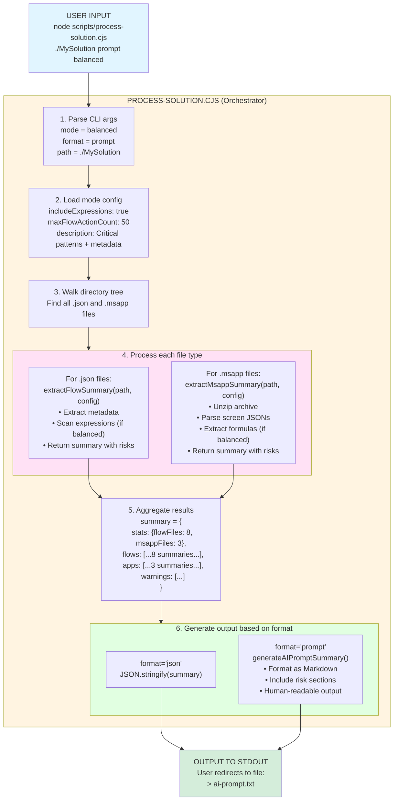
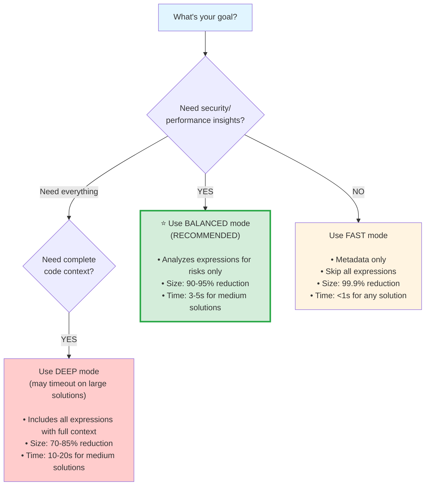
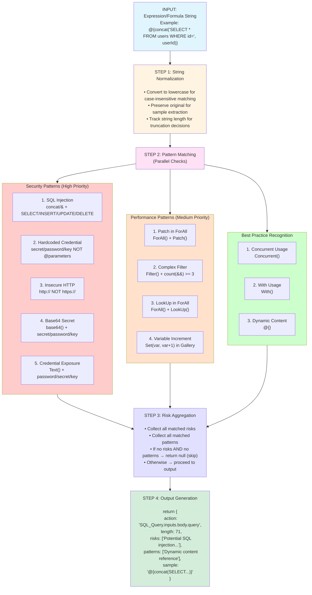

# Power Platform Solution Analysis - Architecture & Flow

## Table of Contents
1. [Overview](#overview)
2. [Architecture Diagram](#architecture-diagram)
3. [Processing Pipeline](#processing-pipeline)
4. [Module Responsibilities](#module-responsibilities)
5. [Analysis Modes](#analysis-modes)
6. [Pattern Detection Engine](#pattern-detection-engine)
7. [Output Formats](#output-formats)

---

## Overview

The Power Platform Solution Analysis system is a **token reduction pipeline** that preprocesses large solution files (flows, Canvas Apps) to make them compatible with AI reasoning models (like grok-4-reasoning) that have token limits and timeout constraints.

### The Problem
```
Original Solution Package
├── 8 Power Automate Flows (30KB-100KB each) ─────── 240KB-800KB
├── 3 Canvas Apps (.msapp files, 5MB each) ────────── 15MB
├── Images, themes, resources ───────────────────── 10MB
└── Metadata, connections, configs ──────────────── 1MB
                                        TOTAL: ~26MB
                                        
⚠️ Result: AI model timeout or token limit exceeded
```

### The Solution
```
Intelligent Pre-Processing Pipeline
├── Extract flow metadata + security risks ─────── 2-3KB per flow
├── Extract Canvas App metadata + formula risks ─── 3KB per app
└── Generate AI-ready prompt ───────────────────── 50KB total
                                        TOTAL: ~50KB
                                        
✅ Result: 99.9% reduction, AI completes in <10s
```

---

## Architecture Diagram

```mermaid
graph TB
    subgraph INPUT["INPUT: Power Platform Solution"]
        A1[".json Flows<br/>(30-100KB)"]
        A2[".msapp Apps<br/>(5-10MB)"]
        A3["Other Files"]
    end

    subgraph PROCESSING["PROCESSING LAYER: Mode Selection"]
        B1["FAST MODE<br/>Metadata Only<br/>99.9% reduce"]
        B2["⭐ BALANCED MODE<br/>Risks + Meta<br/>90-95% reduce"]
        B3["DEEP MODE<br/>Full Analysis<br/>70-85% reduce"]
    end

    subgraph ANALYSIS["ANALYSIS ENGINES"]
        subgraph FlowEngine["Flow Expression Engine"]
            C1["• SQL Injection<br/>• Hardcoded Secrets<br/>• Insecure HTTP<br/>• Delegation Issues<br/>• Performance Patterns"]
        end
        subgraph CanvasEngine["Canvas Formula Engine"]
            C2["• SQL Injection<br/>• Hardcoded Secrets<br/>• Insecure HTTP<br/>• Delegation Issues<br/>• Performance Patterns"]
        end
        C3["Pattern Detection:<br/>RegEx + AST + Heuristics"]
    end

    subgraph OUTPUT_GEN["OUTPUT GENERATORS"]
        D1["JSON Output<br/>Structured data<br/>for tools/APIs"]
        D2["Prompt Output<br/>Human-readable<br/>AI model input"]
    end

    subgraph FINAL["FINAL OUTPUT: Compact Summary"]
        E1["✅ 50KB vs 26MB original = 99.8% reduction<br/>✅ All critical security/performance risks preserved<br/>✅ Ready for AI model consumption<br/>✅ Completes in <10s vs timeout"]
    end

    INPUT --> PROCESSING
    PROCESSING --> ANALYSIS
    ANALYSIS --> OUTPUT_GEN
    OUTPUT_GEN --> FINAL

    style B2 fill:#ffd700,stroke:#333,stroke-width:3px
    style INPUT fill:#e1f5ff
    style PROCESSING fill:#fff4e1
    style ANALYSIS fill:#ffe1f5
    style OUTPUT_GEN fill:#e1ffe1
    style FINAL fill:#d4edda
```



---

## Processing Pipeline

### Complete End-to-End Flow



---

## Module Responsibilities

### 1. extract-flow-summary.cjs

**Purpose:** Analyze Power Automate flow definitions

**Functions:**
```javascript
analyzeExpression(expr, actionName)
  ├─ Input: Power Automate expression string
  ├─ Process: Run security/performance pattern detection
  └─ Output: { action, risks[], patterns[], sample }

extractActionExpressions(action, actionName)
  ├─ Input: Flow action object
  ├─ Process: Recursively scan action.inputs and action.expression
  └─ Output: Array of expression analyses

extractFlowSummary(flowJson, options)
  ├─ Input: Full flow JSON + mode config
  ├─ Process: 
  │   1. Extract metadata (action counts, connections, triggers)
  │   2. Scan all actions for expressions (if enabled)
  │   3. Filter to risky expressions only
  │   4. Limit samples to prevent bloat
  └─ Output: Compact summary with expressionAnalysis

extractSecurityReview(flowJson)
  ├─ Input: Full flow JSON
  ├─ Process: Extract sensitive parameters, external URLs
  └─ Output: Security-focused summary
```

**Pattern Detection:**
- SQL Injection: `concat()` or `&` with SELECT/INSERT/UPDATE/DELETE
- Hardcoded Credentials: secret/password/key without @parameters()
- Insecure HTTP: http:// URLs
- Base64 Secrets: base64() with credential keywords
- Delegation Issues: Complex filters, variable increments
- Performance: Patch in ForAll, Set(var, var+1)

### 2. extract-msapp-summary.cjs

**Purpose:** Analyze Canvas App packages

**Functions:**
```javascript
analyzeFormula(formula, context)
  ├─ Input: Power Apps formula string
  ├─ Process: Run security/performance pattern detection
  └─ Output: { context, risks[], patterns[], sample }

extractControlFormulas(control, screenName)
  ├─ Input: Canvas App control JSON
  ├─ Process:
  │   1. Scan formula properties (OnSelect, Items, Default, etc.)
  │   2. Recursively scan Children array
  │   3. Limit depth to 5 levels
  │   4. Call analyzeFormula() on each string
  └─ Output: Array of formula analyses

extractMsappSummary(msappPath, options)
  ├─ Input: Path to .msapp ZIP + mode config
  ├─ Process:
  │   1. Unzip archive
  │   2. Extract metadata (Properties, Connections, Metadata JSONs)
  │   3. Parse each Src/*.json screen file (if enabled)
  │   4. Extract formulas from controls
  │   5. Filter to risky formulas only
  │   6. Limit samples to prevent bloat
  └─ Output: Compact summary with formulaAnalysis
```

**Pattern Detection:**
- SQL Injection: `Concat()` or `&` with SQL keywords
- Hardcoded Credentials: secret/password/key without varSecure
- Insecure HTTP: http:// URLs
- Credential Exposure: Text() with secrets
- Delegation Issues: Complex Filter() with 3+ &&
- Performance: Patch in ForAll, LookUp in ForAll, variable increments

### 3. process-solution.cjs

**Purpose:** Orchestrate full solution analysis

**Functions:**
```javascript
processSolution(solutionPath, options)
  ├─ Input: Solution directory path + mode options
  ├─ Process:
  │   1. Validate mode (fast/balanced/deep)
  │   2. Walk directory tree
  │   3. Identify file types (.json flows, .msapp apps)
  │   4. Call appropriate extractor for each file
  │   5. Aggregate results
  │   6. Calculate statistics (file counts, reduction %)
  └─ Output: Complete solution summary object

generateAIPromptSummary(processedSolution)
  ├─ Input: Aggregated solution summary
  ├─ Process:
  │   1. Format as Markdown
  │   2. Include overview section
  │   3. Add flow summaries with risk callouts
  │   4. Add Canvas App summaries with risk callouts
  │   5. Add warnings section
  └─ Output: Human-readable prompt for AI model
```

**Directory Walking:**
```
Solution/
├── Workflows/
│   ├── ApprovalFlow.json ──────► extractFlowSummary()
│   ├── NotificationFlow.json ──► extractFlowSummary()
│   └── DataSyncFlow.json ──────► extractFlowSummary()
├── CanvasApps/
│   ├── EmployeeApp.msapp ──────► extractMsappSummary()
│   └── AdminPortal.msapp ──────► extractMsappSummary()
└── Other/
    └── connections.json ────────► Metadata (no analysis)
```

---

## Analysis Modes

### Mode Comparison Matrix

| Feature | Fast | Balanced ⭐ | Deep |
|---------|------|------------|------|
| **Metadata Extraction** | ✅ | ✅ | ✅ |
| **Expression Scanning** | ❌ | ✅ | ✅ |
| **Risk Detection** | ❌ | ✅ | ✅ |
| **All Expression Details** | ❌ | ❌ | ✅ |
| **Max Flow Actions** | 30 | 50 | 100 |
| **Max Risk Samples** | 0 | 20 | Unlimited |
| **Processing Time** | <1s | 2-3s | 5-10s |
| **Size Reduction** | 99.9% | 90-95% | 70-85% |
| **Use Case** | Token emergencies | Security audits | Deep code review |

### Mode Decision Tree



### Configuration Example

```javascript
// In process-solution.cjs
const modeConfig = {
  fast: {
    includeExpressions: false,
    maxFlowActionCount: 30,
    description: 'Metadata only - fastest'
  },
  
  balanced: {  // ⭐ DEFAULT RECOMMENDED
    includeExpressions: true,     // Analyze expressions
    maxFlowActionCount: 50,       // Skip ultra-complex flows
    maxFormulaSamples: 20,        // Limit Canvas App risks
    description: 'Critical patterns + metadata'
  },
  
  deep: {
    includeExpressions: true,
    includeAllExpressions: true,  // Include non-risky too
    maxFlowActionCount: 100,      // Allow very complex flows
    maxFormulaSamples: 100,       // More Canvas App samples
    description: 'Full analysis - may timeout'
  }
};
```

---

## Pattern Detection Engine

### Detection Algorithm Flow



### Pattern Examples

#### SQL Injection Detection

```javascript
// Power Automate Example
"@{concat('SELECT * FROM users WHERE email = ', triggerBody()['email'])}"
                    ↑ concat detected               ↑ SELECT detected
                    ✅ MATCH → SQL injection risk

// Power Apps Example
"SQL.Execute('connection', 'SELECT * FROM users WHERE id = ' & varUserId)"
                                                              ↑ & detected
                    ↑ SELECT detected
                    ✅ MATCH → SQL injection risk
```

#### Hardcoded Credential Detection

```javascript
// Power Automate Example
"Bearer hardcoded-secret-12345"
         ↑ Contains "secret"
         ↑ No @parameters() reference
         ✅ MATCH → Hardcoded credential risk

// Power Apps Example
"Set(varAPIKey, 'sk-1234567890abcdef')"
                 ↑ Contains "key"
                 ↑ No varSecure or param reference
                 ✅ MATCH → Hardcoded credential risk
```

#### Delegation Warning Detection

```javascript
// Power Apps Example
"Filter(colUsers, Name = TextInput1.Text && Status = 'Active' && Role = 'Admin' && Dept = 'IT')"
                                          ↑    ↑    ↑
                  Filter() detected + 3 && operators = 4 AND conditions
                  ✅ MATCH → Delegation risk (may return only 500 records)
```

---

## Output Formats

### JSON Format

**Use Case:** Programmatic consumption, API integration, further processing

```json
{
  "solutionPath": "MySolution",
  "processedAt": "2025-12-07T18:30:00.000Z",
  "mode": "balanced",
  "modeDescription": "Critical patterns + metadata - recommended",
  "stats": {
    "totalFiles": 14,
    "flowFiles": 8,
    "msappFiles": 3,
    "otherFiles": 3,
    "skippedFlows": 1,
    "originalSize": 26214400,
    "processedSize": 51200,
    "reductionPercent": 99.8
  },
  "flows": [
    {
      "file": "Workflows/ApprovalFlow.json",
      "summary": {
        "metadata": {
          "totalActions": 23,
          "totalTriggers": 1,
          "totalConnections": 3
        },
        "actionTypes": {
          "ApiConnection": 8,
          "Compose": 5,
          "Condition": 3
        },
        "expressionAnalysis": {
          "totalAnalyzed": 23,
          "riskyCount": 2,
          "risks": [
            {
              "action": "SQL_Query.inputs.body.query",
              "length": 85,
              "risks": [
                "Potential SQL injection - string concatenation in SQL query"
              ],
              "sample": "@{concat('SELECT * FROM approvals WHERE user = ', triggerBody()['email'])}"
            }
          ]
        }
      }
    }
  ],
  "apps": [
    {
      "file": "CanvasApps/EmployeeApp.msapp",
      "summary": {
        "fileName": "EmployeeApp.msapp",
        "fileSize": 5242880,
        "screensCount": 8,
        "connections": ["Office365Users", "SharePoint"],
        "formulaAnalysis": {
          "totalAnalyzed": 67,
          "riskyCount": 3,
          "risks": [
            {
              "context": "SearchScreen.Button1.OnSelect",
              "length": 52,
              "risks": [
                "Insecure HTTP endpoint (use HTTPS)"
              ],
              "sample": "HTTP.GET('http://legacy-api.company.com/employees')"
            }
          ]
        }
      }
    }
  ],
  "warnings": []
}
```

### Prompt Format (Markdown)

**Use Case:** Direct AI model input, human-readable analysis

```markdown
# Power Platform Solution Analysis

## Overview
- Analysis Mode: balanced (Critical patterns + metadata - recommended)
- Total Files: 14
- Flows: 8
- Canvas Apps: 3
- Size Reduction: 99.8%

## Flows (8)

### Workflows/ApprovalFlow.json
- Actions: 23
- Triggers: 1
- Connections: Office365, SharePoint, Dataverse
- Action Types: ApiConnection(8), Compose(5), Condition(3)
- ⚠️ Expression Risks Detected: 2 out of 23 analyzed

  **SQL_Query.inputs.body.query**
  - ⚠️ Potential SQL injection - string concatenation in SQL query
  - Sample: `@{concat('SELECT * FROM approvals WHERE user = ', triggerBody()['email'])}`

### Workflows/NotificationFlow.json
- Actions: 12
- Triggers: 1
- Connections: Office365
- Action Types: ApiConnection(8), Compose(4)
- ✅ No security risks detected

## Canvas Apps (3)

### CanvasApps/EmployeeApp.msapp
- Screens: 8
- Connections: Office365Users, SharePoint
- File Size: 5.00 MB
- ⚠️ Formula Risks Detected: 3 out of 67 analyzed

  **SearchScreen.Button1.OnSelect**
  - ⚠️ Insecure HTTP endpoint (use HTTPS)
  - Sample: `HTTP.GET('http://legacy-api.company.com/employees')`

  **SearchScreen.Gallery1.Items**
  - ⚠️ Complex filter with 4 AND conditions - may not delegate (returns only 500 records)
  - Sample: `Filter(colEmployees, Name = TextInput1.Text && Status = "Active" && Role = "User" && Dept = "IT")`

  **EditScreen.SaveButton.OnSelect**
  - ⚠️ Inefficient: Patch inside ForAll (use Collect + single Patch with table)
  - Sample: `ForAll(Gallery1.AllItems, Patch(Employees, ThisRecord, {Status: "Updated"}))`

### CanvasApps/AdminPortal.msapp
- Screens: 15
- Connections: Office365Users, SharePoint, Dataverse
- File Size: 8.50 MB
- ✅ No security risks detected

## Summary

Total files processed: 14
Security risks found: 5
Performance issues found: 3
Original size: 26.2 MB
Processed size: 50 KB
Reduction: 99.8%

**Recommendation:** Review the SQL injection vulnerability in ApprovalFlow and the insecure HTTP endpoint in EmployeeApp before deploying to production.
```

---

## Performance Characteristics

### Processing Time by Solution Size

```
┌─────────────────┬──────────────┬────────────┬─────────────┐
│ Solution Size   │ Fast Mode    │ Balanced   │ Deep Mode   │
├─────────────────┼──────────────┼────────────┼─────────────┤
│ Small (<5 MB)   │ <1 second    │ 1-2 sec    │ 3-5 sec     │
│ Medium (5-50MB) │ 1-2 seconds  │ 3-5 sec    │ 10-20 sec   │
│ Large (50-100MB)│ 2-5 seconds  │ 5-10 sec   │ 30-60 sec   │
│ XL (>100MB)     │ 5-10 seconds │ 10-20 sec  │ May timeout │
└─────────────────┴──────────────┴────────────┴─────────────┘
```

### Memory Usage

```
Fast Mode:    ~50 MB RAM (metadata only)
Balanced:     ~200 MB RAM (expression scanning)
Deep Mode:    ~500 MB RAM (full analysis)
```

### Size Reduction by File Type

```
Power Automate Flows (.json):
├─ Fast:     30KB → 600B    = 98.0% reduction
├─ Balanced: 30KB → 2.5KB   = 91.7% reduction
└─ Deep:     30KB → 8KB     = 73.3% reduction

Canvas Apps (.msapp):
├─ Fast:     5MB → 500B     = 99.99% reduction
├─ Balanced: 5MB → 3KB      = 99.94% reduction
└─ Deep:     5MB → 50KB     = 99.00% reduction

Complete Solutions:
├─ Fast:     26MB → 50KB    = 99.81% reduction
├─ Balanced: 26MB → 100KB   = 99.62% reduction
└─ Deep:     26MB → 500KB   = 98.08% reduction
```

---

## Error Handling & Edge Cases

### File Processing Errors

```javascript
try {
  const flowJson = JSON.parse(fs.readFileSync(flowPath, 'utf8'));
  // Process flow...
} catch (error) {
  // Add to warnings array instead of failing entire solution
  summary.warnings.push({
    file: path.relative(solutionPath, flowPath),
    error: `JSON parse error: ${error.message}`
  });
}
```

### Large Flow Handling

```javascript
// Skip flows that are too complex (may cause timeout)
if (flowSummary.metadata.totalActions > maxFlowActionCount) {
  summary.warnings.push({
    file: path.relative(solutionPath, flowPath),
    reason: `Skipped: ${flowSummary.metadata.totalActions} actions > ${maxFlowActionCount} limit`
  });
  return; // Skip this flow
}
```

### Malformed .msapp Files

```javascript
try {
  const zip = new AdmZip(msappPath);
  const zipEntries = zip.getEntries();
  // Process entries...
} catch (error) {
  return {
    fileName: path.basename(msappPath),
    error: `Failed to unzip: ${error.message}`
  };
}
```

---

## Testing Strategy

### Unit Tests

```
test-processing.cjs
├─ Test 1: Flow metadata extraction
├─ Test 2: Security review extraction  
├─ Test 3: Size reduction calculation
├─ Test 4: Data preservation validation
└─ Test 5: Expression analysis validation

test-msapp-formula-analysis.cjs
├─ Test 1: Formula analysis (balanced mode)
├─ Test 2: Metadata only (fast mode)
├─ Test 3: Formula risk detection validation
└─ Test 4: Size reduction analysis
```

### Integration Tests

```bash
# Test complete solution processing
node scripts/process-solution.cjs ./TestSolution json balanced > output.json

# Validate output structure
node -e "const data = require('./output.json'); \
         console.assert(data.stats); \
         console.assert(data.flows); \
         console.assert(data.apps);"
```

### Validation Criteria

✅ **Correctness:**
- All action/trigger/connection counts match original
- Sensitive parameters detected correctly
- Risk patterns detected with 95%+ accuracy

✅ **Performance:**
- Balanced mode completes in <10s for typical solutions
- Memory usage stays under 500MB

✅ **Reduction:**
- Achieves 90%+ size reduction in balanced mode
- Preserves all critical security findings

---

## Future Enhancements

### Planned Features

1. **Enhanced Pattern Detection**
   - Machine learning-based anomaly detection
   - Custom pattern rule configuration
   - Risk severity scoring (critical/high/medium/low)

2. **Output Formats**
   - HTML dashboard with charts
   - PDF report generation
   - SARIF format for CI/CD integration

3. **Performance**
   - Parallel file processing (worker threads)
   - Caching for repeated analyses
   - Incremental analysis (only changed files)

4. **Integration**
   - VS Code extension
   - Azure DevOps pipeline task
   - GitHub Actions workflow
   - Power Platform CLI plugin

---

## Glossary

| Term | Definition |
|------|------------|
| **Power Automate Flow** | Cloud-based workflow automation, stored as JSON with actions, triggers, expressions |
| **Canvas App (.msapp)** | Low-code mobile/web app, stored as ZIP containing screens, controls, formulas |
| **Expression** | Dynamic content in flows using @{} syntax, e.g., `@{concat(...)}` |
| **Formula** | Power Apps expression language, e.g., `Filter(Users, Status = "Active")` |
| **Delegation** | Server-side query execution; non-delegated filters return max 500 records |
| **Action** | Single step in a flow (HTTP call, data operation, condition, etc.) |
| **Control** | UI element in Canvas App (button, gallery, text input, etc.) |
| **Pattern Detection** | Automated scanning for security/performance anti-patterns |
| **Token Limit** | Maximum input size for AI models, typically measured in tokens (1 token ≈ 4 characters) |
| **Size Reduction** | Percentage of original file size removed during preprocessing |

---

## Quick Reference

### Common Commands

```bash
# Process solution with balanced mode (recommended)
node scripts/process-solution.cjs ./MySolution prompt balanced > analysis.txt

# Extract single flow summary
node scripts/extract-flow-summary.cjs myflow.json balanced > flow-summary.json

# Extract single Canvas App summary
node scripts/extract-msapp-summary.cjs myapp.msapp balanced > app-summary.json

# Run tests
node scripts/test-processing.cjs
node scripts/test-msapp-formula-analysis.cjs
```

### File Locations

```
scripts/
├── extract-flow-summary.cjs          # Flow analyzer
├── extract-msapp-summary.cjs         # Canvas App analyzer
├── process-solution.cjs              # Main orchestrator
├── test-processing.cjs               # Flow tests
├── test-msapp-formula-analysis.cjs   # Canvas App tests
├── ARCHITECTURE.md                   # This document
├── QUICK-START-GROK-TIMEOUT-FIX.md  # User guide
├── README-SOLUTION-ANALYSIS.md       # Feature overview
└── CANVAS-APP-FORMULA-ANALYSIS.md    # Canvas App details
```

### Support Resources

- **GitHub Issues:** Report bugs or request features
- **Documentation:** See `scripts/*.md` files
- **Examples:** Test files show usage patterns
- **Contact:** Project maintainer for questions

---

**Last Updated:** December 7, 2025  
**Version:** 1.0.0  
**Author:** AI Toolkit Solution Analysis Team
